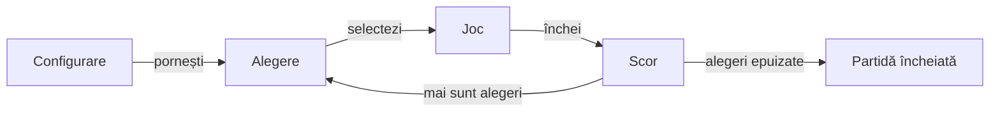

# Rentz Lab

## Pe scurt

Rentz Lab este un joc de cărți pentru Android, cu opt sub-jocuri și adversari AI. Poți juca offline, relua o partidă salvată și urmări scorul și realizările.

## Jocul

- [Descarcă Rentz Lab 0.18.0 pentru testare](https://github.com/crististefanita/atf_j5_releases/releases/download/preview-v0.18.0/RentzLab-0.18.0-ui-sanity.apk)

## Prima partidă

Deschide **Partidă nouă** și alege numărul de jucători și dificultatea. Când îți revine alegerea, selectezi unul dintre sub-jocurile rămase.



<details>
<summary><strong>Legendă — de la alegere la scor</strong></summary>

- **Alegere.** Jucătorul la rând stabilește sub-jocul.
- **Joc.** Obiectivul depinde de alegere. În Rentz, construiești secvențe pe culori pornind de la valeți.
- **Scor.** La finalul mâinii vezi punctele și poți deschide istoricul.

</details>

Din meniu poți deschide **Cum se joacă** sau reveni la o sesiune prin **Continuă partida**. [Reguli și punctaj](docs/rentz/ATF_Rules.md)

## Pentru dezvoltatori

| Zonă | Responsabilitate |
|---|---|
| [Motor](rentz-lab-app/game-core/README.md) | Aplică regulile, mutările legale, scorul și politicile AI. |
| [Aplicație Android](rentz-lab-app/app/README.md) | Afișează masa și păstrează sesiunea și profilul. |
| [Teste și integrare](atf-tests/README.md) | Verifică regulile, arena offline și integrarea Android. |

Regresia offline pornește din rădăcina proiectului.

```powershell
.\scripts\run-rentz-components.ps1
```

## Documentație

- [Regulile și arhitectura Rentz](docs/rentz/README.md)
- [Evaluarea offline a jucătorilor AI](docs/rentz/ATF_Learning.md)
- [Catalogul edițiilor](release/README.md) și [procesul de release](docs/rentz/ATF_Release.md)
- [Feedback activ](docs/feedback/README.md)
