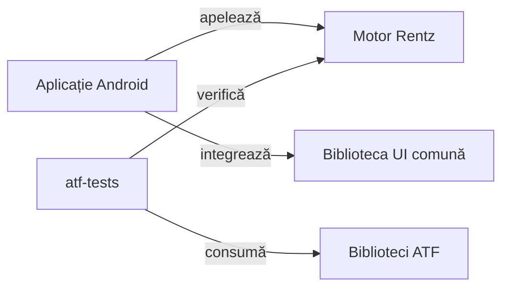

# Rentz Lab

## Pe scurt

Rentz Lab este un joc de cărți pentru Android, cu opt sub-jocuri și adversari AI. Poți juca offline, relua o partidă salvată și urmări scorul și realizările.

Proiectul ATF J5 modelează regulile Rentz în Java și verifică același motor pe care îl folosește aplicația. Verificările offline acoperă regulile și scorul, iar acceptanța Android confruntă interacțiunea cu observațiile publice ale motorului.

## Jocul

- [Descarcă Rentz Lab 0.23.0](https://github.com/crististefanita/atf_j5_releases/releases/download/v0.23.0/RentzLab-0.23.0.apk)

## Prima partidă

Deschide **Partidă nouă**, alege numărul de jucători și dificultatea, apoi selectează un sub-joc când îți vine rândul. **Cum se joacă** explică obiectivele, iar **Continuă partida** redeschide sesiunea salvată. [Reguli și punctaj](docs/rentz/ATF_Rules.md)

## Arhitectura ATF



<details>
<summary><strong>Legendă — dependențele aplicației și ale testelor</strong></summary>

- **Aplicație Android.** Traduce comenzile utilizatorului și gestionează sesiunea și profilul. Biblioteca UI comună furnizează componentele vizuale.
- **Motor Rentz.** Deține starea, mutările legale și scorul. Politicile AI primesc observația permisă jucătorului.
- **atf-tests.** Adaugă scenarii, oracole independente și guvernanță. Folosește Test Kit pentru comparații și Reporting pentru publicarea dovezilor.

</details>

| Zonă | Contract și punct de intrare |
|---|---|
| [Motor · `rentz-lab-app/game-core`](rentz-lab-app/game-core/README.md) | Modul Java în Maven și Gradle. Reguli, politici AI și teste de domeniu. |
| [Aplicație · `rentz-lab-app/app`](rentz-lab-app/app/README.md) | Modul Gradle. Sesiune, persistență, masă, scor și realizări. |
| [Verificare · `atf-tests`](atf-tests/README.md) | Modul Maven. Scenarii Rentz, evaluare offline, guvernanță și adaptoare de acceptanță. |
| [Biblioteci ATF · `lib`](lib/README.md) | Perechi JAR/POM pentru Core, Reporting, Console, Mock și Test Kit, cu verificări de proveniență. |
| [Bibliotecă UI · `rentz-lab-app/ui-library`](rentz-lab-app/ui-library/README.md) | Repository Maven local folosit de Gradle pentru dependențele de produs. |
| [Aplicația de referință](rentz-reference/README.md) | Observarea aplicației originale și proveniența regulilor. |

`config` declară profilurile de reguli, colecțiile de teste și politicile de guvernanță. `scripts` orchestrează rularea izolată, iar `release` păstrează catalogul ediției. [Configurație și trasabilitate](docs/rentz/ATF_Architecture.md#configurație-și-trasabilitate) · [Infrastructură](docs/rentz/ATF_Infrastructure.md)

## Verificare și livrare

Regresia Maven și Android JVM pornește din rădăcina proiectului, în PowerShell 7 cu JDK 21 și mediul pregătit. Rularea își păstrează dovezile într-un spațiu de lucru dedicat. [Pregătirea mediului](docs/rentz/ATF_Infrastructure.md#creare-și-verificare)

```powershell
.\scripts\run-rentz-components.ps1
```

- **Componente și guvernanță.** Reguli, scor, cazuri de frontieră, selecția suitelor și integritatea dovezilor. [Strategia de testare](docs/rentz/ATF_TestingStrategy.md) · [Calificarea consumatorului](docs/rentz/ATF_Qualification.md)
- **Traseul Android de release.** 3 mâini complete, cu Rentz prima.
- **Livrare.** Calificarea verifică reluarea sesiunii, iar după publicare se verifică descărcarea. [Procesul de release](docs/rentz/ATF_Release.md)

## Documentație

- [Harta documentației Rentz](docs/README.md)
- [Evaluarea offline a jucătorilor AI](docs/rentz/ATF_Learning.md)
- [Catalogul edițiilor](release/README.md)
- [Feedback activ](docs/feedback/README.md)
