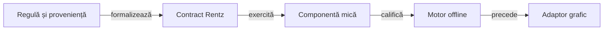

# Rentz Lab

## Pe scurt

Laborator specializat în regulile Rentz și verificarea lor prin componente offline. Motorul local este independent de aplicația de referință `com.boonwiz.rentz`; regulile declarate, variantele modelate și ipotezele neconfirmate au statut explicit.

Prioritatea este contractul jocului: distribuire, alegerea sub-jocului, mutări legale, închiderea mâinii și scor. Interfața grafică și integrarea Android se tratează separat, după stabilizarea acestor contracte.

## Module și responsabilități

| Zonă | Responsabilitate |
|---|---|
| [Motor Rentz](rentz-lab-app/game-core/README.md) | Cărți, levate fără atu, opt sub-jocuri, secvențe, rotație, scor și jucători Normal/Hard. |
| [Aplicație locală](rentz-lab-app/app/README.md) | Prototip Android nativ, sesiune salvată, istoric și reluare. |
| [Testare și integrare](atf-tests/README.md) | Profil YAML tipizat, componente, arenă offline și acceptanța bibliotecilor comune. |
| [Kit](lib/README.TestKit.md#scope-și-integrare) | Clasificare, lifecycle JUnit și păstrarea comparațiilor evaluate. |
| [Observarea referinței](rentz-reference/README.md) | Identitatea aplicației originale și capturi Android cu rezervare exclusivă. |
| [Documentație Rentz](docs/rentz/README.md) | Reguli, proveniență, arhitectură, componente și transfer. |

## Traseul de lucru



<details>
<summary>Legendă: domeniul se califică înaintea interfeței</summary>

Un rezultat al modelului verifică regula implementată și profilul său. Echivalența cu aplicația originală cere confruntare separată; existența unui APK sau a unei componente verzi nu o stabilește automat.

</details>

## Pornire

Din rădăcina proiectului, în PowerShell 7, cu JDK 21, Maven și dependențele locale pregătite:

```powershell
.\scripts\run-rentz-components.ps1
```

Lansatorul execută o copie temporară și păstrează rezultatele în afara surselor. Profilul activ este de laborator; valorile originale „Classic” și „Traditional” rămân neconfirmate până la calificarea lor.

[Reguli](docs/rentz/ATF_Rules.md) · [Surse și certitudine](docs/rentz/ATF_RuleSources.md) · [Feedback activ](docs/feedback/ATF_Rentz.md)

[Jocul și evaluarea offline](docs/rentz/ATF_Learning.md) explică memoria publică, politicile, compararea distribuirilor și separarea dezvoltării de evaluarea nouă. O partidă a modelului nu confirmă automat comportamentul aplicației originale.

## Materiale păstrate separat

[Testele istorice Contract Whist](reference-tests/README.md) nu intră în reactorul Rentz. Rularea lor nu califică noul joc și nu face parte din fluxul activ.
