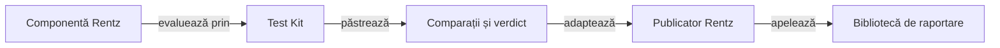

# Componentele și integrarea Rentz

## Pe scurt

Modulul specializează integrarea ATF pentru regulile Rentz. Citește profilul tipizat, verifică frontierele domeniului și transmite comparațiile evaluate bibliotecii de raportare comune.

## Flux



<details>
<summary>Legendă: verdictul precede publicarea</summary>

Test Kit păstrează rezultatul comparației efective. Publicatorul mapează fazele și valorile către API-ul bibliotecii, fără să reevalueze regula sau să implementeze un renderer.

</details>

## Surse și verificare

| Sursă | Contract |
|---|---|
| [RuleProfiles](src/main/java/atf/rentz/RuleProfiles.java) | Citire YAML strictă și identitate explicită de laborator. |
| [RuleCatalog](src/main/java/atf/rentz/RuleCatalog.java) | Valori parțiale și legături la implementare și declarații JUnit eligibile; [analiza sintactică](../docs/rentz/ATF_Qualification.md#legăturile-manifestelor-către-teste) rămâne distinctă de execuție. |
| [YamlDocuments](src/main/java/atf/rentz/YamlDocuments.java) | Un singur document, fără chei duplicate sau ignorarea unui document suplimentar. |
| [PolicyInputs](src/main/java/atf/rentz/PolicyInputs.java) | Buget, ponderi finite și legături ale regulilor tactice la cod și componente. |
| [FamilyAnalysis](src/main/java/atf/rentz/arena/FamilyAnalysis.java) | Agregarea pură a rotațiilor, metricei și costurilor; independentă de simulare și I/O. |
| [OfflineArena](src/main/java/atf/rentz/OfflineArena.java) | Partide complete CPU, control pereche, locuri rotite și selecția jurnalelor. |
| [OfflineGameAudit](src/main/java/atf/rentz/OfflineGameAudit.java) | Tranziții, legalitate, câștigător și scor recalculate separat de politică. |
| [EvaluationRegistry](src/main/java/atf/rentz/EvaluationRegistry.java) | Expunere atomică și refuzul reutilizării datelor rezervate. |
| [RentzRuleComponentTest](src/test/java/atf/rentz/RentzRuleComponentTest.java) | Profil, cumul, lipsa atuului, blind și observație permisă. |
| [RentzRulePublication](src/test/java/atf/rentz/RentzRulePublication.java) | Rezultatul Kitului publicat prin Extent. |

[Lansatorul componentelor](../scripts/run-rentz-components.ps1) execută copia izolată și păstrează XML-ul și HTML-ul extern. Scopul este contractul Rentz modelat; grafica, nivelul expert și echivalența cu referința au calificări distincte.

## Arena offline

[Lansatorul arenei](tools/run-arena.ps1) folosește snapshot-ul compilat și classpath-ul unei rulări de componente trecute. Nu înlocuiește sursa înghețată cu HEAD și nu pornește Android.

```powershell
.\atf-tests\tools\run-arena.ps1 -ComponentRun $env:RENTZ_COMPONENT_RUN -Protocol $env:RENTZ_ARENA_PROTOCOL -RunRoot $env:RENTZ_ARENA_RUN
```

| Intrare | Contract |
|---|---|
| `RENTZ_COMPONENT_RUN` | Director extern cu `result.json`, identitatea surselor și XML-urile testelor; snapshot-ul compilat trebuie să existe. |
| `RENTZ_ARENA_PROTOCOL` | Protocol JSON cu fază, jucători, seed-uri distincte, familii, candidat, buget și retenție. |
| `RENTZ_ARENA_RUN` | Director extern nou; rapoartele și partidele păstrează profilul de laborator și sursa evaluată. |

[Protocolul învățării](../docs/rentz/ATF_Learning.md) separă dezvoltarea, admiterea datelor noi, progresul observat și calificarea E2E. XML-ul componentelor, rezultatul strategic și raportul narativ sunt populații și livrabile distincte.

### Inițializarea registrului

Arena folosește registrul comun din rădăcina datelor. Pentru prima evaluare rezervată, inițializați registrul cu istoricul v1 revizuit, responsabilul și referința reviziei.

```powershell
.\atf-tests\tools\run-arena.ps1 -ComponentRun $env:RENTZ_COMPONENT_RUN -ReviewedHistory $env:RENTZ_REVIEWED_HISTORY -Reviewer $env:RENTZ_REVIEWER -ReviewReference $env:RENTZ_REVIEW_REFERENCE
```

Pentru migrarea în loc, indicați chiar registrul v1 existent. Păstrați referința reviziei împreună cu documentele care atestă expunerile. [Contractul registrului](../docs/rentz/ATF_Learning.md#identitatea-distribuirii-și-expunerea)

## Colecții și porți offline

[Calificarea consumatorului](../docs/rentz/ATF_Qualification.md) deține contractele binare, selecțiile și probele de eșec. [Registrul colecțiilor](../config/test-collections.json) selectează etapele, iar lansatorul confruntă populația executată cu sursele înghețate.

| Intrare | Utilizare |
|---|---|
| `run-rentz-components.ps1 -Collection regression` | Intrarea standard: toate testele Maven, componentele Android JVM și controalele PowerShell. |
| `-Collection quick` | Reguli și frontiere, adopție binară și guvernanță Java, fără etapa Gradle. |
| `-Collection learning` | Politici și arena ca mecanism; evaluările pe partide noi cer protocol separat. |
| `-Collection infrastructure` | Biblioteci, surse, publicare și controale runtime. |
| `-Collection android-jvm` | Coordonare și codec prin Gradle, fără asamblare APK sau dispozitiv. |

Comenzile pornesc din rădăcina proiectului, în PowerShell 7, cu JDK 21, Maven, cache-uri pregătite și SDK pentru Android JVM. Un selector gol ori fără țintă, XML lipsă, suite goale și skip-uri refuză calificarea; HTML-ul narativ nu înlocuiește inventarul probelor.

## Accesul la dependențe

Componentele și arena rezervă exclusiv cache-ul Maven comun pe durata utilizării. Bootstrap-ul nu poate rescrie JAR-uri încă deschise de un proces Java; concurența este refuzată înaintea execuției, iar rezervarea se eliberează și la eroare.

[Componenta rezervării](tools/test-cache-lease.ps1) verifică refuzul concurent și reutilizarea după eliberare, fără Maven sau emulator. Classpath-ul arenei este explicit și legat de inventarul complet al JAR-urilor, claselor și resurselor observate înainte și după planul JUnit. [Atestarea runtime-ului](../docs/rentz/ATF_Qualification.md#identitatea-runtime-ului-calificat) este confruntată independent înaintea comenzii și după rulare.

## Guvernanța directoarelor

[Inventarul infrastructurii](../docs/rentz/ATF_Infrastructure.md) definește checkout-urile, colecțiile de dovezi și spațiile de lucru admise. Lansatoarele active verifică inventarul înaintea execuției; compilarea folosește o copie izolată cu descriptor, sub rădăcina externă documentată.

| Probă | Contract |
|---|---|
| [Test live](../scripts/test-infrastructure-governance.ps1) | Refuză directoare neînregistrate, descriptor invalid, scripturi fără rol și sursele TEMP recunoscute din producători. Nu șterge automat. |
| [Controale negative](tools/test-workspace-governance.ps1) | Cazuri independente pentru sursă, proiect, artefact, familie interzisă, identitate, parser și limitele căilor. |

Rezultatul roșu se păstrează înaintea curățării, iar aceleași criterii se rulează după remediere. Receipt-urile istorice nu sunt rescrise ca și cum ar fi folosit noua rădăcină.

## Acceptanța Android locală

[Build-ul izolat](../scripts/build-rentz-android.ps1) cere o rulare de componente trecută, confruntă sursa motorului, execută testele Gradle și păstrează identitatea APK-ului. [Sanity-ul UI comun](tools/run-shared-ui-sanity.ps1) cere calificarea APK-ului izolat; [lansatorul prototipului](tools/run-android-sanity.ps1) refuză noul contract UI înaintea comenzilor de dispozitiv.

| Mecanism | Contract |
|---|---|
| [Adaptorul compilat de test](src/test/java/atf/rentz/android/RentzNativeFlow.java) | Separă decizia independentă, auditul și publicarea; [componentele CLI](src/test/java/atf/rentz/android/RentzNativeFlowTest.java) verifică procesele fără ADB. |
| Descriptorul `native-runtime.json` | Identifică sursa, clasa compilată și classpath-ul explicit al rulării calificate; lansatorul verifică hash-urile înaintea utilizării. |
| [Guvernanța sursei](src/test/java/atf/rentz/governance/SourceLayoutTest.java) | Verifică [inventarul declarat](../config/java-source-layout.json): source-set-uri mixte, acoperirea fișierelor active, coeziune și limite de import. |
| [Protocolul Android](../docs/rentz/ATF_Android.md) | Delimitează distribuirea completă, istoricul și reluarea față de o partidă completă sau echivalența cu aplicația originală. |

Pentru comparația unei secvențe Rentz cu jocurile de levate, rulați lansatorul calificat cu `-ConsecutiveSubgames`. Această populație pornește sub-jocul Rentz din interfață, apoi joacă două sub-jocuri standard prin selectorul vizibil sau alegerea automată a actorului AI. Păstrează geometria chenarelor, matricea Rentz, istoricul și replay-ul jurnalului în raportul Extent.
