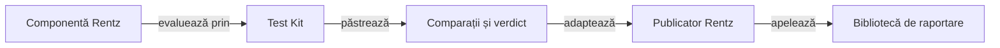

# Componentele și integrarea Rentz

## Pe scurt

Modulul specializează integrarea ATF pentru regulile Rentz. Citește profilul tipizat, verifică frontierele domeniului și transmite comparațiile evaluate bibliotecii de raportare comune.

## Flux



<details>
<summary>Legendă: verdictul precede publicarea</summary>

Test Kit păstrează rezultatul comparației efective. Publicatorul mapează fazele și valorile către API-ul bibliotecii, fără să reevalueze regula sau să implementeze un renderer.

</details>

## Surse și verificare

| Sursă | Contract |
|---|---|
| [RuleProfiles](src/main/java/atf/rentz/RuleProfiles.java) | Citire YAML strictă și identitate explicită de laborator. |
| [RuleCatalog](src/main/java/atf/rentz/RuleCatalog.java) | Valori parțiale cu sursă și auditul legăturilor manifestului la codul live; nu produce preset executabil. |
| [YamlDocuments](src/main/java/atf/rentz/YamlDocuments.java) | Un singur document, fără chei duplicate sau ignorarea unui document suplimentar. |
| [PolicyInputs](src/main/java/atf/rentz/PolicyInputs.java) | Buget, ponderi finite și legături ale regulilor tactice la cod și componente. |
| [OfflineArena](src/main/java/atf/rentz/OfflineArena.java) | Partide complete CPU, control pereche, locuri rotite și selecția jurnalelor. |
| [OfflineGameAudit](src/main/java/atf/rentz/OfflineGameAudit.java) | Tranziții, legalitate, câștigător și scor recalculate separat de politică. |
| [EvaluationRegistry](src/main/java/atf/rentz/EvaluationRegistry.java) | Expunere atomică și refuzul reutilizării datelor rezervate. |
| [RentzRuleComponentTest](src/test/java/atf/rentz/RentzRuleComponentTest.java) | Profil, cumul, lipsa atuului, blind și observație permisă. |
| [RentzRulePublication](src/test/java/atf/rentz/RentzRulePublication.java) | Rezultatul Kitului publicat prin Extent. |

[Lansatorul componentelor](../scripts/run-rentz-components.ps1) execută copia izolată și păstrează XML-ul și HTML-ul extern. Scopul este contractul Rentz modelat; grafica, nivelul expert și echivalența cu referința au calificări distincte.

## Arena offline

[Lansatorul arenei](tools/run-arena.ps1) folosește snapshot-ul compilat și classpath-ul unei rulări de componente trecute. Nu înlocuiește sursa înghețată cu HEAD și nu pornește Android.

```powershell
.\atf-tests\tools\run-arena.ps1 -ComponentRun $env:RENTZ_COMPONENT_RUN -Protocol $env:RENTZ_ARENA_PROTOCOL -RunRoot $env:RENTZ_ARENA_RUN
```

| Intrare | Contract |
|---|---|
| `RENTZ_COMPONENT_RUN` | Director extern cu `result.json`, identitatea surselor și XML-urile testelor; snapshot-ul compilat trebuie să existe. |
| `RENTZ_ARENA_PROTOCOL` | Protocol JSON cu fază, jucători, seed-uri distincte, familii, candidat, buget și retenție. |
| `RENTZ_ARENA_RUN` | Director extern nou; rapoartele și partidele păstrează profilul de laborator și sursa evaluată. |

[Protocolul învățării](../docs/rentz/ATF_Learning.md) separă dezvoltarea, admiterea datelor noi, progresul observat și calificarea E2E. XML-ul componentelor, rezultatul strategic și raportul narativ sunt populații și livrabile distincte.

## Accesul la dependențe

Componentele și arena rezervă exclusiv cache-ul Maven comun pe durata utilizării. Bootstrap-ul nu poate rescrie JAR-uri încă deschise de un proces Java; concurența este refuzată înaintea execuției, iar rezervarea se eliberează și la eroare.

[Componenta rezervării](tools/test-cache-lease.ps1) verifică refuzul concurent și reutilizarea după eliberare, fără Maven sau emulator. Classpath-ul arenei elimină intrările goale și păstrează identitatea JAR-urilor folosite.

## Acceptanța Android locală

[Build-ul izolat](../scripts/build-rentz-android.ps1) cere o rulare de componente trecută, confruntă sursa motorului, execută testele Gradle și păstrează identitatea APK-ului. [Lansatorul nativ](tools/run-android-sanity.ps1) cere acest receipt înaintea rezervării dispozitivului.

Decizia independentă, auditul și publicarea au moduri separate în [adaptor](tools/RentzNativeFlow.java). [Protocolul Android](../docs/rentz/ATF_Android.md) delimitează distribuirea completă, istoricul și reluarea față de o partidă completă sau echivalența cu aplicația originală.
