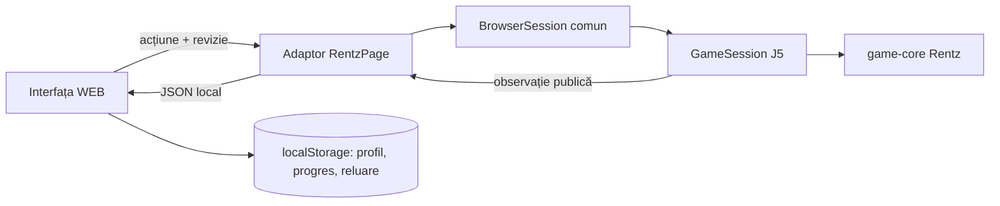

# Adaptorul WEB Rentz

## Rolul adaptorului

Adaptorul livrează aceeași partidă Rentz în browser, folosind motorul J5 și shell-ul comun Card Table Browser. `GameSession` rămâne sursa regulilor, a comenzilor legale, a AI-ului și a scorului. Adaptorul transformă comenzile locale ale paginii în comenzi pentru sesiunea comună și proiectează numai informația publică; mâinile adversarilor nu sunt trimise către interfață.



Shell-ul comun gestionează masa, dialogurile, comenzile cu revizie, animațiile și aspectul adaptiv. J5 păstrează conținutul specific Rentz: cele opt sub-jocuri, succesiunea cărților, punctajul, profilul, realizările și istoria.

## Contractul de compatibilitate cu APK-ul

Adaptorul WEB nu implementează o a doua versiune a jocului. Testele compilează aceleași surse `game-core` și `GameSession` pe care le folosește APK-ul, apoi verifică stratul de browser la granița publică. Sursa WEB proprie `PlayerNames` există numai în compilarea TeaVM: înlocuiește apelurile Unicode indisponibile în acel runtime, iar testul ei compară rezultatele direct cu biblioteca de nume folosită de APK. Codul nativ și APK-ul nu sunt schimbate de această adaptare.

| Strat | Verifică fără emulator | Ce protejează |
|---|---|---|
| Componente JVM | Validarea configurării comune; 3–6 jucători și Normal/Greu; reguli, acțiuni legale, treceri automate, rezultate și istoric; profil, realizări și checkpoint; contractele de nume și punctaj; cele 550 ms după primul cadru al locului activ, comparate cu biblioteca UI Android fixată | Motorul, regulile și ritmul de decizie rămân aliniate cu APK-ul, iar proiecția WEB nu schimbă rezultatul sesiunii |
| Paritate cu biblioteca APK | NFC, limita de zece puncte Unicode, intrări valide/invalide și lista deterministă de adversari, comparate cu JAR-ul `card-table-names`; normalizarea profilului se compară și cu sursa Android `DisplayName` | Shim-urile necesare TeaVM nu schimbă contractul de profil Android |
| Componente pentru API-ul TeaVM | Pornire pentru 3–6 locuri și Normal/Greu; cărți ascunse până la dezvăluire; alegerea Rentz; ancora de deschidere pentru fiecare dimensiune de masă; mutări legale; o mână Rentz completă; sosirea Rentz înaintea scorului; punctaj, progres, reluare și următoarea mână | Codul compilat efectiv pentru browser se comportă ca implementarea JVM, fără DOM sau emulator |
| Componente DOM și transport local | Proiecția mesei, marcarea cărților legale, selectorul de sub-joc, durata sosirii Rentz de 1,8 secunde, anunțul accesibil și revenirea la scor; transferul strict al evenimentului tranzitoriu | Shell-ul păstrează ordinea de prezentare Android fără să persiste temporizatorul în profil/checkpoint și fără să schimbe punctajul |
| Verificare în browser MCP | Încărcarea pachetului static, creare profil, pornirea unei mese, Rentz și o mutare legală | Integrarea dintre browser, worker și artefactele publicate local |

Aceste verificări înlocuiesc verificările de logică, stare, alegeri AI, scor, istoric, profil și realizări care altfel ar fi repetate prin emulator. Se folosesc aceleași surse de motor, aceleași comenzi `GameSession` și același JAR nativ de nume ca bază de comparație; testele nu simulează sau injectează rezultatele partidei.

La încheierea unei mâini Rentz, adaptorul transmite un eveniment public numai în răspunsul acțiunii care a încheiat mâna. Pagina păstrează tabla de succesiune și totalurile anterioare timp de 1,8 secunde, anunță jucătorul sosit primul și cărțile rămase, apoi afișează rezultatul calculat de sesiunea comună. Evenimentul nu intră în checkpoint sau profil; la restaurarea unei partide deja încheiate se afișează direct scorul, la fel ca în aplicația Android.

Rămân dependente de un dispozitiv Android numai proprietățile platformei native: instalarea APK-ului, lifecycle-ul și restaurarea prin sistemul Android, inset-urile și fonturile furnizorului, gesturile tactile reale și performanța pe hardware. Ele nu sunt criterii pentru validarea logicii jocului în browser. Pagina WEB se califică separat prin testele de browser și prin publicarea reală.

## Compilare și verificări locale

Necesită PowerShell 7, JDK 21, Maven și Node.js 24. Toate clasele generate, cache-urile și paginile construite se scriu într-un director extern checkout-ului.

```powershell
.\atf-ui-browser\Test-RentzBrowserComponents.ps1 -WorkRoot C:\work\rentz_back\web-01\components
.\atf-ui-browser\Build-RentzPages.ps1 -WorkRoot C:\work\rentz_back\web-01\pages
```

`Test-RentzBrowserComponents.ps1` rulează testele JVM ale adaptorului și ale sesiunii comune. Build-ul WEB rulează, în ordine, testele JVM ale endpoint-ului, comparația cu biblioteca APK, compilarea TeaVM, verificările Node asupra motorului generat și verificările DOM. O eroare la oricare strat oprește build-ul.

## Pornire locală

Folosiți lansatorul și un build extern:

```powershell
.\atf-ui-browser\Start-RentzBrowser.ps1 -WorkRoot C:\work\rentz_back\web-01\local
```

## Publicare

Workflow-ul `.github/workflows/rentz-pages.yml` publică pachetul static din `main` numai după ce trec testele JVM native și verificările adaptorului și ale motorului compilat. Profilul și reluarea rămân în `localStorage`, pe dispozitivul browserului; pagina nu trimite datele într-un serviciu extern.

README-ul principal va lega jocul online după ce workflow-ul publică pagina și URL-ul trece verificarea anonimă. Un build local sau un URL de preview nu este adresă publică de joc.

## Surse

- [Regulile și arhitectura motorului Rentz](../rentz-lab-app/game-core/README.md)
- [JAR-ul comun Card Table Browser](lib/atf-ui-browser-0.2.4.jar) · [checksum](lib/atf-ui-browser-0.2.4.jar.sha256)
