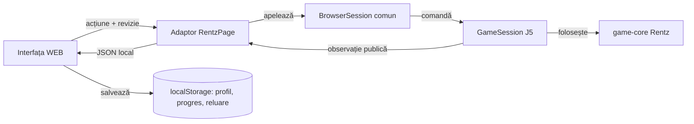
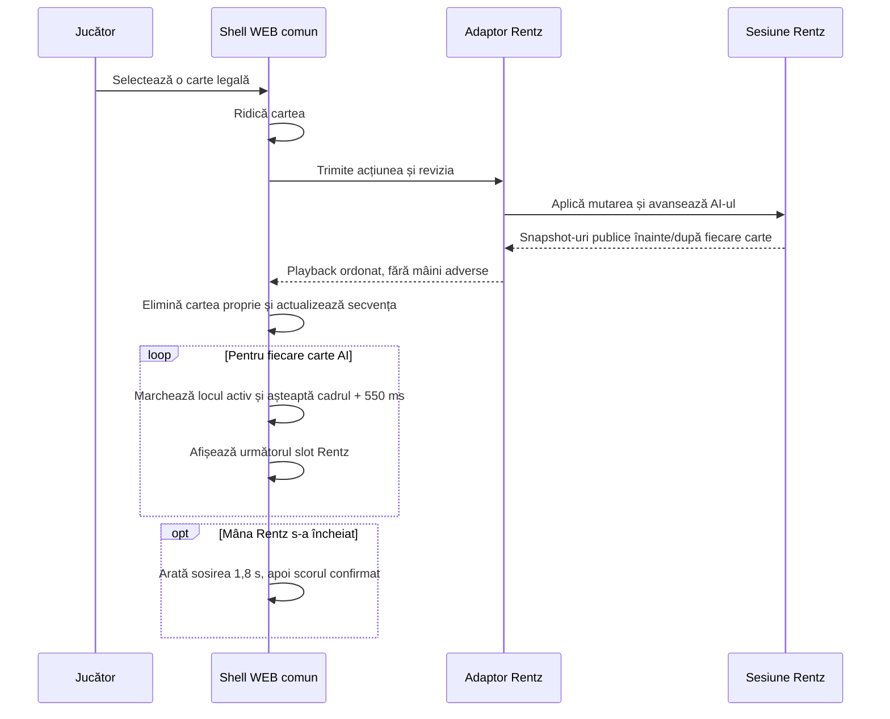

# Adaptorul WEB Rentz

## Pe scurt

Adaptorul livrează aceeași partidă Rentz în browser, folosind motorul J5 și shell-ul comun Card Table Browser. `GameSession` rămâne sursa regulilor, a comenzilor legale, a AI-ului și a scorului. Adaptorul transformă comenzile locale ale paginii în comenzi pentru sesiunea comună și proiectează numai informația publică; mâinile adversarilor nu sunt trimise către interfață.



<details>
<summary>Legendă</summary>

Cartea și actorul ajung la browser prin observația publică. Sesiunea este proprietarul stării partidei.

</details>

Shell-ul comun gestionează masa, dialogurile, comenzile cu revizie, animațiile și aspectul adaptiv. J5 păstrează conținutul specific Rentz: cele opt sub-jocuri, succesiunea cărților, punctajul, profilul, realizările și istoria.

Consumatorul fixează Card Table Browser 0.2.10. [Proveniența pachetului](lib/browser-build.json) leagă cele două JAR-uri de commitul Whist și de amprentele SHA-256. Fontul comun `CardTableSuits` redă simbolurile de culoare în secvența Rentz; build-ul verifică prezența fontului și a licenței sale în pachetul static.

### Secvența vizibilă a unei mâini Rentz

- La o mutare umană, feedback-ul comun ridică mai întâi cartea selectată.
- Adaptorul proiectează apoi același snapshot în două locuri: cartea pleacă din mâna proprie, iar slotul public din secvența Rentz devine jucat.
- Pentru fiecare carte AI, locul activ rămâne vizibil după primul cadru și înaintea intervalului de 550 ms; tabla avansează cu o singură carte la fiecare pas.
- Bifa „Joc automat” rămâne în antet pe toate cadrele de redare: adaptorul păstrează numai acțiunea-marker `auto-step` din starea anterioară, fără să expună butoanele de carte în timpul animației.
- Snapshot-urile conțin doar mâna proprie și secvența publică, niciodată mâinile adversarilor.

- Pentru patru jucători păstrăm ancorele comune ale locurilor și reducem numai benzile verticale rezervate în jurul centrului. Rămân 6 px de separare față de casetele standard de 52 px, iar zona cărților câștigă 23 px.
- Celelalte configurații păstrează inset-urile comune; testele verifică geometria compactă și faptul că randarea urmează numărul real de locuri.

- Înainte de prima randare, adaptorul validează întregul lot de snapshot-uri.
- Fiecare pas trebuie să schimbe exact un slot liber în carte jucată; la mutarea umană, aceeași carte trebuie să dispară din mâna proprie, iar mutarea adversarului nu poate modifica mâna umană.
- Locul activ trebuie să corespundă actorului, iar payload-ul nu poate conține colecții de mâini adverse.
- Dacă un cadru este invalid, lotul este refuzat integral: tabla nu ajunge într-o stare WEB parțial actualizată.



<details>
<summary>Legendă</summary>

Săgețile punctate întorc observațiile publice. Așteptarea fixează ritmul redării cărților AI, iar scorul confirmat încheie mâna.

</details>

## Contractul de compatibilitate cu APK-ul

- Adaptorul WEB nu implementează o a doua versiune a jocului.
- Testele compilează aceleași surse `game-core` și `GameSession` pe care le folosește APK-ul, apoi verifică stratul de browser la granița publică.
- Sursa WEB proprie `PlayerNames` există numai în compilarea TeaVM: înlocuiește apelurile Unicode indisponibile în acel runtime, iar testul ei compară rezultatele direct cu biblioteca de nume folosită de APK.
- Codul nativ și APK-ul nu sunt schimbate de această adaptare.

### Scor și clasament comune

- `ScoreSettlement` păstrează ordinea de sosire la Rentz; la celelalte sub-jocuri păstrează ordinea locurilor.
- Fiecare rând de rezultat adaptează delta, totalul confirmat și contribuțiile din istoricul motorului.
- `ScoreStandings` aplică departajarea competitivă și eticheta totalului final folosite de APK.
- Testele compară adaptoarele Android și WEB cu rezultatul motorului pentru mese de 3–6 jucători și verifică un singur zero la Rentz.

| Strat | Verifică fără emulator | Ce protejează |
|---|---|---|
| Componente JVM | Validarea configurării comune; 3–6 jucători și Normal/Greu; reguli, acțiuni legale, treceri automate, rezultate și istoric; profil, realizări și checkpoint; contractele de nume și punctaj; ordinea snapshot-urilor Rentz și cele 550 ms după primul cadru al locului activ, comparate cu biblioteca UI Android fixată | Motorul, regulile și ritmul de decizie rămân aliniate cu APK-ul, iar proiecția WEB nu schimbă rezultatul sesiunii |
| Paritate cu biblioteca APK | NFC, limita de zece puncte Unicode, intrări valide/invalide și lista deterministă de adversari, comparate cu JAR-ul `card-table-names`; profilul TeaVM verifică și zece litere Unicode din afara planului de bază, apoi respinge a unsprezecea; normalizarea se compară cu sursa Android `DisplayName` | Shim-urile necesare TeaVM nu schimbă contractul de profil Android |
| Componente pentru API-ul TeaVM și adaptorul DOM | Pornire pentru 3–6 locuri și Normal/Greu; cărți ascunse până la dezvăluire; alegerea Rentz; ancora de deschidere pentru fiecare dimensiune de masă; mutări legale; o mână Rentz completă; cadrele reale ale motorului trec prin adaptorul DOM cu randare mock; placa finală coincide cu starea confirmată; sosirea Rentz înaintea scorului; punctaj, progres, reluare și următoarea mână | Motorul compilat și secvența WEB reală respectă contractele APK fără DOM sau emulator |
| Componente DOM și transport local | Validarea atomică a tuturor snapshot-urilor; identitatea cărții mutate din mână pe secvență; mâna neschimbată la mutările adverse; locul activ înaintea întârzierii; bifa „Joc automat” prezentă la fiecare cadru; geometria centrului la 3–6 locuri; selectorul și antetul contractului selectat; sosirea Rentz de 1,8 secunde și revenirea la scor | Un payload inconsistent nu poate produce randare parțială; checkbox-ul nu clipește în timpul redării, iar spațiul la patru locuri crește fără să schimbe ancorele comune; shell-ul nu afișează panoul Whist „Atu” |
| Verificare în browser MCP | Încărcarea pachetului static, creare profil, pornirea unei mese, Rentz și o mutare legală | Integrarea dintre browser, worker și artefactele publicate local |

- Build-ul verifică hash-urile JAR-urilor comune fixate.
- Testul `hand-presentation.mjs` din pachetul de teste comun este rulat cu setup-ul Rentz: verifică hint-ul pentru o atingere greșită, ridicarea cărții legale, anularea și aplicarea unică a mutării, fără browser sau emulator.

- Aceste verificări înlocuiesc verificările de logică, stare, alegeri AI, scor, istoric, profil și realizări care altfel ar fi repetate prin emulator.
- Se folosesc aceleași surse de motor, aceleași comenzi `GameSession` și același JAR nativ de nume ca bază de comparație; testele nu simulează sau injectează rezultatele partidei.

- La o acțiune Rentz, adaptorul trimite snapshot-uri publice pentru cartea umană și fiecare carte AI din acel răspuns.
- Shell-ul redă fiecare pas în ordinea jocului, iar antetul folosește cele două rânduri Android — progresul mâinii și contractul ales — fără titlu duplicat sau panou de atu.
- Bifa de joc automat rămâne vizibilă și în cadrele intermediare, inclusiv când următorul actor este un adversar; în scurta pauză de sosire rămâne vizibilă, dar este dezactivată.
- La sosirea terminală automatizarea se oprește pentru a păstra vizibil scorul. La încheiere, adaptorul păstrează ultimul snapshot cu secvența completă pe masă, prezintă sosirea timp de 1,8 secunde, apoi afișează scorul confirmat.
- Playback-ul este tranzitoriu și nu intră în checkpoint sau profil; reluarea unei partide terminate afișează direct scorul.

- Rămân dependente de un dispozitiv Android numai proprietățile platformei native: instalarea APK-ului, lifecycle-ul și restaurarea prin sistemul Android, inset-urile și fonturile furnizorului, gesturile tactile reale și performanța pe hardware.
- Ele nu sunt criterii pentru validarea logicii jocului în browser.
- Pagina WEB se califică separat prin testele de browser și prin publicarea reală.

## Compilare și verificări locale

Necesită PowerShell 7, JDK 21, Maven și Node.js 24. Toate clasele generate, cache-urile și paginile construite se scriu într-un director extern checkout-ului.

```powershell
$env:RENTZ_WORK_ROOT = '<director extern pentru artefactele Rentz>'
$components = Join-Path $env:RENTZ_WORK_ROOT 'browser-components'
$pages = Join-Path $env:RENTZ_WORK_ROOT 'browser-pages'
.\atf-ui-browser\Test-RentzBrowserComponents.ps1 -WorkRoot $components
.\atf-ui-browser\Build-RentzPages.ps1 -WorkRoot $pages
```

`Test-RentzBrowserComponents.ps1` rulează testele JVM ale adaptorului și ale sesiunii comune, apoi extrage runtime-ul și testul versionate și verifică toate cele 51 de cazuri din contractul de viewport. Build-ul WEB rulează, în ordine, testele JVM ale endpoint-ului, comparația cu biblioteca APK, compilarea TeaVM, verificările Node asupra motorului generat și verificările DOM. O eroare la oricare strat oprește build-ul.

## Pornire locală

Folosiți lansatorul și un build extern:

```powershell
$env:RENTZ_WORK_ROOT = '<director extern pentru artefactele Rentz>'
$local = Join-Path $env:RENTZ_WORK_ROOT 'browser-local'
.\atf-ui-browser\Start-RentzBrowser.ps1 -WorkRoot $local
```

## Publicare

Workflow-ul `.github/workflows/rentz-pages.yml` publică pachetul static din `main` numai după ce trec testele JVM native și verificările adaptorului și ale motorului compilat. Profilul și reluarea rămân în `localStorage`, pe dispozitivul browserului; pagina nu trimite datele într-un serviciu extern.

README-ul principal va lega jocul online după ce workflow-ul publică pagina și URL-ul trece verificarea anonimă. Un build local sau un URL de preview nu este adresă publică de joc.

## Surse

- [Regulile și arhitectura motorului Rentz](../rentz-lab-app/game-core/README.md)
- [JAR-ul comun Card Table Browser](lib/atf-ui-browser-0.2.10.jar) · [checksum](lib/atf-ui-browser-0.2.10.jar.sha256)
- [Testul comun de componentă](lib/atf-ui-browser-0.2.10-tests.jar) · [checksum](lib/atf-ui-browser-0.2.10-tests.jar.sha256)
