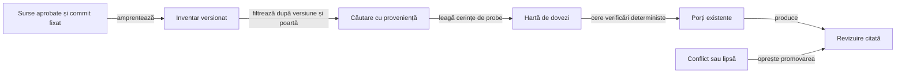

# Cerințe pentru RAG de asistență la release

## Starea implementării live

RAG-ul este un asistent local, determinist și read-only. Porțile și receiptele originale dețin verdictul; recuperarea doar găsește și citează dovezi.

| Suprafață | Stare live |
|---|---|
| Corpus și citări | Allowlist local, filtre exacte, maximum cinci fragmente; citatele au cale, linii, commit și SHA-256. |
| Componente și Extent | Receipt-ul regression include Extent produs prin `atf-reporting` ales din `atf.reporting.version`; JAR/POM, XML-urile și hash-ul HTML sunt verificate. |
| Workspace de staging | Runner-ul alocă `components-<id>` în zona externă de workspace și scrie descriptor cu owner, tip, ID și `sourceRoot`; RAG validează fiecare câmp înainte să accepte receipt-ul Android JVM. |
| Android JVM și APK | Adaptoarele locale verifică receipte de build și sanity nativ legate de aceeași sursă. Extent UI conține capturi originale inline Base64, verificate de RAG. |
| Catalog local | `ReleaseCatalog` verifică manifestul, APK-ul publicat local și pasul candidat de versiune/cod Android. Aceasta nu dovedește existența release-ului remote. |
| Publicare și descărcări | Adaptoarele RAG pentru remote, autentificat și anonim lipsesc; porțile rămân `NOT_RUN`. `publishAllowed` nu devine `true`. |
| Promovare | `READY_FOR_MAIN_PROMOTION_REVIEW` este o etapă locală de candidat, cu decizie umană; nu este `PUBLISHED`. |

## Pe scurt

RAG-ul găsește cerința și dovada relevante pentru sursa curentă. El explică blocajele, fără să modifice sursele sau să declare un release calificat.

| Concept | Sursa adevărului |
|---|---|
| Cerințe și reguli | Politica de release versionată și testele care o aplică. |
| Verdictul porții | Receipt-ul verificabil al porții desemnate, legat de candidatul curent. |
| Starea ediției | `DRAFT`, `PREPARED` sau `PUBLISHED`, păstrate separat de `PASS`, `FAIL`, `BLOCKED` și `NOT_RUN`. |
| Efectul RAG | Citește receipte și catalog, explică lipsurile; nu execută porți, nu schimbă verdictul ori starea ediției. |

| Decizie | Contract |
|---|---|
| Proprietar | Procesul de release și adaptorul Rentz rămân în J5. |
| Sursa verdictului | Testele și verificările deterministe existente; RAG-ul le localizează și le explică. |
| Efecte secundare | Citire și raportare; fără build, editare, commit, tag, upload sau publicare. |
| Stare incertă | **BLOCKED** sau **NOT_RUN**, cu motiv și pas următor; niciodată PASS dedus din text. |
| Rezumat agregat | Separă `releaseWorkflow.stage=READY_FOR_MAIN_PROMOTION_REVIEW` de agregatul porților; publicarea cere receipte remote și aprobarea operatorului. |

## Fluxul dorit

Legendă — indexul găsește; porțile existente decid

- Indexul păstrează amprenta și proveniența fiecărei surse admise.
- Recuperarea găsește cerința și testul aferent; nu produce verdictul porții.
- O lipsă ori contradicție oprește recomandarea până la o verificare deterministă.

## Elemente live care trebuie legate

Inspecția actuală arată că RAG-ul nu trebuie să inventeze un al doilea release orchestrator. El trebuie să găsească porțile existente și să ceară dovada potrivită fiecăreia.

| Suprafață verificată | Contract existent | Implicație pentru RAG |
|---|---|---|
| [Politica de release](../rentz/ATF_Release.md) | DRAFT, PREPARED și PUBLISHED au condiții distincte; buildul Release cere regresie completă și sursă fixată. | Explică ordinea și condițiile; nu le reimplementează într-un prompt. |
| [Calificarea iOS](../rentz/ATF_Release.md#calificarea-ios) și [feedback-ul de produs](ATF_Rentz.md#platforma-ios) | iOS este cerință deschisă; APK-ul și porțile Android nu califică un client Apple. | Recuperează domeniul declarat al platformei și cere separat ținta Xcode, matricea OS, receiptele iOS și identitatea artefactului; pentru o ediție numai pentru Android nu inventează suport iOS. |
| [Implementarea RAG](../../atf-tests/src/main/java/atf/rentz/distribution/ReleaseReadinessRag.java), [lansatorul](../../scripts/run-release-rag.ps1) și [probele sale](../../atf-tests/src/test/java/atf/rentz/governance/release/ReleaseGovernanceTest.java) | Corpusul recuperează cerințe și porți cu citări. Implementarea atașează acum regresia, Extent, Android JVM, buildul și UI-ul nativ, dar publicarea și descărcările remote rămân fără adaptoare; lansatorul folosește runtime-ul calificat al testului nativ. Domeniul de platforme trebuie declarat în manifest. | **P1 deschis:** separați runtime-ul RAG de aplicația Android, adăugați domeniul și receiptele per platformă, stările de aplicabilitate/implementare și probele controlate Android→iOS. Nu activați afirmații iOS înaintea acestor porți și teste. |
| [Lansatorul offline](../../scripts/run-rentz-components.ps1), [colecțiile](../../config/test-collections.json) și [scriptul de build](../../scripts/build-rentz-android.ps1) | Receipt-urile leagă selecția, sursa, manifestul și buildul de aceeași intrare. | Citește identitățile și receipt-urile; orice drift face probele anterioare neeligibile. |
| [Catalogul](../../atf-tests/src/main/java/atf/rentz/distribution/ReleaseCatalog.java) și [guvernanța release](../../atf-tests/src/test/java/atf/rentz/governance/release/ReleaseGovernanceTest.java) | Manifestul local, fișierele și ruta README sunt verificate pentru ediția curentă. | Validarea locală nu este prezentată drept interogare remote sau confirmare de publicare. |
| [Acceptanța API](../../atf-tests/src/main/java/atf/rentz/distribution/ReleaseDownloadAcceptance.java) și [fixture-urile loopback](../../atf-tests/src/test/java/atf/rentz/governance/release/ReleaseDownloadComponentTest.java) | Acceptanța API live este explicită; testele offline folosesc un transport sintetic. | Separă API-ul autentificat, transportul de test și accesul anonim real. |
| [Calificarea J4](../../../atf_j4/docs/testing/ATF_ReleaseQualification.md) și testele sale de integritate, retenție și prezentare | Colegul de release păstrează proveniența și handoff-ul în porți distincte. | Reutilizează principiul de separare; nu importă regulile Rentz sau rezultate J4. |
| [Guvernanța documentației J0](../../../atf_j0/docs/README_Atf_DocumentationBestPractices.md) și testele de ținte, fapte și schimbări | Inventarul și afirmațiile documentate au contracte verificabile și mutanți negativi. | Aplică același stil de guvernanță la index, citări, feedback și prompturi RAG. |

J4 și J0 sunt repere de proiectare, nu surse active pentru calificarea Rentz. RAG-ul consultă sursele J5 fixate pentru candidatul evaluat.

## Autoritatea pentru fiecare afirmație

RAG-ul trebuie să cunoască tipul afirmației înainte să aleagă sursa. Similaritatea semantică nu schimbă autoritatea și nu repară o dovadă absentă.

| Afirmație | Sursă normativă | Dovadă suficientă pentru PASS |
|---|---|---|
| Ce pași și limite are release-ul | docs/rentz/ATF_Release.md, testele și scripturile care îl implementează | Politica și testul aplicabil sunt legate de versiunea curentă a sursei. |
| Ce sursă a fost calificată | commitul, starea worktree-ului și manifeste de intrare | Receipt-ul real identifică același commit și aceeași populație de fișiere. |
| Ce teste au trecut | config/test-collections.json, selectorul și suita executată | Receipt validat: colecție, sursă, invocări, exit code și numere; zero FAIL, ERROR și SKIP pentru poarta cerută. |
| Ce APK a rezultat | build-qualification.json, manifestul ediției și verifier-ele APK | Octeții APK, SHA-256, certificatul, pachetul și versiunea corespund sursei calificate. |
| Ce platforme sunt suportate | Domeniul platformelor declarat în release și contractele platformei din J5 | Fiecare platformă are țintă, versiune OS, probe și artefact proprii; pentru iOS sunt obligatorii dovezile din [contractul iOS](../rentz/ATF_Release.md#calificarea-ios). O APK sau un receipt Android nu satisface o afirmație iOS. |
| Ce a fost publicat | tagul și obiectul release remote, cu asset-urile lor | Commitul tagului, starea publicată, populația asset-urilor și hash-urile sunt citite din remote. |
| Cine poate descărca | probe distincte pentru API autentificat și canal anonim | Două receipte efective, fiecare legat de același URL, versiune, bytes și SHA-256. Un status declarat în manifest nu înlocuiește proba. |
| Ce trebuie remediat | feedback-ul deschis și criteriul lui de închidere | Elementul rămâne avertisment/blocaj; închiderea cere dovadă și actualizarea ownerului. |

## Contractul rapoartelor pentru fiecare candidat

| Rulare | Raport obligatoriu | Dovada de audit |
|---|---|---|
| Componente | Extent emis prin JAR-ul `atf-reporting` selectat din POM | XML Surefire original, hash per XML, fiecare suită și testcase reconciliate, comparația expected/actual pentru totalurile suitei și verdict plus diagnostic pentru fiecare testcase, exit code, colecție, commit, hash-ul JAR-ului și hash-ul raportului. Nu inventează aserțiuni de domeniu absente din XML. |
| UI/E2E | Extent emis de același `atf-reporting` | Așteptare și observație capturate la fiecare checkpoint, screenshot nativ inline Base64, hash APK/build, oracle independent, starea rezervării și hash raport. |
| RAG | JSON de porți cu citări | Fiecare receipt leagă aceeași sursă și artefact; raportul RAG nu înlocuiește HTML-ul și nu convertește lipsa dovezii în PASS. |

Candidatul este staging extern, nu `main`: executați componentele offline mai întâi, apoi buildul și numai E2E-ul care justifică valoare pentru schimbarea respectivă. După review, promovați exact snapshotul calificat; publicați doar după validarea din remote și două descărcări independente. O refactorizare nu sare peste regresia sau identitatea APK-ului și primește versiunea minoră conform politicii J5.
## Cerințe prioritare

| ID | Prioritate | Cerință și criteriu de închidere |
|---|---|---|
| RAG-01 | P1 · înaintea primei utilizări | Fiecare răspuns fixează repository, commit, arbore de surse, hash-ul indexului, versiunea și canalul evaluat. O schimbare de commit, worktree sau intrare invalidează dovezile afectate; surse din două candidaturi nu se combină. |
| RAG-02 | P1 | Fiecare afirmație despre cod, reguli sau stare citează calea, intervalul de linii, commitul și hash-ul conținutului. Dacă citatul nu se mai potrivește cu octeții indexați, răspunsul devine BLOCKED; un embedding ori un rezumat nu ține loc de citat. |
| RAG-03 | P1 | Stările sunt tipizate: PASS, FAIL, BLOCKED, NOT_RUN, NOT_APPLICABLE și NOT_IMPLEMENTED. Doar un receipt al verificării desemnate poate produce PASS. NOT_APPLICABLE cere domeniu de platformă explicit și nu poate satisface o afirmație de suport; NOT_IMPLEMENTED diferențiază țintă sau funcție absentă de probă neexecutată. README, feedback, log sumar sau răspuns generat nu pot promova o poartă. |
| RAG-04 | P1 | Se confruntă întregul lanț candidat → test → build → artefact pe platformă → tag → release → descărcare. Orice commit, platformă, versiune OS, toolchain, populație, asset, dimensiune, digest sau certificat divergent oprește calificarea și arată ambele valori. APK și IPA/Archive au identități și receipte distincte. |
| RAG-05 | P1 | Canalele autentificat și anonim rămân independente. Un rezultat API cu autentificare nu dovedește acces public; un manifest care declară HTTP 200 nu dovedește un răspuns live sau octeții primiți. |
| RAG-06 | P1 | Prima versiune este read-only și locală. Nu primește și nu indexează chei, parole, tokenuri, dump-uri de mediu, profiluri sau date de dispozitiv; conținutul recuperat este intrare neautorizată, nu instrucțiune executabilă. Modelul, versiunea, politica de prompt și hash-urile lor sunt înregistrate; niciun cod sau rezultat privat nu pleacă spre un serviciu extern fără aprobare de securitate. |
| RAG-07 | P2 | Corpusul este allowlistat: documente normative curente, codul porților, scripturile declarate, metadatele candidatului și receipte necesare. Rulările vechi și arhivele se accesează numai la cerere diagnostică și nu pot satisface porți curente. |
| RAG-08 | P2 | Începeți cu index local, versionat și filtrare de metadate plus căutare textuală. Adăugați embeddings sau un serviciu vectorial numai dacă un set de evaluare controlat arată o îmbunătățire măsurată; nu introduceți o bază de date nouă înaintea acestei probe. |
| RAG-09 | P1 | Rezultatul are schemă validată: candidat, poartă, verdict, cerință, citate, receipt, identitatea sursei, conflict, responsabil și acțiunea următoare. Starea agregată poate fi doar BLOCKED sau READY_FOR_HUMAN_REVIEW, niciodată PUBLISHED. Citatul trebuie să rezolve exact o sursă din snapshot; JSON invalid sau citație inexistentă înseamnă BLOCKED. Raportul și indexul se scriu în zona externă înregistrată, nu în checkout-ul de produs. |
| RAG-10 | P2 | Întrebările rămase deschise se leagă de feedback-ul ownerului. La închidere se păstrează criteriul și referința dovezii, dar elementele închise și exemplele istorice nu intră implicit în contextul activ. |
| RAG-11 | P1 | Domeniul platformelor este explicit în manifestul candidatului. Schema nouă declară `release.platforms` și receipte per țintă sub `qualification.platforms.<id>`; manifestele istorice cu APK sunt livrări numai pentru Android. Lipsa domeniului din schema nouă este BLOCKED pentru o afirmație de suport pe mai multe platforme. O țintă absentă primește NOT_IMPLEMENTED, dovada cerută și neexecutată primește NOT_RUN, proveniența neclară primește BLOCKED, iar NOT_APPLICABLE se admite numai când manifestul exclude explicit platforma. Aceste stări nu devin PASS și nici Android nu satisface o afirmație iOS. |
| RAG-12 | P1 | Pentru iOS, manifestul și receiptele leagă aceeași sursă de ținta Xcode, versiunea minimă declarată, simulatorul OS-ului minim și al celei mai noi versiuni stabile curente, SDK și lanțul de instrumente, vectorii comuni de conformitate ai regulilor și scorului, testele adapterului/persistenței și artefactul semnat. IPA/Archive, Bundle ID, numărul buildului, semnarea și descărcarea au identitate distinctă de APK. Simulatorul nu substituie proba pe dispozitiv când se declară distribuție către utilizatori. Testele controlate demonstrează recuperarea cerinței iOS și refuzul substituției Android→iOS. |

## Contractul minim al raportului

| Câmp | Conținut obligatoriu |
|---|---|
| Schema | Versiune de schemă, moment UTC și identitatea candidatului. |
| Snapshot | Repository, branch observat, commit, arbore, stare worktree și hash-ul setului indexat. |
| Domeniu platforme | Platformele declarate, versiunea minimă și stabilă calificată, toolchain-ul și aplicabilitatea fiecărei porți. |
| Generare | Furnizor/localitate, model și versiune, hash-ul instrucțiunilor și filtrele de recuperare. |
| Poartă | ID stabil, cerință, verdict tipizat, expected/actual și motiv pentru orice abatere. |
| Citație | Repository, commit, cale, linii și SHA-256 pentru sursă; URI, canal, timestamp și hash de corp pentru dovada remote. |
| Receipt | ID/cale externă, comandă sau endpoint, exit code, populație, sursă și hash verificat; secretele și headerele de autentificare sunt excluse. |
| Rezumat | BLOCKED sau READY_FOR_HUMAN_REVIEW; include porți NOT_RUN și responsabilul următor. Nu conține o tranziție automată la PUBLISHED. |

Raportul este regenerabil din snapshot și receipte. El nu rescrie receipt-ul original și nu unește execuții doar pentru că au același număr de versiune.

## Corpusul minim și regulile de proaspătare

| Inclus în indexul activ | Exclus din indexul implicit |
|---|---|
| Contractul de release, colecțiile și inventarele executabile. | APK-uri, capturi, rapoarte HTML/XML complete și arhive voluminoase. |
| Teste, implementările porților și lansatoarele înregistrate. | Secrete, credențiale, configurații locale și date de utilizator. |
| Manifeste și receipte ale candidatului curent, cu identități și proveniență. | Rezultate ale altui commit, release precedent sau alt checkout. |
| Cerințe deschise din feedback-ul ownerului și linkurile către probe externe; contractul iOS și limitele platformei. | Feedback închis, corpus AI de joc și fixture-uri de antrenare fără legătură cu release-ul. |

Fiecare sursă indexată are cale, owner, clasă de încredere, commit sau identificator remote, hash și momentul scanării. O modificare invalidează numai unitățile afectate, dar verificarea finală recalculează amprenta întregului set declarat.

## Probe obligatorii înainte de folosire

Porțile RAG primesc teste de componentă mici, offline și cu fixture-uri sintetice. Testele verifică atât găsirea sursei corecte, cât și refuzul unui verdict fără probă.

| Mutant controlat | Rezultat cerut |
|---|---|
| Index vechi sau citat cu alt hash | BLOCKED; se indică fișierul schimbat. |
| README spune PUBLISHED, manifestul sau remote-ul spun DRAFT | Conflict vizibil; fără verdict PASS. |
| Receipt PASS provine din alt commit sau din alt candidat | BLOCKED; nicio combinare a testelor și buildului. |
| Lipsește o selecție, există SKIP sau buildul are alt APK | FAIL ori NOT_RUN conform probei; release-ul nu este calificat. |
| Descărcarea autentificată trece, cea anonimă răspunde 404 | Canalul anonim eșuează independent; accesul public nu este afirmat. |
| O întrebare cere suport iOS, dar corpusul are doar APK și probe Android | RAG-ul citează cerința iOS, indică lipsa țintei/receiptei și refuză PASS; nu folosește dovada Android ca substitut. |
| Candidatul se schimbă după generarea revizuirii | Receipt-urile afectate se invalidează și evaluarea se reia pentru snapshot-ul nou. |
| Întrebarea nu are sursă sau dovadă admisă | Răspunsul spune explicit „nu există dovadă suficientă” și cere clarificarea potrivită. |

### Criterii de acceptanță

- Toate afirmațiile factuale ale raportului au citate verificabile și sursa fixată; nicio stare nu este completată prin inferență.
- La adăugarea porților, extindeți suita de întrebări și cereți sursa așteptată în primele cinci rezultate. Păstrați refuzul întrebărilor fără suport.
- Întrebarea controlată despre iOS găsește contractul iOS și feedback-ul deschis în primele cinci rezultate; probele negative demonstrează că dovezile Android nu califică iOS și că NOT_APPLICABLE nu devine PASS.
- Orice poartă BLOCKED, FAIL ori NOT_RUN împiedică recomandarea de release.
- Adaptoarele noi păstrează refuzurile v1 pentru fragmente ostile, secrete, amestec de candidaturi și scriere în sursă.
- Schema respinge JSON invalid, citate inexistente, receipte nelegate de candidat și recomandări care ascund o poartă neexecutată.
- Proba live de publicare rămâne explicită și separată de testele de componentă; fixture-urile loopback nu sunt prezentate ca acces public verificat.

## Livrare incrementală

1. Contract și fixture-uri: definiți tipurile de sursă, schema raportului și setul mic de interogări; demonstrați întâi toate refuzurile negative.
2. Asistent read-only: explicați poarta, listați dovezile și indicați ce lipsește, fără a lansa comenzi cu efecte secundare.
3. Evaluare paralelă: comparați concluziile RAG cu porțile deterministe și revizia operatorului; orice abatere rămâne blocantă și produce un caz minim de regresie.
4. Extindere condiționată: adoptați embeddings, servicii ori automatizare numai după măsurarea câștigului și aprobarea separată a limitelor de acces.

## Repere reutilizate

- Procesul fratelui de release separă integritatea, aspectul prezentării, retenția și starea handoff-ului în controale verificabile.
- Guvernanța comună validează inventarul documentelor, afirmațiile factuale și schimbările prin mutanți negativi, fără a altera sursa verificată.
- Aceste repere informează criteriile; corpusul și deciziile de release rămân proprii J5.
- Indexul și adaptorul Rentz rămân în J5. O nevoie demonstrată de API generic intră la ownerul comun, cu versiune JAR, reproducere și criteriu de acceptanță; J5 păstrează probele consumatorului și nu copiază implementarea comună.

