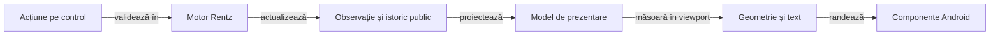

# ToDo: interfața Rentz aliniată cu Whist Lab

## Pe scurt

**P1 · paritate și acceptanță pe candidat.** Rămân verificările de interacțiune, geometrie și timing, plus clasamentul final. Contractele livrate și dovezile istorice sunt în [ghidul integrării UI](../rentz/ATF_UiIntegration.md).

| Prioritate | Semnificație |
|---|---|
| P1 | Necesar înainte de a prezenta interfața drept finisată și complet calificată. |
| P2 | Rafinare după corectitudinea informației, geometrie și accesibilitate. |

## Diferențele față de reperul Whist Lab

Registrul este confruntat cu sursele, componentele și încercările native identificate în dosarul integrării. [Refactorizarea cerută producătorului UI](../../../atf_j4/docs/feedback/ATF_CardUi_Extraction.md) trebuie să păstreze comportamentul Whist; acest registru deține adaptarea Rentz.

| Suprafață | Reper verificabil în Whist Lab | Lacună Rentz și efect |
|---|---|---|
| Pornire | [MenuScreens](../../../atf_j4/whist-lab-app/app/src/main/java/ro/whistlab/app/screens/MenuScreens.java), [SetupScreen](../../../atf_j4/whist-lab-app/app/src/main/java/ro/whistlab/app/screens/SetupScreen.java): pagini separate, dropdown RO/EN, profil, reluare și scoruri. | Integrat prin `HomeMenu` și `RentzMenus`: configurare separată, RO/EN, profil și reluare vizibilă. Rămân verificările native ale rutelor negative și ale textului mărit. |
| Nume și preferințe | [PlayerSettingsDialog](../../../atf_j4/whist-lab-app/app/src/main/java/ro/whistlab/app/profile/PlayerSettingsDialog.java), [PlayerPreferences](../../../atf_j4/whist-lab-app/app/src/main/java/ro/whistlab/app/profile/PlayerPreferences.java). | Editor comun și preferințe Rentz durabile, fără schimbarea identității locului. Filtrul Android UTF-16 și politica de puncte de cod cer reconciliere în producătorul comun. |
| Masă și navigare | [GameScreen](../../../atf_j4/whist-lab-app/app/src/main/java/ro/whistlab/app/screens/GameScreen.java), [AppNavigation](../../../atf_j4/whist-lab-app/app/src/main/java/ro/whistlab/app/navigation/AppNavigation.java). | Masa folosește `BoardLayout`, chenarele comune și meniul discret. Inițializarea 3/6 locuri a trecut pe același viewport API 28; fontul mărit și profilul compact cer probe distincte. |
| Mână și depunere | [CenteredHandView](../../../atf_j4/whist-lab-app/app/src/main/java/ro/whistlab/app/hand/CenteredHandView.java), [GameTablePanel](../../../atf_j4/whist-lab-app/app/src/main/java/ro/whistlab/app/table/GameTablePanel.java). | `HandFan` și `PlayedCardsView` sunt comune; `RentzTableContent` păstrează reveal și legalitatea. Indicii, o carte și mâna goală trebuie urmărite pe probele native, separat de datele JVM. |
| Continuitate | Modelele de navigare, reafișare și colectare păstrează masa și invalidează evenimentele depășite. | Controllerul livrează o tură pe cadru, iar `TrickPreview` păstrează levata completă. Cadrele individuale și marcajul pe dispozitiv rămân de calificat pentru APK-ul candidat. |
| Scor | [Proiecția istoricului](../../../atf_j4/whist-lab-app/app/src/main/java/ro/whistlab/app/score/ScoreHistoryColumn.java) este distinctă de geometrie și randare. | J5 măsoară textul, aliniază Δ și Σ și păstrează antetul și identitatea mâinii în timpul derulării. |

Componentele existente de sesiune, codec și lifecycle se păstrează. Cazurile UI noi folosesc motorul Rentz real și comparații capturate în execuție; selectorii nativi au probe separate pentru item AdapterView, vecin dezactivat și ambiguitate.

## P1: paritatea vizuală și de interacțiune

Admiterea U08 este documentată în [contractul bibliotecilor UI](../rentz/ATF_UiIntegration.md#admiterea-bibliotecilor-de-produs).

| ID și stare | Schimbare cerută și criteriu de închidere |
|---|---|
| **U01 · PARȚIAL** | **Fixați reperul înainte de portare.** Identificați sursele Whist, configurația, geometria și capturile disponibile pentru aceleași intrări. Codul live și ultimul APK calificat pot diferi; orice diferență rămâne explicită. Nu comparați Rentz cu o captură sau un mock vechi prezentat ca interfață live. |
| **U02 · PARȚIAL** | **Același meniu și editor de nume.** Același aranjament, controale, stil și flux pornire → configurare → masă; reluarea fără sesiune păstrează comportamentul butonului din reper. Dropdown RO/EN, implicit EN la prima pornire, titluri și ajutor Rentz localizate, salvare/resetare/anulare a numelui și erori IO vizibile. Contractul de nume al reperului este NFC, 1–10 puncte de cod și caracterele admise; confruntați separat filtrul Android și validatorul. Preferințele și salvările rămân proprii aplicației Rentz. |
| **U03 · PARȚIAL** | **Aceleași principii la configurare și scoruri personale.** Limba și revenirea păstrează alegerile valide; o partidă nouă cere confirmare când înlocuiește sesiunea. Selectorul jocului, regulile și opțiunile afișează numai capabilități Rentz reale. Intrările de scor din meniul comun cer un conținut Rentz funcțional și o stare goală explicită; nu se copiază clasamentul Whist sau un buton fără efect. |
| **U04 · PARȚIAL** | **Aceeași compoziție a mesei.** Omul rămâne jos, chenarele și cărțile depuse păstrează identitatea locului și ordinea motorului la 3–6 jucători. Indicatorul marchează actorul efectiv; asul, săritura și jucătorul terminat din secvențe interzic deducerea turei numai prin incrementarea locului. Fără spatele cărților adverse, etichete redundante sau scroll vertical al mesei în profilurile declarate. |
| **U05 · PARȚIAL** | **Același desen al cărții și aceeași mână centrată.** Proporție, dimensiune la același viewport, suprapunere, indici lizibili și reacție la atingere conforme reperului. Opt cărți Rentz pe un rând, o carte centrată și mână goală reprezentată corect; cartea ridicată nu mută chenarul și nu ascunde indicii vecinilor. Legalitatea și comanda aparțin motorului, cu o singură aplicare. În alegerea pe nevăzute nu se dezvăluie mâna înainte de `REVEAL`. |
| **U06 · PARȚIAL** | **Depunere și continuitate inspectabile.** Cartea publică apare în dreptul actorului, iar levata completă rămâne inspectabilă potrivit politicii de timp a reperului înainte de colectare. Masa nu dispare în timpul AI; fluxul de prezentare folosește evenimente publice identificate, fără repetarea calculului sau a comenzii. Pauza, istoricul, meniul și callback-urile întârziate nu avansează încă o dată jocul. |
| **U07 · PARȚIAL** | **Clasamentul și rezumatul de final.** S01 și S07 completează [istoricul adaptiv](../rentz/ATF_UiIntegration.md#istoricul-adaptiv-rentz). |

**Distribuire și depunere sunt criterii separate.** Reperul consultat compune mâna din snapshot; animatorul `TrickCollection` colectează levata și nu demonstrează o animație de distribuire. Copiați comportamentul vizual demonstrat, iar o animație nouă se tratează ca funcționalitate distinctă, fără a o introduce în refactorizarea Whist.

## Matricea parității prin componente

Reutilizarea testelor înseamnă aceleași invariante și oracole independente, adaptate la intrările Rentz. Clasele Whist care construiesc direct `GameSession` sau `GameConfig` păstrează și o verificare de integrare în jocul lor.

| Familie și reper | Componente de introdus în Rentz |
|---|---|
| Meniu, profil și [MatchSetup](../../../atf_j4/whist-lab-app/app/src/test/java/ro/whistlab/app/screens/MatchSetupComponentTest.java) | RO/EN, limbă schimbată pe fiecare rută, alegeri reținute, nume valid/invalid/resetat, eșec de salvare și reluare. Separat, binding Android: dropdown, tastatură, buton și semantica accesibilă. |
| [Ordinea locurilor](../../../atf_j4/whist-lab-app/app/src/test/java/ro/whistlab/app/table/TableSeatOrderComponentTest.java) | Aceeași mapare loc → chenar → carte la 3–6 jucători; secvențe cu as, săritură, pas și actor terminat, comparate cu motorul Rentz real. |
| Mână, carte, viewport și fereastră | Opt, una și zero cărți; indici, ridicare, z-order, centrare, insets și text mărit. Cele 13 cărți pot verifica rendererul comun pentru Whist, dar nu devin o distribuire legală Rentz: [OpeningDeal](../../rentz-lab-app/game-core/src/main/java/ro/rentzlab/core/OpeningDeal.java) cere opt cărți per loc. |
| Evenimente și lifecycle | Mutări AI individuale, levată completă, calcul anulat, reluare, dialoguri suprapuse și rezultat depășit. Ceas și coadă controlate. |
| Scor și raster | Zero, negativ, egalități, 3–6 locuri și istoric până la 48 de mâini; sumă independentă a deltelor, text, clipping și primul/ultimul rând după restaurare. Rasterul JVM nu substituie fontul Android. |

Păstrați dimensiunile și scalele de mai jos pentru componente. E2E minim verifică meniul/profilul și revenirea, apoi un traseu legal cu depunere și scor; profilurile suplimentare disting numai riscul de afișaj, fără repetarea partidei complete.

Înregistrați selecția UI în colecțiile testabile, cu clase și invocări așteptate, astfel încât filtrul Gradle sau adaptorul ATF să nu piardă cazuri. Raportul Extent al componentelor păstrează comparațiile capturate în execuția lor; XML-ul JVM și auditul randării rămân probe distincte, fără aserțiuni inventate la publicare.

## Lacune active după integrare

Ordinea livrării este contractul producătorului, componentele, consumul pe artefacte cu hash, apoi sanity Android și Extent. Notați pentru fiecare punct dovezile și limitele rămase.

| Prioritate | Lacună și consecință | Închidere necesară |
|---|---|---|
| P2 | U06: ritmul și marcajul fiecărui actor trebuie confirmate pe APK-ul candidat. | Înregistrați trei mutări adverse consecutive și trecerea la o levată nouă. Fiecare carte trebuie să apară după marcajul actorului, iar prima mutare următoare să respecte colectarea și propria pauză. Includeți o reluare între două mutări. |
| P2 | Politica numelui este pe puncte de cod, iar filtrul dialogului comun este UTF-16. | U02, proprietar J4: port de filtrare compatibil cu politica consumatorului, păstrând comportamentul Whist cerut. |
| P2 | Proba nativă minimă acoperă 3/4/6 locuri pe un singur afișaj. | U01/U04/U05: font mărit și viewport compact, folosind componentele înaintea capturilor native focalizate; fără repetarea mâinii complete la fiecare rezoluție. |
| P2 | Grila de secvențe este măsurată între chenarele jocului, cu probe pentru 3–6 locuri. | Confirmați pe APK-ul candidat grila la 3, 5 și 6 locuri, cu profil compact, profil înalt și font mărit. Verificați lizibilitatea celui mai lung rang, nuanța exclusiv pe cărțile legale, marcajul „Pasează” și stabilitatea grilei înainte și după pas. |
| P2 | Lansatorul prototipului folosește alte etichete și altă navigare. | U09: noul receipt identifică `uiContract`; lansatorul vechi refuză noul UI înainte de ADB. Migrați decizia și oracolul independent în traseul nou înainte de a declara înlocuită suita veche. |

## P1: Rentz organizat în jurul lui J

| ID și stare | Cerință și criteriu de acceptanță |
|---|---|
| **R01 · TODO** | **J trebuie să fie regula și ancora reală a modului cerut.** La patru jucători, motorul actual deschide deja din J. Pentru celelalte mese, opțiunea explicită „Valet mereu” trebuie propagată prin configurație, motor, observație, simulare, oracol și salvare; varianta existentă „Mijlocul pachetului” rămâne identificată distinct. Este interzis ca UI să arate J în timp ce motorul așteaptă Q, 10 sau 9. |
| **R02 · PARȚIAL** | **Patru rânduri stabile există.** `RentzSequenceContent` păstrează rangul real și sloturile 3–6 locuri. Grila folosește lățimea mesei, cu font dimensionat după lățimea celulei și înălțimea disponibilă. Alinierea opțiunii J depinde de R01. Rămân calificarea rasterului compact și probele independente de ordinea culorilor. |
| **R03 · PARȚIAL** | **Slotul gol nu este carte jucată.** Proiecția distinge ancora și cărțile publice, iar legalitatea vine din motor. Rămân marcarea ultimei mutări și indicii explicabili pentru continuare, fără dezvăluirea deținătorilor necunoscuți. |
| **R04 · PARȚIAL** | **Tabla și comanda explicită de continuare există.** Calculul blochează comenzile și păstrează masa; la încheiere rămâne tabla publică. Rămân sosirile, explicațiile pentru pas/săritură și calificarea nativă a închiderii secvențelor. |
| **R05 · PARȚIAL** | **Cărțile publice sunt proiectate exact.** Componentele confruntă tabla reală fără umplerea fictivă a sloturilor. Adăugați cazul terminal independent și contorul lizibil; modelul poate încheia cu cărți nejucate, iar orice schimbare a terminării rămâne regulă separată. |

Schema stabilește relația rangurilor, fără a reprezenta o distribuire de antrenament:

| Rând | Ranguri sub J | Ancoră | Ranguri peste J |
|---|---|---|---|
| ♣ | Rangurile active până la 10 | J♣ | Q♣, K♣, A♣ |
| ♦ | Rangurile active până la 10 | J♦ | Q♦, K♦, A♦ |
| ♥ | Rangurile active până la 10 | J♥ | Q♥, K♥, A♥ |
| ♠ | Rangurile active până la 10 | J♠ | Q♠, K♠, A♠ |

**Dependența critică R01:** [RentzBoard](../../rentz-lab-app/game-core/src/main/java/ro/rentzlab/core/RentzBoard.java) calculează acum deschiderea numai din numărul jucătorilor. [Memoria și eșantionarea](../../rentz-lab-app/game-core/src/main/java/ro/rentzlab/ai/KnowledgeSampler.java), [căutarea](../../rentz-lab-app/game-core/src/main/java/ro/rentzlab/ai/SearchPolicy.java) și [oracolul](../../atf-tests/src/main/java/atf/rentz/OfflineGameAudit.java) trebuie să consume aceeași variantă publică; o schimbare doar de etichetă sau de desen este insuficientă.

## P1: tabelă de scor elegantă și utilă

| ID și stare | Cerință și criteriu de acceptanță |
|---|---|
| **S01 · TODO** | **Clasament general lizibil pentru toți jucătorii.** Nume, total confirmat și poziție, cu egalități tratate explicit. Scorurile negative se ordonează numeric; zero nu este lipsă de date. Ordinea locurilor la masă rămâne stabilă în istoric, chiar dacă ordinea clasamentului se schimbă. |
| **S04 · PARȚIAL** | **Delta și totalul confirmat sunt separate.** Componentele verifică o mână în curs și totalurile tuturor locurilor. Sanity-ul confruntă totalurile finale și revizia după derulare. Rămâne proba cu sosire în Rentz înaintea decontării. |
| **S07 · PARȚIAL** | **Punctajul mâinii are ecran propriu.** După colectare apar contractul, dublarea, contribuțiile, Δ și Σ. Rămâne clasamentul de final cu egalități, separat de ordinea locurilor și de rezultatul mâinii. |

## Arhitectură de prezentare și refolosire

Extrageți proiecțiile și geometria din `MainActivity`, păstrând un singur motor responsabil de reguli. Componentele de măsurare și de derulare se pot adapta din mecanismele existente, cu contracte Rentz proprii.

Legendă: desenul nu decide legalitatea sau scorul

Proiecțiile și adaptoarele existente sunt identificate în atlasul UI. Diagrama delimitează și extensiile rămase: proiecția formatează date publice, geometria măsoară spațiul, iar comanda rămâne validată de motor.

| Responsabilitate | Cerință de refolosire |
|---|---|
| Modelul tablei | Culoare, rang, stare și frontiere derivate din varianta efectivă. |
| Modelul scorului | Grupuri de jucători, meta-datele mâinii, Δ, Σ și detaliu public. |
| Măsurare | Viewport, insets și măsurător de text injectabile; fără dependență de un model de telefon. |
| Randare | Controale native și semantică accesibilă, separate de calculele de layout. |
| Continuitate | Selecție, poziție de derulare și masă păstrate între actualizări; fără reconstruirea unui ecran gol la fiecare calcul. |

## Componente înaintea extinderii E2E

| Familie | Cazuri și comparații obligatorii |
|---|---|
| Regula deschiderii | J la fiecare culoare, vecini legali și refuz atomic; mese de 3–6 jucători, opțiunea J și varianta mijloc separate. Aceeași configurație după reluare și în lumile AI. |
| Tabla | Culoare nedeschisă, numai J, extindere în ambele direcții, interval maxim, as, carte minimă, pas și ultimul loc. Reordonarea colecției de cărți nu schimbă geometria finală. |
| Limita închiderii | Tabla terminală păstrează exact cărțile publice, inclusiv spațiile rămase; nu apar cărți noi la intrarea în istoricul scorului. |
| Scor | Istoric gol, prima mână, program complet și reluare; delta zero, puncte negative, valori mari și premii egale. Pentru fiecare jucător, Σ este suma deltelor înregistrate. |
| Identități | Toate cele 3–6 locuri, nume scurte/lungi și diacritice; totalurile și sosirile nu se atașează altui jucător după sortare. |
| Geometrie | Limite în interiorul viewportului, fără intersecții; antete și grupuri corelate după derulare. Fiecare punct interactiv trimite o singură comandă legală, inclusiv după recalcularea dimensiunilor. |

| Parametru | Selecție pentru componente |
|---|---|
| Lățime utilă | 320, 360, 393, 412, 600 și 800 dp; o lățime în pixeli nu înlocuiește măsurarea în dp. |
| Orientare | Portret și peisaj, inclusiv spațiul redus de barele sistemului. |
| Scala fontului | 1,0 / 1,3 / 2,0. |
| Conținut | Mese de 3–6 jucători, opt cărți proprii, tablă completă și până la 48 de mâini în istoric. |

La limita lizibilității se alege un mod explicit de derulare sau o dispunere adaptată. Nu micșorați nelimitat textul și nu eliminați jucători, valori sau cărți pentru a face testul să treacă; țintele interactive păstrează minimum 48 × 48 dp, separat de cărțile doar informative, conform [recomandării Android pentru accesibilitate](https://developer.android.com/guide/topics/ui/accessibility/apps).

[Ghidul Android pentru layout-uri adaptive cu Views](https://developer.android.com/develop/ui/views/layout/responsive-adaptive-design-with-views) fundamentează adaptarea la spațiul disponibil. Dimensiunile matricei de mai sus sunt selecția de testare a proiectului, fără atribuire unui model de telefon.

## E2E minim și condiția de închidere

1. Componentele de proiecție, reguli și geometrie trec; măsurarea simulată este confruntată separat cu fontul și randarea Android reale.
2. O probă Rentz pornește din interfață și surprinde J-urile, extinderile, o frontieră relevantă și tabla păstrată la închidere. Stările pregătite pentru componente nu sunt prezentate drept joc real.
3. O probă de istoric derulează vertical și până la ultimul jucător, confruntă toate valorile vizibile și verifică revenirea și reluarea, fără linii duplicate.
4. Rularea păstrează extern identitatea APK-ului, configurația efectivă, expected/actual și capturile native originale inline base64 în stilul proiectului. O masă sau o rezoluție nu califică întreaga matrice.

**Ordine de lucru.** U01 → refactorizarea UI în producător → U02–U05 și adaptoarele Rentz prin componente → U06–U07, R02–R05 și S01/S04/S07 → calibrare nativă și E2E selectiv. R01 rămâne regula separată pentru disponibilitatea opțiunii „Valet mereu”. Închideți criteriile cu implementare identificată și probă relevantă.

## Tura automată — probă nativă rămasă

[Contractul de lifecycle](../rentz/ATF_Lifecycle.md) descrie ordinea cadru, mutare și checkpoint. [Catalogul livrării](../../release/README.md) indică dosarul calificării curente și acoperirea probei native cu pachet izolat. `TurnPacingTest` verifică intervalul de 550 ms și invalidarea cadrului.

- [ ] În următoarea probă nativă focalizată pe tură, măsurați intervalul dintre cadrul actorului și mutare și verificați o singură mutare per cadru, anularea la pauză sau navigare și reluarea din checkpoint. Asociați jurnalul și capturile cu SHA-ul APK-ului verificat.

## P1 — Geometria mesei Rentz și sub-jocuri consecutive

### Constatare din codul live

- `RentzTablePanel` alege `RentzCardBoard` pentru contractul Rentz și `BoardLayout` pentru celelalte șapte contracte. În modurile cu levate, tabela comună este construită cu `fullWidthCardRows=true`; planul inițial Rentz cheamă `RentzCardSpace.plan` cu `false` și o lățime de referință de 220 dp. Comentariul `RentzCardBoard` spune că păstrează geometria comună, însă parametrii trimiși către planificator diferă de cei ai `BoardLayout`; comportamentul trebuie aliniat sau comentariul trebuie corectat explicit.
- În `TableGeometry`, diferența dintre centre influențează decalarea colțurilor. La 3, 5 și 6 jucători, `fullWidthCardRows` produce alte ancore verticale; la 4, chiar dacă flag-ul nu schimbă formula, Rentz folosește un centru de 128 dp, iar celelalte contracte folosesc înălțimea din `PlayedCardMetrics`, deci decalarea colțurilor se schimbă și ea. Planul Rentz poate apropia colțurile de centru și micșora banda verticală disponibilă. Fallback-ul Rentz folosește ancorele pe lățime completă doar dacă banda inițială scade sub pragul de 72 dp; egalitatea nu este garantată în toate viewporturile.
- Tabla secvenței este o grilă cu patru rânduri de etichete, nu fețe de carte: fiecare rând are `2 × jucători` sloturi, înălțimea rândului este limitată la 40 dp, iar textul la 15 sp. Sloturile sunt așezate egal, fără suprapunere. Mărirea benzii centrale singură nu crește cardurile peste aceste plafoane.

Constatarea este dedusă din parametrii reali ai celor două planuri și din formula comună pentru colțuri; nu este o afirmație că toate rezoluțiile au fost validate pe Android.

### Schimbare de testare introdusă

`atf-tests/tools/run-shared-ui-sanity.ps1 -ConsecutiveSubgames` adaugă un traseu nativ de trei mâini în aceeași partidă: primul sub-joc Rentz, apoi două sub-jocuri standard selectate prin interfață când omul este la rând sau automat de AI. Verifică sloturile și cărțile publice ale secvenței, păstrează geometria chenarelor la începutul și după mutări, verifică cele trei rânduri de istoric și restart-ul, apoi compară sesiunea cu replay-ul independent al jurnalului. Capturile sunt folosite de Extent-ul proiectului ca PNG original inline base64.

`RentzCardSpaceTest` compară acum banda Rentz cu banda comună a jocurilor de levate la patru jucători, în viewport compact și înalt; verificarea nouă cere ca Rentz să nu primească mai mult spațiu central doar prin schimbarea reperului. Acoperirea existentă la 3–6 jucători verifică banda și evitarea suprapunerilor, dar încă nu impune paritatea ancorelor cu cele șapte moduri comune.

### Închidere solicitată

| Prioritate | Criteriu verificabil |
|---|---|
| P1 | Comparați chenarele Rentz și levată la 3, 4, 5 și 6 jucători, cu aceleași dimensiuni, insets, font și viewport. Dacă jocul nu cere intenționat altă distanțare, folosiți aceleași ancore pentru toate contractele; apoi măsurați banda centrală rămasă, nu doar centrul teoretic. |
| P1 | În Rentz, păstrați rangul și culoarea pentru toate sloturile publice, inclusiv sloturile goale și cele jucate. Testați o reprezentare suprapusă/etajată care mărește fața fără să ascundă rangul, legalitatea sau ținta tactilă; accesibilitatea trebuie să expună fiecare carte o singură dată. |
| P1 | Rulați `-ConsecutiveSubgames` pe APK-ul izolat calificat. Raportul trebuie să arate trei sub-jocuri distincte în istoric, măsurătorile native ale chenarelor, grila Rentz înainte/după depuneri, identitatea APK-ului și replay-ul jurnalului cu aceeași stare finală. |
| P2 | Componentele trebuie să confrunte ancorele comune și Rentz în toate cele patru numere de jucători și în profiluri compacte, înalte, cu text mărit și fereastră scundă. Testul nativ de patru locuri rămâne o verificare focalizată, nu substituie matricea. |

**Stare:** traseul și aserțiunea focalizată sunt adăugate, dar nu sunt încă executate. Nu modificați UI-ul în baza unei presupuneri despre distanță; măsurați comparația nativă după ce porțile de guvernanță permit build-ul și rularea.
