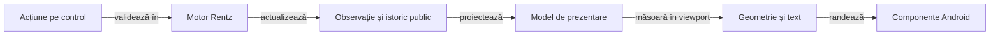

# ToDo: interfața Rentz aliniată cu Whist Lab

## Pe scurt

**P1 · integrare și istoric adaptiv verificate.** Meniul, profilul, limbile, chenarele și cărțile folosesc nucleul vizual J4. Pe API 28, istoricul Rentz a ajuns la ultimul jucător și la mâna 48 în ambele ferestre, cu font 1,5. [Matricea istoricului](../../../../rentz_back/ui-review/history-native-matrix-j5/README.md)

| Prioritate | Semnificație |
|---|---|
| P1 | Necesar înainte de a prezenta interfața drept finisată și complet calificată. |
| P2 | Rafinare după corectitudinea informației, geometrie și accesibilitate. |

## Diferențele față de reperul Whist Lab

Registrul este confruntat cu sursele, componentele și încercările native identificate în dosarul integrării. [Refactorizarea cerută producătorului UI](../../../atf_j4/docs/feedback/ATF_CardUi_Extraction.md) trebuie să păstreze comportamentul Whist; acest registru deține adaptarea Rentz.

| Suprafață | Reper verificabil în Whist Lab | Lacună Rentz și efect |
|---|---|---|
| Pornire | [MenuScreens](../../../atf_j4/whist-lab-app/app/src/main/java/ro/whistlab/app/screens/MenuScreens.java), [SetupScreen](../../../atf_j4/whist-lab-app/app/src/main/java/ro/whistlab/app/screens/SetupScreen.java): pagini separate, dropdown RO/EN, profil, reluare și scoruri. | Integrat prin `HomeMenu` și `RentzMenus`: configurare separată, RO/EN, profil și reluare vizibilă. Rămân verificările native ale rutelor negative și ale textului mărit. |
| Nume și preferințe | [PlayerSettingsDialog](../../../atf_j4/whist-lab-app/app/src/main/java/ro/whistlab/app/profile/PlayerSettingsDialog.java), [PlayerPreferences](../../../atf_j4/whist-lab-app/app/src/main/java/ro/whistlab/app/profile/PlayerPreferences.java). | Editor comun și preferințe Rentz durabile, fără schimbarea identității locului. Filtrul Android UTF-16 și politica de puncte de cod cer reconciliere în producătorul comun. |
| Masă și navigare | [GameScreen](../../../atf_j4/whist-lab-app/app/src/main/java/ro/whistlab/app/screens/GameScreen.java), [AppNavigation](../../../atf_j4/whist-lab-app/app/src/main/java/ro/whistlab/app/navigation/AppNavigation.java). | Masa folosește `BoardLayout`, chenarele comune și meniul discret. Inițializarea 3/6 locuri a trecut pe același viewport API 28; fontul mărit și profilul compact cer probe distincte. |
| Mână și depunere | [CenteredHandView](../../../atf_j4/whist-lab-app/app/src/main/java/ro/whistlab/app/hand/CenteredHandView.java), [GameTablePanel](../../../atf_j4/whist-lab-app/app/src/main/java/ro/whistlab/app/table/GameTablePanel.java). | `HandFan` și `PlayedCardsView` sunt comune; `RentzTableContent` păstrează reveal și legalitatea. Indicii, o carte și mâna goală trebuie urmărite pe probele native, separat de datele JVM. |
| Continuitate | Modelele de navigare, reafișare și colectare păstrează masa și invalidează evenimentele depășite. | Controllerul livrează o tură pe cadru, iar `TrickPreview` păstrează levata completă. Cadrele individuale și marcajul pe dispozitiv rămân de calificat pentru APK-ul candidat. |
| Scor | [Proiecția istoricului](../../../atf_j4/whist-lab-app/app/src/main/java/ro/whistlab/app/score/ScoreHistoryColumn.java) este distinctă de geometrie și randare. | J5 măsoară textul, aliniază Δ și Σ și păstrează antetul și identitatea mâinii în timpul derulării. |

Componentele existente de sesiune, codec și lifecycle se păstrează. Cazurile UI noi folosesc motorul Rentz real și comparații capturate în execuție; selectorii nativi au probe separate pentru item AdapterView, vecin dezactivat și ambiguitate.

## Dovezi pe increment

- Cele 33 de teste JVM inițiale sunt păstrate, cu sursele neschimbate; 16 cazuri noi verifică proiecțiile, cele opt contracte, scorul negativ/pozitiv, blind-ul, restaurarea și refuzul comenzilor depășite.
- API 28: profil, RO/EN, configurare, revenire, o mână de levate, o carte centrată, istoric și restart au trecut. Inițializarea cu 3/6 locuri este probă de afișaj pe același viewport.
- Extent păstrează comparațiile evaluate, acțiunile native și capturile originale; XML-ul celor 33 de teste vechi rămâne dovadă de execuție, fără expected/actual reconstruite ulterior.
- Matricea istoricului adaptiv cuprinde 53 de teste JVM și 10 puncte native de verificare pe jurnalul de 48 de mâini. [Dosarul istoricului](../../../../rentz_back/ui-review/history-native-matrix-j5/README.md)
- Detaliul punctajului adaugă comparații pe cele 48 de mâini și verifică nativ două detalii după restaurare. Pe API 28, locurile cu premiu egal rămân distincte și revenirea păstrează grila. [Dosarul S05/S06](../../../../rentz_back/ui-review/settlement-details-j5/README.md)
- Incrementul comun verifică ajutorul RO/EN, ordinea mâinii pe ecran și continuitatea numelor AI după restart. Pe profilul logic 720×1280, cu font 1,5, fiecare chenar păstrează două rânduri complete de scor sub nume. [Dovezile S05 și U10–U13](../../../../rentz_back/ui-review/shared-seats-collection-j5/README.md)

## P1: paritatea vizuală și de interacțiune

### Admiterea nucleului comun

**U08 — integrare realizată:** configurația live consumă `ro.cardtable:card-table-ui:0.1.6` și `ro.cardtable:card-table-names:0.1.0` din repository-ul local fixat prin hash. Proiecțiile și comenzile sunt ale motorului Rentz.

- [Contractul integrării](../rentz/ATF_UiIntegration.md) și [atlasul UI](../../rentz-lab-app/app/src/main/java/ro/rentzlab/app/ui/README.md) identifică implementarea.
- Dosarul integrării inițiale păstrează rezultatele, domeniul și încercările originale. [Dovezile integrării J4 → J5](../../../../rentz_back/ui-review/shared-ui-cb695c1461/README.md)
- Compatibilitatea API 28 a expus un apel `Stream.toList()` în adaptor; colectorul portabil păstrează ordinea și imutabilitatea. Lint și proba nativă sunt porți distincte.

| ID și stare | Schimbare cerută și criteriu de închidere |
|---|---|
| **U01 · PARȚIAL** | **Fixați reperul înainte de portare.** Identificați sursele Whist, configurația, geometria și capturile disponibile pentru aceleași intrări. Codul live și ultimul APK calificat pot diferi; orice diferență rămâne explicită. Nu comparați Rentz cu o captură sau un mock vechi prezentat ca interfață live. |
| **U02 · PARȚIAL** | **Același meniu și editor de nume.** Același aranjament, controale, stil și flux pornire → configurare → masă; reluarea fără sesiune păstrează comportamentul butonului din reper. Dropdown RO/EN, implicit EN la prima pornire, titluri și ajutor Rentz localizate, salvare/resetare/anulare a numelui și erori IO vizibile. Contractul de nume al reperului este NFC, 1–10 puncte de cod și caracterele admise; confruntați separat filtrul Android și validatorul. Preferințele și salvările rămân proprii aplicației Rentz. |
| **U03 · PARȚIAL** | **Aceleași principii la configurare și scoruri personale.** Limba și revenirea păstrează alegerile valide; o partidă nouă cere confirmare când înlocuiește sesiunea. Selectorul jocului, regulile și opțiunile afișează numai capabilități Rentz reale. Intrările de scor din meniul comun cer un conținut Rentz funcțional și o stare goală explicită; nu se copiază clasamentul Whist sau un buton fără efect. |
| **U04 · PARȚIAL** | **Aceeași compoziție a mesei.** Omul rămâne jos, chenarele și cărțile depuse păstrează identitatea locului și ordinea motorului la 3–6 jucători. Indicatorul marchează actorul efectiv; asul, săritura și jucătorul terminat din secvențe interzic deducerea turei numai prin incrementarea locului. Fără spatele cărților adverse, etichete redundante sau scroll vertical al mesei în profilurile declarate. |
| **U05 · PARȚIAL** | **Același desen al cărții și aceeași mână centrată.** Proporție, dimensiune la același viewport, suprapunere, indici lizibili și reacție la atingere conforme reperului. Opt cărți Rentz pe un rând, o carte centrată și mână goală reprezentată corect; cartea ridicată nu mută chenarul și nu ascunde indicii vecinilor. Legalitatea și comanda aparțin motorului, cu o singură aplicare. În alegerea pe nevăzute nu se dezvăluie mâna înainte de `REVEAL`. |
| **U06 · PARȚIAL** | **Depunere și continuitate inspectabile.** Cartea publică apare în dreptul actorului, iar levata completă rămâne inspectabilă potrivit politicii de timp a reperului înainte de colectare. Masa nu dispare în timpul AI; fluxul de prezentare folosește evenimente publice identificate, fără repetarea calculului sau a comenzii. Pauza, istoricul, meniul și callback-urile întârziate nu avansează încă o dată jocul. |
| **U07 · PARȚIAL** | **Grila, derularea și detaliul mâinii sunt implementate.** S02 și S03 au componente și sanity nativ cu șase jucători. Clasamentul și rezumatul de final rămân la S01 și S07. |

**Distribuire și depunere sunt criterii separate.** Reperul consultat compune mâna din snapshot; animatorul `TrickCollection` colectează levata și nu demonstrează o animație de distribuire. Copiați comportamentul vizual demonstrat, iar o animație nouă se tratează ca funcționalitate distinctă, fără a o introduce în refactorizarea Whist.

## Matricea parității prin componente

Reutilizarea testelor înseamnă aceleași invariante și oracole independente, adaptate la intrările Rentz. Clasele Whist care construiesc direct `GameSession` sau `GameConfig` păstrează și o verificare de integrare în jocul lor.

| Familie și reper | Componente de introdus în Rentz |
|---|---|
| Meniu, profil și [MatchSetup](../../../atf_j4/whist-lab-app/app/src/test/java/ro/whistlab/app/screens/MatchSetupComponentTest.java) | RO/EN, limbă schimbată pe fiecare rută, alegeri reținute, nume valid/invalid/resetat, eșec de salvare și reluare. Separat, binding Android: dropdown, tastatură, buton și semantica accesibilă. |
| [Ordinea locurilor](../../../atf_j4/whist-lab-app/app/src/test/java/ro/whistlab/app/table/TableSeatOrderComponentTest.java) | Aceeași mapare loc → chenar → carte la 3–6 jucători; secvențe cu as, săritură, pas și actor terminat, comparate cu motorul Rentz real. |
| Mână, carte, viewport și fereastră | Opt, una și zero cărți; indici, ridicare, z-order, centrare, insets și text mărit. Cele 13 cărți pot verifica rendererul comun pentru Whist, dar nu devin o distribuire legală Rentz: [OpeningDeal](../../rentz-lab-app/game-core/src/main/java/ro/rentzlab/core/OpeningDeal.java) cere opt cărți per loc. |
| Evenimente și lifecycle | Mutări AI individuale, levată completă, calcul anulat, reluare, dialoguri suprapuse și rezultat depășit. Ceas și coadă controlate. |
| Scor și raster | Zero, negativ, egalități, 3–6 locuri și istoric până la 48 de mâini; sumă independentă a deltelor, text, clipping și primul/ultimul rând după restaurare. Rasterul JVM nu substituie fontul Android. |

Păstrați dimensiunile și scalele de mai jos pentru componente. E2E minim verifică meniul/profilul și revenirea, apoi un traseu legal cu depunere și scor; profilurile suplimentare disting numai riscul de afișaj, fără repetarea partidei complete.

Înregistrați selecția UI în colecțiile testabile, cu clase și invocări așteptate, astfel încât filtrul Gradle sau adaptorul ATF să nu piardă cazuri. Raportul Extent al componentelor păstrează comparațiile capturate în execuția lor; XML-ul JVM și auditul randării rămân probe distincte, fără aserțiuni inventate la publicare.

## Lacune active după integrare

| ID | Increment comun și criteriu de acceptanță |
|---|---|
| U10 · VERIFICAT | **Scorul din chenar.** Numele și cele două rânduri rămân întregi. Matricea Android acoperă 36 de combinații cu font până la 2× și verifică lățimea glifelor, geometria chenarelor, diacriticele și valorile negative lungi. |
| U11 · VERIFICAT | **Numele adversarilor.** J5 folosește selecția din J4. Componentele acoperă 3–6 locuri, numele uman rezervat și jurnalul vechi. Proba nativă confirmă păstrarea locurilor și numelor la restart. |
| U12 · VERIFICAT PE API 28 | **Colectarea levatei.** Pe rendererul Android, confirmarea la 1080×1920 a trecut în joc la 1.491 ms și după restart la 1.433 ms. Au fost urmărite patru cărți în fiecare traseu, cu jurnal identic. Prima rulare cu același APK a depășit cu 20 ms pragul pentru prima mișcare din joc. [Măsurători și Extent](../../../../rentz_back/ui-review/restart-collection-j5/README.md) |
| U14 · VERIFICAT | **Sugestie AI.** Alegerea după dezvăluire oferă o opțiune legală din observația jucătorului și nivelul AI al partidei. Sanity-ul confirmă că opțiunea lipsește din alegerea oarbă și că afișarea sugestiei lasă jurnalul identic. |
| U13 · VERIFICAT | **Ordinea mâinii.** Cărțile vizibile urmează ♠ ♥ ♣ ♦ și rangul crescător. Proiecția păstrează identitatea și legalitatea, iar proba Android verifică ordinea fizică și centrajul ultimei cărți. |

Ordinea livrării este contractul producătorului, componentele, consumul pe artefacte cu hash, apoi sanity Android și Extent. Notați pentru fiecare punct dovezile și limitele rămase.

| Prioritate | Lacună și consecință | Închidere necesară |
|---|---|---|
| P2 | U06: ritmul și marcajul fiecărui actor trebuie confirmate pe APK-ul candidat. | Înregistrați trei mutări adverse consecutive și trecerea la o levată nouă. Fiecare carte trebuie să apară după marcajul actorului, iar prima mutare următoare să respecte colectarea și propria pauză. Includeți o reluare între două mutări. |
| P2 | Politica numelui este pe puncte de cod, iar filtrul dialogului comun este UTF-16. | U02, proprietar J4: port de filtrare compatibil cu politica consumatorului, păstrând comportamentul Whist cerut. |
| P2 | Proba nativă minimă acoperă 3/4/6 locuri pe un singur afișaj. | U01/U04/U05: font mărit și viewport compact, folosind componentele înaintea capturilor native focalizate; fără repetarea mâinii complete la fiecare rezoluție. |
| P2 | Grila de secvențe este măsurată între chenarele jocului, cu probe pentru 3–6 locuri. | Confirmați pe APK-ul candidat grila la 3, 5 și 6 locuri, cu profil compact, profil înalt și font mărit. Verificați lizibilitatea celui mai lung rang, nuanța exclusiv pe cărțile legale, marcajul „Pasează” și stabilitatea grilei înainte și după pas. |
| P2 | Lansatorul prototipului folosește alte etichete și altă navigare. | U09: noul receipt identifică `uiContract`; lansatorul vechi refuză noul UI înainte de ADB. Migrați decizia și oracolul independent în traseul nou înainte de a declara înlocuită suita veche. |

## P1: Rentz organizat în jurul lui J

| ID și stare | Cerință și criteriu de acceptanță |
|---|---|
| **R01 · TODO** | **J trebuie să fie regula și ancora reală a modului cerut.** La patru jucători, motorul actual deschide deja din J. Pentru celelalte mese, opțiunea explicită „Valet mereu” trebuie propagată prin configurație, motor, observație, simulare, oracol și salvare; varianta existentă „Mijlocul pachetului” rămâne identificată distinct. Este interzis ca UI să arate J în timp ce motorul așteaptă Q, 10 sau 9. |
| **R02 · PARȚIAL** | **Patru rânduri stabile există.** `RentzSequenceContent` păstrează rangul real și sloturile 3–6 locuri. Grila folosește lățimea mesei, cu font dimensionat după lățimea celulei și înălțimea disponibilă. Alinierea opțiunii J depinde de R01. Rămân calificarea rasterului compact și probele independente de ordinea culorilor. |
| **R03 · PARȚIAL** | **Slotul gol nu este carte jucată.** Proiecția distinge ancora și cărțile publice, iar legalitatea vine din motor. Rămân marcarea ultimei mutări și indicii explicabili pentru continuare, fără dezvăluirea deținătorilor necunoscuți. |
| **R04 · PARȚIAL** | **Tabla și comanda explicită de continuare există.** Calculul blochează comenzile și păstrează masa; la încheiere rămâne tabla publică. Rămân sosirile, explicațiile pentru pas/săritură și calificarea nativă a închiderii secvențelor. |
| **R05 · PARȚIAL** | **Cărțile publice sunt proiectate exact.** Componentele confruntă tabla reală fără umplerea fictivă a sloturilor. Adăugați cazul terminal independent și contorul lizibil; modelul poate încheia cu cărți nejucate, iar orice schimbare a terminării rămâne regulă separată. |

Schema stabilește relația rangurilor, fără a reprezenta o distribuire de antrenament:

| Rând | Ranguri sub J | Ancoră | Ranguri peste J |
|---|---|---|---|
| ♣ | Rangurile active până la 10 | J♣ | Q♣, K♣, A♣ |
| ♦ | Rangurile active până la 10 | J♦ | Q♦, K♦, A♦ |
| ♥ | Rangurile active până la 10 | J♥ | Q♥, K♥, A♥ |
| ♠ | Rangurile active până la 10 | J♠ | Q♠, K♠, A♠ |

**Dependența critică R01:** [RentzBoard](../../rentz-lab-app/game-core/src/main/java/ro/rentzlab/core/RentzBoard.java) calculează acum deschiderea numai din numărul jucătorilor. [Memoria și eșantionarea](../../rentz-lab-app/game-core/src/main/java/ro/rentzlab/ai/KnowledgeSampler.java), [căutarea](../../rentz-lab-app/game-core/src/main/java/ro/rentzlab/ai/SearchPolicy.java) și [oracolul](../../atf-tests/src/main/java/atf/rentz/OfflineGameAudit.java) trebuie să consume aceeași variantă publică; o schimbare doar de etichetă sau de desen este insuficientă.

## P1: tabelă de scor elegantă și utilă

| ID și stare | Cerință și criteriu de acceptanță |
|---|---|
| **S01 · TODO** | **Clasament general lizibil pentru toți jucătorii.** Nume, total confirmat și poziție, cu egalități tratate explicit. Scorurile negative se ordonează numeric; zero nu este lipsă de date. Ordinea locurilor la masă rămâne stabilă în istoric, chiar dacă ordinea clasamentului se schimbă. |
| **S02 · VERIFICAT** | **Istoric de până la 48 de mâini confirmate.** Fiecare rând arată sub-jocul, alegătorul și marcajul ×2, urmate de Δ și Σ. Componentele confruntă toate locurile după restaurare și probează excluderea unei mâini în curs. |
| **S03 · VERIFICAT** | **Acces la capetele istoricului, inclusiv cu font mărit.** Pe API 28, EN, 360 dpi și font 1,5, ultimul grup complet și mâna 48 sunt accesibile la 720 × 1280 și 720 × 740. Fereastra scundă derulează întregul conținut până la legenda completă. La mărire, antetul și legenda revin în pozițiile fixe. |
| **S04 · PARȚIAL** | **Delta și totalul confirmat sunt separate.** Componentele verifică o mână în curs și totalurile tuturor locurilor. Sanity-ul confruntă totalurile finale și revizia după derulare. Rămâne proba cu sosire în Rentz înaintea decontării. |
| **S05 · VERIFICAT** | **Detaliul și ajutorul folosesc profilul efectiv.** Detaliul păstrează alegătorul, dublarea și contribuțiile, inclusiv Q♦ în ambele categorii la Totale. Ajutorul prezintă grila pentru 3–6 jucători, cu verificare pentru profil alternativ și probă Android în engleză și română. |
| **S06 · VERIFICAT** | **Date publice și imuabile.** Motorul fixează contribuțiile și ordinea la decontare. Componentele reconstruiesc rezultatele pentru jurnale compatibile. Pe API 28, mâna 48 păstrează ordinea locurilor cu premiu zero după reluare. |
| **S07 · PARȚIAL** | **Punctajul mâinii are ecran propriu.** După colectare apar contractul, dublarea, contribuțiile, Δ și Σ. Rămâne clasamentul de final cu egalități, separat de ordinea locurilor și de rezultatul mâinii. |

## Arhitectură de prezentare și refolosire

Extrageți proiecțiile și geometria din `MainActivity`, păstrând un singur motor responsabil de reguli. Componentele de măsurare și de derulare se pot adapta din mecanismele existente, cu contracte Rentz proprii.

Legendă: desenul nu decide legalitatea sau scorul

Proiecțiile și adaptoarele existente sunt identificate în atlasul UI. Diagrama delimitează și extensiile rămase: proiecția formatează date publice, geometria măsoară spațiul, iar comanda rămâne validată de motor.

| Responsabilitate | Cerință de refolosire |
|---|---|
| Modelul tablei | Culoare, rang, stare și frontiere derivate din varianta efectivă. |
| Modelul scorului | Grupuri de jucători, meta-datele mâinii, Δ, Σ și detaliu public. |
| Măsurare | Viewport, insets și măsurător de text injectabile; fără dependență de un model de telefon. |
| Randare | Controale native și semantică accesibilă, separate de calculele de layout. |
| Continuitate | Selecție, poziție de derulare și masă păstrate între actualizări; fără reconstruirea unui ecran gol la fiecare calcul. |

## Componente înaintea extinderii E2E

| Familie | Cazuri și comparații obligatorii |
|---|---|
| Regula deschiderii | J la fiecare culoare, vecini legali și refuz atomic; mese de 3–6 jucători, opțiunea J și varianta mijloc separate. Aceeași configurație după reluare și în lumile AI. |
| Tabla | Culoare nedeschisă, numai J, extindere în ambele direcții, interval maxim, as, carte minimă, pas și ultimul loc. Reordonarea colecției de cărți nu schimbă geometria finală. |
| Limita închiderii | Tabla terminală păstrează exact cărțile publice, inclusiv spațiile rămase; nu apar cărți noi la intrarea în istoricul scorului. |
| Scor | Istoric gol, prima mână, program complet și reluare; delta zero, puncte negative, valori mari și premii egale. Pentru fiecare jucător, Σ este suma deltelor înregistrate. |
| Identități | Toate cele 3–6 locuri, nume scurte/lungi și diacritice; totalurile și sosirile nu se atașează altui jucător după sortare. |
| Geometrie | Limite în interiorul viewportului, fără intersecții; antete și grupuri corelate după derulare. Fiecare punct interactiv trimite o singură comandă legală, inclusiv după recalcularea dimensiunilor. |

| Parametru | Selecție pentru componente |
|---|---|
| Lățime utilă | 320, 360, 393, 412, 600 și 800 dp; o lățime în pixeli nu înlocuiește măsurarea în dp. |
| Orientare | Portret și peisaj, inclusiv spațiul redus de barele sistemului. |
| Scala fontului | 1,0 / 1,3 / 2,0. |
| Conținut | Mese de 3–6 jucători, opt cărți proprii, tablă completă și până la 48 de mâini în istoric. |

La limita lizibilității se alege un mod explicit de derulare sau o dispunere adaptată. Nu micșorați nelimitat textul și nu eliminați jucători, valori sau cărți pentru a face testul să treacă; țintele interactive păstrează minimum 48 × 48 dp, separat de cărțile doar informative, conform [recomandării Android pentru accesibilitate](https://developer.android.com/guide/topics/ui/accessibility/apps).

[Ghidul Android pentru layout-uri adaptive cu Views](https://developer.android.com/develop/ui/views/layout/responsive-adaptive-design-with-views) fundamentează adaptarea la spațiul disponibil. Dimensiunile matricei de mai sus sunt selecția de testare a proiectului, fără atribuire unui model de telefon.

## E2E minim și condiția de închidere

1. Componentele de proiecție, reguli și geometrie trec; măsurarea simulată este confruntată separat cu fontul și randarea Android reale.
2. O probă Rentz pornește din interfață și surprinde J-urile, extinderile, o frontieră relevantă și tabla păstrată la închidere. Stările pregătite pentru componente nu sunt prezentate drept joc real.
3. O probă de istoric derulează vertical și până la ultimul jucător, confruntă toate valorile vizibile și verifică revenirea și reluarea, fără linii duplicate.
4. Rularea păstrează extern identitatea APK-ului, configurația efectivă, expected/actual și capturile native originale inline base64 în stilul proiectului. O masă sau o rezoluție nu califică întreaga matrice.

**Ordine de lucru:** U01 → refactorizarea UI în producător → U02–U05 și adaptoarele Rentz prin componente → U06–U07, R02–R05 și S01–S07 → calibrare nativă și E2E selectiv. R01 rămâne o modificare de regulă separată: condiționează opțiunea „Valet mereu”, fără să blocheze meniul sau geometria și fără să fie simulată prin desen. Închideți criteriile numai cu implementare identificată, probe relevante și reconfirmarea codului live.

## P1 — livrarea 0.3.0 și turele Rentz vizibile

**Prioritate:** blochează declararea noii interacțiuni ca livrată. APK-ul public verificat rămâne 0.2.0 până când toate criteriile de mai jos trec pentru aceiași octeți ai sursei și ai binarului. README-ul principal nu trebuie să indice drept descărcabil un candidat DRAFT/PREPARED.

| Criteriu | Stare | Dovada necesară pentru închidere |
|---|---|---|
| Temporizarea turei automate | **IMPLEMENTAT · NEQUALIFICAT** | Testul de componentă demonstrează cadrul activ → pauză de 550 ms → exact o comandă; niciun timer înainte de cadrul efectiv; tura umană/colectarea excluse; invalidarea înainte și după cadru refuză mutarea. |
| Integrarea Android a cadrului și lifecycle-ului | **P1 · DESCHIS** | Sanity pe APK 0.3.0 verifică indicatorul actorului înaintea mutării, o acțiune pe cadru, anularea la pauză/navigare și reluarea din checkpoint; capturile și jurnalul se leagă de SHA-ul APK-ului. Testul JVM singur nu închide acest criteriu. |
| Pachetul funcțional 0.3.0 | **P1 · DRAFT** | Include schimbările Rentz din sursa fixată: spațiu adaptiv pentru 3–6 locuri, tablă de secvențe, evidențierea cărților legale, ture pas-cu-pas și protecțiile lifecycle. Regresia completă, Android JVM, buildul semnat, certificatul, manifestul și integritatea ZIP trebuie să treacă fără skip-uri. |
| Disponibilitatea publică și README principal | **P1 · DRAFT** | Tagul v0.3.0 pointează exact la sursa calificată și commitul există pe branch-ul remote; release-ul și copia publică HTTPS conțin APK-ul și checksum-ul; descărcarea anonimă verifică HTTP 200, bytes și SHA-256. Abia apoi README-ul principal devine legătura către ultima ediție publicată. |
| Bibliotecă de raportare J23 | **PARALEL · PĂSTRATĂ** | Proveniența J23, hash-urile fizice JAR/POM și regresia consumatorului trebuie să fie în aceeași calificare; biblioteca este pentru testare și nu este împachetată în APK. |

README-ul aplicației diferențiază acum `advanceBotTurn()` pentru UI de `advanceBots()` pentru simularea offline. Contractul de lifecycle și integrarea descriu actorul vizibil înainte de tur și separarea acțiunilor automate. `TurnPacing` primește poarta primului cadru ca dependență; implementarea este prezentă, dar se închide numai cu rezultate verzi și sanity Android. Candidatul `release/0.3.0` este încă DRAFT; nu-l prezentați drept APK instalabil.
