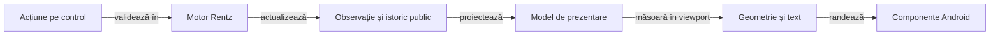

# Feedback activ pentru interfața Rentz

## Pe scurt

**P1 · paritate și acceptanță pe candidat.** Rămân verificările de interacțiune, geometrie și timing, plus clasamentul final. Contractele livrate și dovezile istorice sunt în [ghidul integrării UI](../rentz/ATF_UiIntegration.md).

| Prioritate | Semnificație |
|---|---|
| P1 | Necesar înainte de a prezenta interfața drept finisată și complet calificată. |
| P2 | Rafinare după corectitudinea informației, geometrie și accesibilitate. |

## Diferențele față de reperul Whist Lab

Registrul este confruntat cu sursele, componentele și încercările native identificate în dosarul integrării. [Adopția grafică](../rentz/ATF_UiIntegration.md) explică granița dintre biblioteca partajată și regulile Rentz.

| Suprafață | Reper verificabil în Whist Lab | Lacună Rentz și efect |
|---|---|---|
| Pornire | Modelul de navigare folosește pagini separate, dropdown RO/EN, profil, reluare și scoruri. | Integrat prin `HomeMenu` și `RentzMenus`: configurare separată, RO/EN, profil și reluare vizibilă. Rămân verificările native ale rutelor negative și ale textului mărit. |
| Nume și preferințe | Dialog de editare și preferințe persistente. | Editor comun și preferințe Rentz durabile, fără schimbarea identității locului. Filtrul Android UTF-16 și politica de puncte de cod cer reconciliere în producătorul comun. |
| Masă și navigare | Masă și rute de navigare separate. | Masa folosește `BoardLayout`, chenarele comune și meniul discret. Inițializarea 3/6 locuri a trecut pe același viewport API 28; fontul mărit și profilul compact cer probe distincte. |
| Mână și depunere | Mână centrată și zonă de depunere distinctă. | `HandFan` și `PlayedCardsView` sunt comune; `RentzTableContent` păstrează reveal și legalitatea. Indicii, o carte și mâna goală trebuie urmărite pe probele native, separat de datele JVM. |
| Continuitate | Modelele de navigare, reafișare și colectare păstrează masa și invalidează evenimentele depășite. | Controllerul livrează o tură pe cadru, iar `TrickPreview` păstrează levata completă. Cadrele individuale și marcajul pe dispozitiv rămân de calificat pentru APK-ul candidat. |
| Scor | Proiecția istoricului este distinctă de geometrie și randare. | J5 măsoară textul, aliniază Δ și Σ și păstrează antetul și identitatea mâinii în timpul derulării. |

Componentele existente de sesiune, codec și lifecycle se păstrează. Cazurile UI noi folosesc motorul Rentz real și comparații capturate în execuție; selectorii nativi au probe separate pentru item AdapterView, vecin dezactivat și ambiguitate.

## P1: paritatea vizuală și de interacțiune

Admiterea U08 este documentată în [contractul bibliotecilor UI](../rentz/ATF_UiIntegration.md#admiterea-bibliotecilor-de-produs).

| ID și stare | Schimbare cerută și criteriu de închidere |
|---|---|
| **U01 · PARȚIAL** | **Fixați reperul înainte de portare.** Identificați sursele Whist, configurația, geometria și capturile disponibile pentru aceleași intrări. Codul live și ultimul APK calificat pot diferi; orice diferență rămâne explicită. Nu comparați Rentz cu o captură sau un mock vechi prezentat ca interfață live. |
| **U02 · PARȚIAL** | **Același meniu și editor de nume.** Același aranjament, controale, stil și flux pornire → configurare → masă; reluarea fără sesiune păstrează comportamentul butonului din reper. Dropdown RO/EN, implicit EN la prima pornire, titluri și ajutor Rentz localizate, salvare/resetare/anulare a numelui și erori IO vizibile. Contractul de nume al reperului este NFC, 1–10 puncte de cod și caracterele admise; confruntați separat filtrul Android și validatorul. Preferințele și salvările rămân proprii aplicației Rentz. |
| **U03 · PARȚIAL** | **Aceleași principii la configurare și scoruri personale.** Limba și revenirea păstrează alegerile valide; o partidă nouă cere confirmare când înlocuiește sesiunea. Selectorul jocului, regulile și opțiunile afișează numai capabilități Rentz reale. Intrările de scor din meniul comun cer un conținut Rentz funcțional și o stare goală explicită; nu se copiază clasamentul Whist sau un buton fără efect. |
| **U04 · PARȚIAL** | **Aceeași compoziție a mesei.** Omul rămâne jos, chenarele și cărțile depuse păstrează identitatea locului și ordinea motorului la 3–6 jucători. Indicatorul marchează actorul efectiv; asul, săritura și jucătorul terminat din secvențe interzic deducerea turei numai prin incrementarea locului. Fără spatele cărților adverse, etichete redundante sau scroll vertical al mesei în profilurile declarate. |
| **U05 · PARȚIAL** | **Același desen al cărții și aceeași mână centrată.** Proporție, dimensiune la același viewport, suprapunere, indici lizibili și reacție la atingere conforme reperului. Opt cărți Rentz pe un rând, o carte centrată și mână goală reprezentată corect; cartea ridicată nu mută chenarul și nu ascunde indicii vecinilor. Legalitatea și comanda aparțin motorului, cu o singură aplicare. În alegerea pe nevăzute nu se dezvăluie mâna înainte de `REVEAL`. |
| **U06 · PARȚIAL** | **Depunere și continuitate inspectabile.** Cartea publică apare în dreptul actorului, iar levata completă rămâne inspectabilă potrivit politicii de timp a reperului înainte de colectare. Masa nu dispare în timpul AI; fluxul de prezentare folosește evenimente publice identificate, fără repetarea calculului sau a comenzii. Pauza, istoricul, meniul și callback-urile întârziate nu avansează încă o dată jocul. |
| **U07 · PARȚIAL** | **Clasamentul și rezumatul de final.** S01 și S04 urmăresc acoperirea nativă rămasă pentru [istoricul adaptiv](../rentz/ATF_UiIntegration.md#istoricul-adaptiv-rentz). |

**Distribuire și depunere sunt criterii separate.** Reperul consultat compune mâna din snapshot; animatorul `TrickCollection` colectează levata și nu demonstrează o animație de distribuire. Copiați comportamentul vizual demonstrat, iar o animație nouă se tratează ca funcționalitate distinctă, fără a o introduce în refactorizarea Whist.

## Matricea parității prin componente

Reutilizarea testelor înseamnă aceleași invariante și oracole independente, adaptate la intrările Rentz. Clasele Whist care construiesc direct `GameSession` sau `GameConfig` păstrează și o verificare de integrare în jocul lor.

| Familie și reper | Componente de introdus în Rentz |
|---|---|
| Meniu, profil și configurare | RO/EN, limbă schimbată pe fiecare rută, alegeri reținute, nume valid/invalid/resetat, eșec de salvare și reluare. Separat, binding Android: dropdown, tastatură, buton și semantica accesibilă. |
| [Ordinea locurilor](../../rentz-lab-app/app/src/test/java/ro/rentzlab/app/ui/table/RentzCardSpaceTest.java) | Aceeași mapare loc → chenar → carte la 3–6 jucători; secvențe cu as, săritură, pas și actor terminat, comparate cu motorul Rentz real. |
| Mână, carte, viewport și fereastră | Opt, una și zero cărți; indici, ridicare, z-order, centrare, insets și text mărit. Cele 13 cărți pot verifica rendererul comun pentru Whist, dar nu devin o distribuire legală Rentz: [OpeningDeal](../../rentz-lab-app/game-core/src/main/java/ro/rentzlab/core/OpeningDeal.java) cere opt cărți per loc. |
| Evenimente și lifecycle | Mutări AI individuale, levată completă, calcul anulat, reluare, dialoguri suprapuse și rezultat depășit. Ceas și coadă controlate. |
| Scor și raster | Zero, negativ, egalități, 3–6 locuri și istoric până la 48 de mâini; sumă independentă a deltelor, text, clipping și primul/ultimul rând după restaurare. Rasterul JVM nu substituie fontul Android. |

Păstrați dimensiunile și scalele de mai jos pentru componente. E2E minim verifică meniul/profilul și revenirea, apoi un traseu legal cu depunere și scor; profilurile suplimentare disting numai riscul de afișaj, fără repetarea partidei complete.

Înregistrați selecția UI în colecțiile testabile, cu clase și invocări așteptate, astfel încât filtrul Gradle sau adaptorul ATF să nu piardă cazuri. Raportul Extent al componentelor păstrează comparațiile capturate în execuția lor; XML-ul JVM și auditul randării rămân probe distincte, fără aserțiuni inventate la publicare.

## Lacune active după integrare

Ordinea livrării este contractul producătorului, componentele, consumul pe artefacte cu hash, apoi sanity Android și Extent. Notați pentru fiecare punct dovezile și limitele rămase.

| Prioritate | Lacună și consecință | Închidere necesară |
|---|---|---|
| P2 | U06: ritmul și marcajul fiecărui actor trebuie confirmate pe APK-ul candidat. | Înregistrați trei mutări adverse consecutive și trecerea la o levată nouă. Fiecare carte trebuie să apară după marcajul actorului, iar prima mutare următoare să respecte colectarea și propria pauză. Includeți o reluare între două mutări. |
| P2 | Politica numelui este pe puncte de cod, iar filtrul dialogului comun este UTF-16. | U02, proprietar J4: port de filtrare compatibil cu politica consumatorului, păstrând comportamentul Whist cerut. |
| P2 | Proba nativă minimă acoperă 3/4/6 locuri pe un singur afișaj. | U01/U04/U05: font mărit și viewport compact, folosind componentele înaintea capturilor native focalizate; fără repetarea mâinii complete la fiecare rezoluție. |
| P2 | Grila de secvențe este măsurată între chenarele jocului, cu probe pentru 3–6 locuri. | Confirmați pe APK-ul candidat grila la 3, 5 și 6 locuri, cu profil compact, profil înalt și font mărit. Verificați lizibilitatea celui mai lung rang, marcajul „Pasează” și stabilitatea grilei înainte și după pas. |
| P2 | U09: lansatorul prototipului are navigare proprie și refuză noul UI înainte de ADB. | Evaluați migrarea deciziei externe pe baza actorului public. Traseul curent acoperă deja replay-ul independent, delegarea din produs și emiterea receipt-ului. |

## P1: Afișarea și terminarea secvențelor Rentz

| ID și stare | Cerință și criteriu de acceptanță |
|---|---|
| **R02 · PARȚIAL** | **Patru rânduri stabile între locurile de joc.** Pentru 3–6 jucători, pozițiile urmează geometria Whist de joc pe toată lățimea. Cărțile se suprapun pe rândurile dense, cu rangul și culoarea în fâșia vizibilă. Rămân calificarea rasterului compact la 3, 5 și 6 locuri și ordinea culorilor. |
| **R03 · PARȚIAL** | **Slotul gol nu este carte jucată.** Proiecția distinge ancora și cărțile publice, iar legalitatea vine din motor. Rămân marcarea ultimei mutări și indicii explicabili pentru continuare, fără dezvăluirea deținătorilor necunoscuți. |
| **R04 · PARȚIAL** | **Tabla și comanda explicită de continuare există.** Calculul blochează comenzile și păstrează masa; la încheiere rămâne tabla publică. Rămân sosirile, explicațiile pentru pas/săritură și calificarea nativă a închiderii secvențelor. |
| **R05 · PARȚIAL** | **Contorul de cărți rămase la final.** Tabla terminală este verificată prin evenimentele publice de joc pentru 3–6 locuri. Mai rămâne un contor accesibil pentru cărțile nejucate, verificat pe o închidere cu sloturi rămase libere. |

## P1: tabelă de scor elegantă și utilă

| ID și stare | Cerință și criteriu de acceptanță |
|---|---|
| **S01 · MATRICE NATIVĂ** | [Clasamentul final](../rentz/ATF_UiIntegration.md#clasamentul-final) este verificat la componentă pentru 3–6 locuri. Rămân egalitățile randate nativ și verificările celorlalte mărimi de masă. |
| **S04 · PARȚIAL** | **Delta și totalul confirmat sunt separate.** Componentele verifică o mână în curs și totalurile tuturor locurilor. Sanity-ul confruntă totalurile finale și revizia după derulare. Rămâne proba cu sosire în Rentz înaintea decontării. |

## Arhitectură de prezentare și refolosire

Extrageți proiecțiile și geometria din `MainActivity`, păstrând un singur motor responsabil de reguli. Componentele de măsurare și de derulare se pot adapta din mecanismele existente, cu contracte Rentz proprii.

Legendă: desenul nu decide legalitatea sau scorul

Proiecțiile și adaptoarele existente sunt identificate în atlasul UI. Diagrama delimitează și extensiile rămase: proiecția formatează date publice, geometria măsoară spațiul, iar comanda rămâne validată de motor.

| Responsabilitate | Cerință de refolosire |
|---|---|
| Modelul tablei | Culoare, rang, stare și frontiere derivate din varianta efectivă. |
| Modelul scorului | Grupuri de jucători, meta-datele mâinii, Δ, Σ și detaliu public. |
| Măsurare | Viewport, insets și măsurător de text injectabile; fără dependență de un model de telefon. |
| Randare | Controale native și semantică accesibilă, separate de calculele de layout. |
| Continuitate | Selecție, poziție de derulare și masă păstrate între actualizări; fără reconstruirea unui ecran gol la fiecare calcul. |

## Componente înaintea extinderii E2E

| Familie | Cazuri și comparații obligatorii |
|---|---|
| Regula deschiderii | Pentru jocurile noi, J deschide fiecare culoare la 3–6 jucători; testele verifică vecinii legali și refuzul atomic. Jurnalele vechi își păstrează rangul median la reluare, iar lumile AI folosesc politica înregistrată. |
| Tabla | Culoare nedeschisă, numai J, extindere în ambele direcții, interval maxim, as, carte minimă, pas și ultimul loc. Reordonarea colecției de cărți nu schimbă geometria finală. |
| Limita închiderii | Tabla terminală păstrează exact cărțile publice, inclusiv spațiile rămase; nu apar cărți noi la intrarea în istoricul scorului. |
| Scor | Istoric gol, prima mână, program complet și reluare; delta zero, puncte negative, valori mari, premiile profilului curent și egalitățile din jurnalele istorice. Pentru fiecare jucător, Σ este suma deltelor înregistrate. |
| Identități | Toate cele 3–6 locuri, nume scurte/lungi și diacritice; totalurile și sosirile nu se atașează altui jucător după sortare. |
| Geometrie | Limite în interiorul viewportului, fără intersecții; antete și grupuri corelate după derulare. Fiecare punct interactiv trimite o singură comandă legală, inclusiv după recalcularea dimensiunilor. |

| Parametru | Selecție pentru componente |
|---|---|
| Lățime utilă | 320, 360, 393, 412, 600 și 800 dp; o lățime în pixeli nu înlocuiește măsurarea în dp. |
| Orientare | Portret și peisaj, inclusiv spațiul redus de barele sistemului. |
| Scala fontului | 1,0 / 1,3 / 2,0. |
| Conținut | Mese de 3–6 jucători, opt cărți proprii, tablă completă și până la 48 de mâini în istoric. |

La limita lizibilității se alege un mod explicit de derulare sau o dispunere adaptată. Nu micșorați nelimitat textul și nu eliminați jucători, valori sau cărți pentru a face testul să treacă; țintele interactive păstrează minimum 48 × 48 dp, separat de cărțile doar informative, conform [recomandării Android pentru accesibilitate](https://developer.android.com/guide/topics/ui/accessibility/apps).

[Ghidul Android pentru layout-uri adaptive cu Views](https://developer.android.com/develop/ui/views/layout/responsive-adaptive-design-with-views) fundamentează adaptarea la spațiul disponibil. Dimensiunile matricei de mai sus sunt selecția de testare a proiectului, fără atribuire unui model de telefon.

## E2E minim și condiția de închidere

1. Componentele de proiecție, reguli și geometrie trec; măsurarea simulată este confruntată separat cu fontul și randarea Android reale.
2. O probă Rentz pornește din interfață și surprinde J-urile, extinderile, o frontieră relevantă și tabla păstrată la închidere. Stările pregătite pentru componente nu sunt prezentate drept joc real.
3. O probă de istoric derulează vertical și până la ultimul jucător, confruntă toate valorile vizibile și verifică revenirea și reluarea, fără linii duplicate.
4. Rularea păstrează extern identitatea APK-ului, configurația efectivă, expected/actual și capturile native originale inline base64 în stilul proiectului. O masă sau o rezoluție nu califică întreaga matrice.

**Ordine de lucru.** Verificați întâi geometria și scorul în componente, apoi folosiți probe native scurte pentru criteriile rămase. [Strategia de testare](../rentz/ATF_TestingStrategy.md)

## P1 · Adoptarea checkbox-ului comun „Automat”

**Responsabil · adaptorul Rentz**

Antetul curent construiește bifa în `MainActivity`. Rămâne adoptarea lui `GameTitleBar` după admiterea unei versiuni AAR compatibile, cu „Automat” în RO și „Auto play” în EN. [Antetul curent](../../rentz-lab-app/app/src/main/java/ro/rentzlab/app/MainActivity.java) · [Admiterea bibliotecii](../../rentz-lab-app/ui-library/README.md)

La lățime insuficientă, păstrați „Mâna x/y” integral și bifa aliniată la dreapta pe un rând propriu, înaintea contractului. Verificați trecerea de la selector la un contract cu denumire lungă, la aceeași lățime și același font. Apăsați bifa o dată și verificați o singură comandă.

- Acoperiți adaptorul antetului cu o singură intenție pentru fiecare atingere și cu redarea stării după reafișare. Scenariile de anulare a calculului delegat sunt deja în [componentele lifecycle](../../rentz-lab-app/app/src/test/java/ro/rentzlab/app/lifecycle/AutoPlayComponentTest.java).
- În proba compactă, verificați poziția bifei, revenirea la debifat la mâna nouă și ancorele cărților. Traseul actual exercită delegarea după o mutare manuală. [Poarta Android](../rentz/ATF_Release.md#ordinea-calificării-android-curente)

## Tura automată — probă nativă rămasă

[Contractul de lifecycle](../rentz/ATF_Lifecycle.md) descrie ordinea cadru, mutare și checkpoint. [Catalogul livrării](../../release/README.md) indică dosarul calificării curente și acoperirea probei native cu pachet izolat. `TurnPacingTest` verifică intervalul de 550 ms și invalidarea cadrului.

- [ ] În următoarea probă nativă focalizată pe tură, măsurați intervalul dintre cadrul actorului și mutare și verificați o singură mutare per cadru, anularea la pauză sau navigare și reluarea din checkpoint. Asociați jurnalul și capturile cu SHA-ul APK-ului verificat.

## P1 — Geometria mesei Rentz la 3, 5 și 6 jucători

Proba compactă de release acoperă masa de patru jucători, trei mâini și reluarea istoricului. Verificarea la alte dimensiuni de masă rămâne focalizată pe geometrie și lizibilitate. [Integrarea UI](../rentz/ATF_UiIntegration.md#schimbarea-contractului-la-masa-de-patru-jucători) · [Calificarea APK](../rentz/ATF_Release.md#ordinea-calificării-android-curente)

| Prioritate | Criteriu verificabil |
|---|---|
| P1 | În probe native scurte la 3, 5 și 6 jucători, comparați chenarele Rentz și levată în același profil compact. Măsurați banda și confirmați că indicele celui mai lung rang și simbolul culorii rămân lizibile în fâșia vizibilă. |
| P2 | Confirmați pe profilul scund schimbarea de la grila Rentz la levată și accesul la comanda de continuare. Păstrați în Extent densitatea, fontul și cadrele comparate. |

## P2 · Gesturile pe etichetele istoricului

O serie de gesturi ADB rapide pe coloana fixă a deschis detaliul unei mâini în timpul derulării. Proba de parcurgere a istoricului folosește celulele de scor pentru gestul vertical.

Verificați separat pe dispozitiv o tragere verticală pornită de pe eticheta activă, la viteză obișnuită și după un fling. Tragerea trebuie să mute rândurile, iar o atingere să deschidă un singur detaliu.
