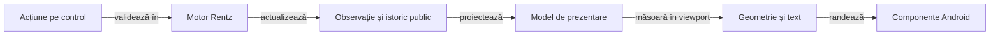

# ToDo: tabla Rentz și scorul general

## Scop și statut

**De implementat.** Documentul stabilește cerințele de prezentare și probele care le închid. Prototipul funcțional și un sanity trecut nu califică lizibilitatea tablei sau utilitatea istoricului complet.

| Prioritate | Semnificație |
|---|---|
| P1 | Necesar înainte de a prezenta interfața drept finisată și complet calificată. |
| P2 | Rafinare după corectitudinea informației, geometrie și accesibilitate. |

## Probleme constatate în cod și capturi

| Constatare | Sursă verificată | Efect pentru jucător |
|---|---|---|
| Tabla este construită din șiruri de text, ordonate după rang; nu există poziții stabile în jurul valetului. | [MainActivity](../../rentz-lab-app/app/src/main/java/ro/rentzlab/app/MainActivity.java), `render`; [tabla nativă](../../../../rentz_back/android-acceptance/20261106-003/native/checkpoint-04.png). | Cărțile se deplasează vizual când apar ranguri mici; frontierele și spațiile libere sunt greu de urmărit. |
| La calculul adversarilor se înlocuiește întregul ecran; la încheiere nu se mai desenează tabla. | `act` și `render`; [închiderea mâinii](../../../../rentz_back/android-acceptance/20261106-003/native/checkpoint-05.png). | Se pierde contextul mutărilor și nu se poate inspecta tabla finală înaintea distribuirii următoare. |
| Rezultatul mâinii este afișat prin reprezentarea unei liste de numere. | `render`, ramura terminală. | Punctele nu au nume sau locuri de sosire atașate explicit. |
| Istoricul repetă antete lungi și pune delta și totalul într-un singur text; nu fixează antetul sau prima coloană. | `history` și `cell`; [istoricul nativ](../../../../rentz_back/android-acceptance/20261106-003/native/checkpoint-06.png). | Se văd doar unele coloane; derularea nu oferă context suficient și comparația între jucători este greoaie. |
| UI omite alegătorul; `HandResult` nu păstrează locurile de sosire sau descompunerea punctajului. | [RentzMatch](../../rentz-lab-app/game-core/src/main/java/ro/rentzlab/core/RentzMatch.java): există `chooser`, dar UI îl omite; lipsesc sosirile și contribuțiile în înregistrarea istorică. | UI nu poate explica retrospectiv toate rezultatele; premiile egale nu identifică ordinea sosirilor. |

Capturile sunt dovezi ale build-ului identificat în [receipt-ul extern](../../../../rentz_back/android-acceptance/20261106-003/native/ui-result.json). Observațiile din sursă se reconfirmă pe codul live înaintea implementării; modificările paralele se păstrează.

## P1: Rentz organizat în jurul lui J

| ID și stare | Cerință și criteriu de acceptanță |
|---|---|
| **R01 · TODO** | **J trebuie să fie regula și ancora reală a modului cerut.** La patru jucători, motorul actual deschide deja din J. Pentru celelalte mese, opțiunea explicită „Valet mereu” trebuie propagată prin configurație, motor, observație, simulare, oracol și salvare; varianta existentă „Mijlocul pachetului” rămâne identificată distinct. Este interzis ca UI să arate J în timp ce motorul așteaptă Q, 10 sau 9. |
| **R02 · TODO** | **Patru rânduri stabile, câte unul pentru fiecare culoare.** J-urile se aliniază pe aceeași coloană; rangurile inferioare cresc către J, iar Q/K/A continuă după el. Fiecare carte depusă are loc determinist, independent de ordinea în care au fost jucate culorile. Nu afișați șiruri text care se rearanjează sau rup rândul arbitrar. |
| **R03 · TODO** | **Stări vizuale distincte.** Carte depusă, loc încă liber, culoare nedeschisă, ultima mutare și continuare legală au reprezentări explicabile. Slotul orientativ nu este carte jucată; indiciul de mutare folosește numai mâna proprie și legalitatea furnizată de motor. Nu dezvăluiți deținătorul cărților necunoscute. |
| **R04 · TODO** | **Tabla rămâne vizibilă și stabilă.** La calcul se blochează comenzile și se indică actorul, păstrând masa. La încheiere rămân tabla finală, sosirile și punctajul; abia comanda explicită de continuare distribuie următoarea mână. „Pas”, tura suplimentară și săritura au explicație scurtă, fără schimbarea ordinii rândurilor. |
| **R05 · TODO** | **Nu falsificați completarea tablei.** Afișați toate cărțile efectiv depuse și contorul lor. Modelul actual determină ultimul loc când ceilalți au terminat; pot rămâne cărți nejucate. Acestea nu se umplu automat în sloturi pentru o imagine „completă”. Orice schimbare a terminării este regulă separată, cu sursă și componente. |

Schema stabilește relația rangurilor, fără a reprezenta o distribuire de antrenament:

| Rând | Ranguri sub J | Ancoră | Ranguri peste J |
|---|---|---|---|
| ♣ | Rangurile active până la 10 | J♣ | Q♣, K♣, A♣ |
| ♦ | Rangurile active până la 10 | J♦ | Q♦, K♦, A♦ |
| ♥ | Rangurile active până la 10 | J♥ | Q♥, K♥, A♥ |
| ♠ | Rangurile active până la 10 | J♠ | Q♠, K♠, A♠ |

**Dependența critică R01:** [RentzBoard](../../rentz-lab-app/game-core/src/main/java/ro/rentzlab/core/RentzBoard.java) calculează acum deschiderea numai din numărul jucătorilor. [Memoria și eșantionarea](../../rentz-lab-app/game-core/src/main/java/ro/rentzlab/core/KnowledgeSampler.java), [căutarea](../../rentz-lab-app/game-core/src/main/java/ro/rentzlab/core/SearchPolicy.java) și [oracolul](../../atf-tests/src/main/java/atf/rentz/OfflineGameAudit.java) trebuie să consume aceeași variantă publică; o schimbare doar de etichetă sau de desen este insuficientă.

## P1: tabelă de scor elegantă și utilă

| ID și stare | Cerință și criteriu de acceptanță |
|---|---|
| **S01 · TODO** | **Clasament general lizibil pentru toți jucătorii.** Nume, total confirmat și poziție, cu egalități tratate explicit. Scorurile negative se ordonează numeric; zero nu este lipsă de date. Ordinea locurilor la masă rămâne stabilă în istoric, chiar dacă ordinea clasamentului se schimbă. |
| **S02 · TODO** | **Istoric complet, compact și navigabil.** O linie pentru fiecare mână încheiată; prima zonă arată numărul, sub-jocul, alegătorul și marcajul ×2. Fiecare jucător are un grup compact cu două valori: **Δ** pentru mâna respectivă și **Σ** pentru totalul cumulativ. Explicați simbolurile o singură dată. Rentz nu primește coloane de licitație sau obiective importate din alt joc. |
| **S03 · TODO** | **Antete și context păstrate la derulare.** Antetul jucătorilor rămâne vizibil vertical, iar identificarea mâinii rămâne vizibilă orizontal. Separatoare discrete între jucători, cifre aliniate la dreapta și spațiere măsurată după conținut; antetul nu ocupă lățimea prin repetarea „puncte / total”. Derularea orizontală este evidentă și ajunge până la ultimul jucător, fără celule inaccesibile sau suprapuse. |
| **S04 · TODO** | **Total confirmat versus mână în curs.** Punctele provizorii nu se adaugă încă o dată la total. O mână incompletă nu apare ca rezultat final; în Rentz, sosirea poate fi vizibilă înaintea decontării premiilor. La închidere, tabelul primește o singură linie, iar revenirea sau reluarea nu o dublează. |
| **S05 · TODO** | **Explicarea rezultatului.** Detaliul unei linii arată profilul, alegătorul, dublarea și contribuțiile relevante: levate, dame, carouri, K♥, 10♣ sau premiu de sosire. Q♦ în Totale este explicată în ambele categorii. Valoarea finală coincide cu înregistrarea motorului; UI nu inventează sau recalculează regulile de punctare. Rezumatul premiilor din meniu corespunde mesei de 3–6 jucători și profilului efectiv, fără o listă fixă pentru patru locuri. |
| **S06 · TODO** | **Date suficiente pentru istoric.** Păstrați public și imuabil ordinea sosirilor Rentz și contribuțiile necesare explicației. Nu deduceți locul din puncte: două locuri pot avea premii egale. Nu introduceți mâinile private sau seed-ul în modelul de prezentare; calificați restaurarea și compatibilitatea jurnalelor existente. |
| **S07 · TODO** | **Închidere cu identități, nu cu liste brute.** Rezumatul mâinii folosește nume, rezultat, delta și total pentru fiecare loc. Finalul partidei separă câștigătorii la egalitate de ordinea de afișare; scorul maxim câștigă și când toate totalurile sunt negative. |

## Arhitectură de prezentare și refolosire

Extrageți proiecțiile și geometria din `MainActivity`, păstrând un singur motor responsabil de reguli. Componentele de măsurare și de derulare se pot adapta din mecanismele existente, cu contracte Rentz proprii.

Legendă: desenul nu decide legalitatea sau scorul

Numele componentelor viitoare se stabilesc la implementare; diagrama nu afirmă că extragerea există deja. Proiecția poate formata date publice, iar geometria poate măsura spațiul, însă comanda rămâne validată de motor.

| Responsabilitate | Cerință de refolosire |
|---|---|
| Modelul tablei | Culoare, rang, stare și frontiere derivate din varianta efectivă. |
| Modelul scorului | Grupuri de jucători, meta-datele mâinii, Δ, Σ și detaliu public. |
| Măsurare | Viewport, insets și măsurător de text injectabile; fără dependență de un model de telefon. |
| Randare | Controale native și semantică accesibilă, separate de calculele de layout. |
| Continuitate | Selecție, poziție de derulare și masă păstrate între actualizări; fără reconstruirea unui ecran gol la fiecare calcul. |

## Componente înaintea extinderii E2E

| Familie | Cazuri și comparații obligatorii |
|---|---|
| Regula deschiderii | J la fiecare culoare, vecini legali și refuz atomic; mese de 3–6 jucători, opțiunea J și varianta mijloc separate. Aceeași configurație după reluare și în lumile AI. |
| Tabla | Culoare nedeschisă, numai J, extindere în ambele direcții, interval maxim, as, carte minimă, pas și ultimul loc. Reordonarea colecției de cărți nu schimbă geometria finală. |
| Limita închiderii | Tabla terminală păstrează exact cărțile publice, inclusiv spațiile rămase; nu apar cărți noi la intrarea în istoricul scorului. |
| Scor | Istoric gol, prima mână, program complet și reluare; delta zero, puncte negative, valori mari și premii egale. Pentru fiecare jucător, Σ este suma deltelor înregistrate. |
| Identități | Toate cele 3–6 locuri, nume scurte/lungi și diacritice; totalurile și sosirile nu se atașează altui jucător după sortare. |
| Geometrie | Limite în interiorul viewportului, fără intersecții; antete și grupuri corelate după derulare. Fiecare punct interactiv trimite o singură comandă legală, inclusiv după recalcularea dimensiunilor. |

| Parametru | Selecție pentru componente |
|---|---|
| Lățime utilă | 320, 360, 393, 412, 600 și 800 dp; o lățime în pixeli nu înlocuiește măsurarea în dp. |
| Orientare | Portret și peisaj, inclusiv spațiul redus de barele sistemului. |
| Scala fontului | 1,0 / 1,3 / 2,0. |
| Conținut | Mese de 3–6 jucători, opt cărți proprii, tablă completă și până la 48 de mâini în istoric. |

La limita lizibilității se alege un mod explicit de derulare sau o dispunere adaptată. Nu micșorați nelimitat textul și nu eliminați jucători, valori sau cărți pentru a face testul să treacă; țintele interactive păstrează minimum 48 × 48 dp, separat de cărțile doar informative, conform [recomandării Android pentru accesibilitate](https://developer.android.com/guide/topics/ui/accessibility/apps).

[Ghidul Android pentru layout-uri adaptive cu Views](https://developer.android.com/develop/ui/views/layout/responsive-adaptive-design-with-views) fundamentează adaptarea la spațiul disponibil. Dimensiunile matricei de mai sus sunt selecția de testare a proiectului, fără atribuire unui model de telefon.

## E2E minim și condiția de închidere

1. Componentele de proiecție, reguli și geometrie trec; măsurarea simulată este confruntată separat cu fontul și randarea Android reale.
2. O probă Rentz pornește din interfață și surprinde J-urile, extinderile, o frontieră relevantă și tabla păstrată la închidere. Stările pregătite pentru componente nu sunt prezentate drept joc real.
3. O probă de istoric derulează vertical și până la ultimul jucător, confruntă toate valorile vizibile și verifică revenirea și reluarea, fără linii duplicate.
4. Rularea păstrează extern identitatea APK-ului, configurația efectivă, expected/actual și capturile native originale inline base64 în stilul proiectului. O masă sau o rezoluție nu califică întreaga matrice.

**Ordine de lucru:** R01 și datele necesare → R02–R05 și S01–S07 prin componente → calibrare nativă → E2E selectiv → P2 pentru animații și finisaje. Bifați fiecare TODO numai cu implementare identificată, probe relevante și o verificare actuală a codului live.
