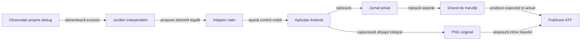

# Acceptanța aplicației Android locale

## Domeniu

Adaptorul nativ folosește motorul și jucătorii offline, cu profilul de laborator declarat. Aplicația locală și aplicația originală au pachete, date și calificări distincte; un succes local nu confirmă preset-urile sau interfața referinței.

## Admitere

| Poartă | Contract |
|---|---|
| Surse | Copie temporară, identitate SHA-256 și verificarea modificărilor concurente. |
| Componente | Motorul și sesiunea Android trec fără teste dezactivate. |
| APK | SHA-256, certificat, pachet și versiune identificabile înainte de instalare. |
| Resursă | Rezervare exclusivă atomică; fiecare comandă ADB verifică proprietarul. |
| Date | Fișierele interne de sesiune sunt arhivate și confruntate înaintea testului și după restaurare; APK-ul preexistent trebuie identificat exact. |
| Actualizare | Numai predecesor calificat, același certificat și date de sesiune goale. Alt binar sau o sesiune care cere migrare opresc actualizarea. |
| Afișaj | Configurația inițială este citită și confruntată la închidere, fără redimensionare implicită. |

[Build-ul izolat](../../scripts/build-rentz-android.ps1) se execută în afara surselor, cu SDK-ul și dependențele pregătite. Intrarea Gradle completă include `:game-core:test`, `:app:testDebugUnitTest` și `:app:assembleDebug`; intrarea `algorithm-build` rămâne disponibilă fără SDK.

## Acțiune și verificare

Legendă: observarea nu înlocuiește controlul interfeței

Fișierul debug este numai citit pentru sincronizare și decizie. Adaptorul nu injectează cărți, rezultate sau stări: noua partidă, alegerea sub-jocului și cărțile se comandă prin controale native. Jurnalul privat ajunge numai la oracol și registrul expunerii, niciodată la funcția de decizie.

## Livrabile și limite

- Sanity-ul UI comun instalează varianta izolată `ro.rentzlab.app.uisanity` și verifică meniul, profilul, limbile, o mână, istoricul și restart-ul. Opțiunea `-SeatExtremes` adaugă probele de afișaj la 3 și 6 locuri. [Lansatorul](../../atf-tests/tools/run-shared-ui-sanity.ps1) · [Protocolul integrării](ATF_UiIntegration.md)
- `-ConsecutiveSubgames` joacă cinci mâini consecutive în aceeași partidă. Segmentul începe cu Rentz și include cel puțin trei contracte distincte. Capturile compară chenarele la fiecare limită de mână, iar auditul verifică grila, istoricul după restart și jurnalul prin replay independent. Extent păstrează capturile Android native inline. Componentele acoperă 3–6 locuri, iar proba de release folosește patru locuri la profilul compact.
- Opțiunea `-HistoryOnly` verifică istoricul gol și încărcarea unui jurnal de 48 de mâini produs de componente. Gesturile urmăresc lățimea completă a ultimei coloane, apoi ultima mână, cu verificări de aliniere și de conservare a reviziei. Android califică gesturile și afișarea pe profilul executat, iar jocul din jurnal provine din execuția de componentă. [Contractul istoricului](ATF_UiIntegration.md#istoricul-adaptiv-rentz)
- `-HistoryOnly -HistoryMatrix` folosește fontul 1,5 la 360 dpi. Proba scurtează dialogul deschis, verifică schimbarea containerului derulabil și readuce fereastra la înălțimea inițială. Lansatorul salvează și restaurează dimensiunea, densitatea și fontul emulatorului în cadrul aceleiași rezervări. [Lansatorul](../../atf-tests/tools/run-shared-ui-sanity.ps1)
- Dialogul Android System UI permite cel mult două acțiuni **Wait** identificate din ierarhia de sistem. Fiecare acțiune păstrează captura și ierarhia, iar runnerul cere o observație proaspătă înainte de a evalua aplicația. Un dialog persistent oprește rularea cu `ANDROID_SYSTEM_UI_ANR` și dovezile capturate.
- Rezervarea reîncearcă un conflict de partajare pentru cel mult patru secunde. Eliberarea confruntă identificatorul și dispozitivul sub același lock exclusiv, iar erorile de curățare se păstrează separat.
- `-HistoryOnly -HistoryDetails` deschide două mâini din jurnalul restaurat pentru detaliile punctajului și revenirea în grilă. Receipt-ul buildului leagă jurnalul calificat de fixture prin SHA-256. Proba verifică profilul și premiile înregistrate. [Contractul detaliului](ATF_UiIntegration.md#detaliul-unei-mâini)

| Ce se verifică | Nivelul potrivit |
|---|---|
| Încadrarea levatei și a cărților în centru, pentru 3–6 locuri, fonturi și densități | Componente JVM cu dimensiuni măsurate controlat. Oracolul compară limita în pixeli cu dimensiunea din formula folosită de randare. |
| Cărțile rămase după finalul secvenței | Componenta confruntă sloturile afișate cu evenimentele publice de joc ale motorului. |
| Tranzițiile între contracte și reluarea sesiunii | Un traseu nativ cu cinci mâini. Dreptunghiurile locurilor și starea tablei se verifică în cadrele atașate aceluiași raport. |
| Raster, fonturi și gesturi | Probe native focalizate pe tabla Rentz sau istoricul compact, după zona modificată. |

[Lansatorul prototipului](../../atf-tests/tools/run-android-sanity.ps1) păstrează contractul UI anterior și refuză receipt-ul `card-table-ui-v1` înainte de ADB. Traseul actual folosește [oracolul Java](../../atf-tests/src/test/java/atf/rentz/android/RentzNativeFlow.java) pentru replay și confruntarea proiecției publice. U09 păstrează separat eventuala migrare a deciziei externe din suita veche.

| Livrabil sau limită | Contract |
|---|---|
| Compilare Maven | Adaptorul aparține source-set-ului de test; nu se compilează manual o copie Java din `tools`. |
| [Publicatorul UI](../../atf-tests/src/test/java/atf/rentz/android/reporting/RentzUiIntegrationReport.java) | Comparațiile componentelor sunt capturate când se evaluează. Pașii nativi includ acțiuni măsurate, assert-uri, PNG original și ierarhie inline; eticheta generică UI nu atribuie controlul Android către Playwright. |
| Descriptorul `native-runtime.json` | Numele complet al clasei, classpath explicit și identitatea sursei și clasei compilate; lansatorul verifică descriptorul și păstrează snapshot-ul calificat. |
| [Lifecycle](ATF_Lifecycle.md) | Checkpoint, proprietate și calcul de fundal; probele JVM preced calibrarea nativă pentru pauză, relansare și erori de filesystem. |
| Calificare | Compilarea și testarea CLI nu constituie execuție pe dispozitiv. |
| Dovezi externe | Comparații evaluate, acțiuni, capturi originale și identitatea binarului. |
| Populație | O distribuire nu califică toate sub-jocurile, partida completă, toate rezoluțiile sau fidelitatea față de referință. |
| Eroare | Dovezile sunt păstrate și verdictul rămâne eșuat. |
| Închidere | Eliberează numai tokenul propriu; nu suprascrie alt proprietar și nu resetează datele altor produse. |

Jurnalul numește versiunea regulilor separat de profilul numeric și politica jucătorului. Formatul vechi cunoscut poate fi reluat numai dacă toate comenzile rămân valide; o alegere incompatibilă oprește restaurarea și păstrează fișierul original.
