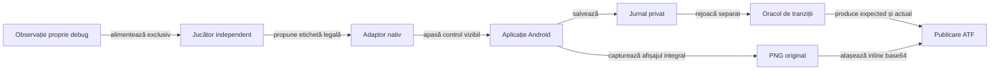

# Acceptanța aplicației Android locale

## Domeniu

Adaptorul nativ folosește motorul și jucătorii offline, cu profilul de laborator declarat. Aplicația locală și aplicația originală au pachete, date și calificări distincte; un succes local nu confirmă preset-urile sau interfața referinței.

## Admitere

| Poartă | Contract |
|---|---|
| Surse | Copie temporară, identitate SHA-256 și verificarea modificărilor concurente. |
| Componente | Motorul și sesiunea Android trec fără teste dezactivate. |
| APK | SHA-256, certificat, pachet și versiune identificabile înainte de instalare. |
| Resursă | Rezervare exclusivă atomică; fiecare comandă ADB verifică proprietarul. |
| Date | Fișierele interne de sesiune sunt arhivate și confruntate înaintea testului și după restaurare; APK-ul preexistent trebuie identificat exact. |
| Actualizare | Numai predecesor calificat, același certificat și date de sesiune goale. Alt binar sau o sesiune care cere migrare opresc actualizarea. |
| Afișaj | Configurația inițială este citită și confruntată la închidere, fără redimensionare implicită. |

[Build-ul izolat](../../scripts/build-rentz-android.ps1) se execută în afara surselor, cu SDK-ul și dependențele pregătite. Intrarea Gradle completă include `:game-core:test`, `:app:testDebugUnitTest` și `:app:assembleDebug`; intrarea `algorithm-build` rămâne disponibilă fără SDK.

## Acțiune și verificare

Legendă: observarea nu înlocuiește controlul interfeței

Fișierul debug este numai citit pentru sincronizare și decizie. Adaptorul nu injectează cărți, rezultate sau stări: noua partidă, alegerea sub-jocului și cărțile se comandă prin controale native. Jurnalul privat ajunge numai la oracol și registrul expunerii, niciodată la funcția de decizie.

## Livrabile și limite

[Lansatorul nativ](../../atf-tests/tools/run-android-sanity.ps1) cere calificarea componentelor și a APK-ului, apoi verifică o distribuire completă, istoricul și reluarea după repornirea procesului. [Adaptorul Java](../../atf-tests/src/test/java/atf/rentz/android/RentzNativeFlow.java) separă modurile de decizie, audit și publicare prin biblioteca declarată în `lib`.

| Livrabil sau limită | Contract |
|---|---|
| Compilare Maven | Adaptorul aparține source-set-ului de test; nu se compilează manual o copie Java din `tools`. |
| Descriptorul `native-runtime.json` | Numele complet al clasei, classpath explicit și identitatea sursei și clasei compilate; lansatorul verifică descriptorul și păstrează snapshot-ul calificat. |
| [Lifecycle](ATF_Lifecycle.md) | Checkpoint, proprietate și calcul de fundal; probele JVM preced calibrarea nativă pentru pauză, relansare și erori de filesystem. |
| Calificare | Compilarea și testarea CLI nu constituie execuție pe dispozitiv. |
| Dovezi externe | Comparații evaluate, acțiuni, capturi originale și identitatea binarului. |
| Populație | O distribuire nu califică toate sub-jocurile, partida completă, toate rezoluțiile sau fidelitatea față de referință. |
| Eroare | Dovezile sunt păstrate și verdictul rămâne eșuat. |
| Închidere | Eliberează numai tokenul propriu; nu suprascrie alt proprietar și nu resetează datele altor produse. |

Jurnalul numește versiunea regulilor separat de profilul numeric și politica jucătorului. Formatul vechi cunoscut poate fi reluat numai dacă toate comenzile rămân valide; o alegere incompatibilă oprește restaurarea și păstrează fișierul original.
