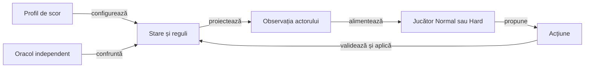
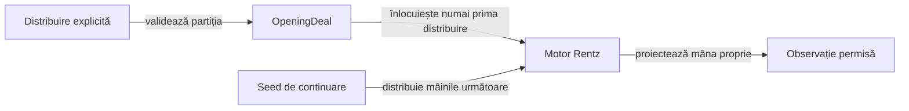

# Arhitectura domeniului Rentz

## Limite

Motorul Java nu depinde de Android, de publicarea HTML sau de algoritmul aplicației originale. Testarea ATF folosește JDK 21; modelul este compilat pentru Java 17 și are și o intrare Gradle exclusiv JVM.

Legendă: actorul și oracolul au intrări distincte

Motorul deține distribuirea completă. Politica primește numai mâna actorului și faptele publice; oracolul poate folosi informație suplimentară fără a o transmite politicii.

| Componentă | Contract |
|---|---|
| `Card`, `Contract` | Pachet și vocabularul celor opt sub-jocuri. |
| `OpeningDeal` | Partiție imuabilă și completă a pachetului pentru o primă distribuire controlată. |
| `TrickRules` | Legalitate și câștigător fără atu. |
| `RentzBoard` | Deschidere și extindere contiguă pe culori. |
| `ScoreProfile` | Punctaj, cumul și protecție numerică. |
| `RentzMatch` | Faze, alegător, rotație, refuz, închidere și istoric. |
| `Observation` | Mână proprie, dimensiuni adverse, masă și evenimente publice. |
| `LabPolicy` | Reper determinist și explicabil, fără calificare expert. |
| `RentzPlayer`, `TacticalPolicy`, `SearchPolicy` | Port Normal/Hard, tactică publică și compararea alternativelor pe lumi comune. |
| `KnowledgeSampler`, `PolicySettings` | Distribuiri ipotetice fezabile și buget/ponderi distincte de regulile de scor. |
| `RuleProfiles` | Citire strictă a profilului YAML în infrastructura JVM. |
| `RuleCatalog` | Proveniență parțială și legături ale manifestului către API-ul și declarațiile de test curente. |
| `OfflineArena`, `EvaluationRegistry` | Jocuri complete CPU, comparare pereche, expunerea datelor și retenția externă. |
| `GameSession`, `SessionJson` | Comenzi ale adaptorului Android, jurnal privat reproductibil și observație publică serializată separat. |
| `SavedJson` | Cititor strict comun JVM/Android; document unic și numere exacte înaintea validării formei și rejucării comenzilor. |
| `MainActivity`, `RentzApplication` | Prezentare nativă și compoziția unui repository unic în proces; fără calcul AI sau scriere directă în activitate. |
| `SessionController`, `SessionRepository`, `FileSessionStorage` | Checkpoint, copie separată, proprietar revocabil și înlocuire atomică; [contractul de lifecycle](ATF_Lifecycle.md) deține intercalările. |

## Memoria publică

Pachetul `ro.rentzlab.core` deține modelul și regulile, iar `ro.rentzlab.ai` deține politicile și inferența. AI consumă observația motorului; motorul nu importă politica. [Inventarul Java](../../config/java-source-layout.json) și guvernanța permanentă protejează această direcție și rădăcinile Maven/Android.

Înaintea dezvăluirii, mâna proprie poate fi ascunsă pentru alegerea pe nevăzute. În joc, observația conține mâna actorului, dimensiunile adverse, angajamentul pe nevăzute, punctele mâinii, totalurile, ordinea sosirilor și evenimentele publice; seed-ul și mâinile adverse nu sunt câmpuri ale observației. Listele sunt copii imuabile, astfel încât mutările ulterioare nu rescriu o observație deja primită.

Evenimentul păstrează actorul, acțiunea, cartea și dimensiunea tablei înaintea acțiunii. Un pas descrie frontiera din acel moment; alte mutări pot deschide continuări noi, deci pasul nu dovedește imposibilitatea permanentă de a juca.

## Configurație și trasabilitate

| Intrare | Consumator | Contract |
|---|---|---|
| [Punctaj](../../config/rentz-score-profiles.yaml) | `RuleProfiles` → `ScoreProfile` | Configurație executabilă, tipizată, cu identitate de laborator și probă de paritate cu fabrica Java. |
| [Manifest](../../config/rentz-rules.yaml) | `RuleCatalog.claims` și auditul legăturilor | Statut, proveniență și referințe către implementare și componente; nu interpretează strategie. |
| [Observații](../../config/rentz-reference-observations.yaml) | `RuleCatalog.evidence` | Informație numerică parțială despre sursă, cu necunoscute păstrate; nu produce profil executabil. |

Toate intrările refuză chei duplicate, câmpuri necunoscute și documente YAML suplimentare. Schimbarea unei reguli cere reconcilierea codului, componentelor și statutului; auditul legăturilor nu demonstrează semantic adevărul regulii sau execuția testului indicat.

## Distribuiri controlate

Legendă: fixture-ul aparține constructorului și oracolului

Fiecare loc are opt cărți, iar reuniunea lor este exact pachetul mesei, fără duplicate sau cărți lipsă. Copiile sunt imuabile; actorul nu primește obiectul distribuirii și nu vede cărți prin alegerea pe nevăzute.

`fromOpeningDeal` permite cazuri mici și reproductibile fără editarea stării interne, rezultate injectate sau interfață Android. Seed-ul de continuare afectează numai distribuirile ulterioare; cunoașterea fixture-ului de către oracol nu se transmite politicii și nu califică forța ei de joc.

## Adaptorul Android

Compoziția, geometria și auditul sunt limite separate ale adaptorului nativ. Alegerile sub-jocurilor, tabla, scorul și observațiile au semantica Rentz; atuul, licitațiile și seriile Whist nu devin reguli reutilizate.

Compatibilitatea Android se califică pe API-ul și runtime-ul efectiv. Testele JVM nu confirmă disponibilitatea metodelor Java pe dispozitiv sau randarea WebView ori nativă; [protocolul evoluției](ATF_Learning.md) separă politicile, arena și admiterea E2E.

| Limită de sesiune | Contract |
|---|---|
| Restaurare | Repetă comenzile acceptate, cu aceeași identitate de profil și politică. |
| Proiecție debug | Exclude seed-ul și mâinile adverse; [protocolul Android](ATF_Android.md) separă intrările jucătorului și oracolului. |
