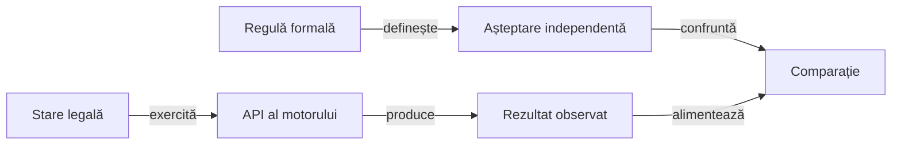

# Componentele și porțile de calificare Rentz

## Alegerea nivelului

O regulă se verifică prin API-ul minim care îi observă efectul. Partida virtuală verifică integrarea motorului și terminarea. [Strategia de testare](ATF_TestingStrategy.md) descrie criteriile pentru mutarea verificărilor dintre niveluri.

| Familie | Proprietăți și frontiere | Sursă |
|---|---|---|
| Masă și pachet | Populație, unicitate, ranguri și deschidere pentru fiecare număr de jucători. | [RentzRulesTest](../../rentz-lab-app/game-core/src/test/java/ro/rentzlab/core/RentzRulesTest.java) |
| Levate | Culoare obligatorie, aruncare fără atu și câștigătorul culorii cerute. | [TrickRules](../../rentz-lab-app/game-core/src/main/java/ro/rentzlab/core/TrickRules.java) și componentele regulilor. |
| Punctaj | Cumul, Q♦ cu două categorii, dublare unică și scor cumulativ. | [ScoreProfile](../../rentz-lab-app/game-core/src/main/java/ro/rentzlab/core/ScoreProfile.java) |
| Atribuire independentă | Fiecare sub-joc cu levate, scor pe capturator, fond total, opțiunea pe nevăzute și prioritatea închiderii; sosiri și ultima mână rămasă în secvențe. | [RentzSettlementTest](../../rentz-lab-app/game-core/src/test/java/ro/rentzlab/core/RentzSettlementTest.java) |
| Secvențe | Deschidere, vecinătate, duplicate, pas, as, carte minimă și actori terminați. | [RentzSequenceTest](../../rentz-lab-app/game-core/src/test/java/ro/rentzlab/core/RentzSequenceTest.java) |
| Faze | Alegere consumată o dată, refuz fără mutație, închidere unică, resetarea faptelor mâinii și număr terminal corect. | Componentele sesiunii și atribuirii. |
| Frontiere controlate | As fără continuare, carte nepermisă ori străină, alegere consumată, refuzul ultimei alegeri pe nevăzute, profil nul și distribuire fixă izolată. | [RentzBoundaryTest](../../rentz-lab-app/game-core/src/test/java/ro/rentzlab/core/RentzBoundaryTest.java) |
| Informație | Mână proprie, dimensiuni adverse și evenimente publice cu actorul păstrat. | [Contractele ATF](../../atf-tests/src/test/java/atf/rentz/RentzRuleComponentTest.java) și componentele evenimentelor. |
| Profil YAML | Paritate tipizată, duplicate, câmpuri necunoscute, tip greșit și statut necalificat. | `RentzRuleComponentTest` și [RuleProfiles](../../atf-tests/src/main/java/atf/rentz/RuleProfiles.java) |
| Proveniență și trasabilitate | Observații parțiale care nu devin preset, necunoscut diferit de zero, document unic, API și declarație de test existente. | [RuleCatalog](../../atf-tests/src/main/java/atf/rentz/RuleCatalog.java) și componentele ATF. |
| Politici | Ținte negative, câștigător economic, lanț propriu, as, lumi compatibile și aceeași decizie pentru aceeași observație permisă. | [RentzAiTest](../../rentz-lab-app/game-core/src/test/java/ro/rentzlab/core/RentzAiTest.java) |
| Strategie de partidă | Obiective distincte, egalități, registru public, portofoliu rămas și aceeași decizie în lumi reale ascunse diferite. | [RentzMatchStrategyTest](../../rentz-lab-app/game-core/src/test/java/ro/rentzlab/core/RentzMatchStrategyTest.java) |
| Rafinarea Hard | Penalitate locală, captură publică demonstrată, necunoscut păstrat, model advers separat și buget oprit simetric. | [RentzHardRefinementTest](../../rentz-lab-app/game-core/src/test/java/ro/rentzlab/core/RentzHardRefinementTest.java) |
| Incertitudine | Agregare pe distribuire, rotații complete, obiectiv primar și refuzul promovării fără progres calificat. | [ClusteredEvaluationTest](../../atf-tests/src/test/java/atf/rentz/evaluation/ClusteredEvaluationTest.java) și poarta arenei. |
| Portabilitate API | Garda statică refuză fabricile `List/Set/Map.of/copyOf` în motorul fără core-library desugaring; nu este inventarul complet al API-urilor Android. | [SourceLayoutTest](../../atf-tests/src/test/java/atf/rentz/governance/SourceLayoutTest.java); runtime-ul nativ se califică separat. |
| Evaluare offline | Refuzul datelor expuse, registru corupt sau concurent, oracol negativ și jurnale private numai pentru rolul evaluat. | [OfflineArenaComponentTest](../../atf-tests/src/test/java/atf/rentz/OfflineArenaComponentTest.java) |
| Registru strict | Proprietăți duplicate la orice nivel, tipuri coercibile, câmpuri incompatibile și conținut suplimentar; refuz fără schimbarea octeților și păstrarea expunerii în vecinul valid. | [EvaluationRegistryValidationTest](../../atf-tests/src/test/java/atf/rentz/EvaluationRegistryValidationTest.java) |
| Partidă virtuală | Conservare, epuizarea alegerilor, rotație, scor și limită de acțiuni. | Cazurile generate din `RentzRulesTest`. |
| UI Rentz fără dispozitiv | Meniu RO/EN, profil, reveal, selecție legală, actor, secvențe, scor, restaurare și callback-uri depășite; comparații capturate în execuție. | [Componente UI](../../rentz-lab-app/app/src/test/java/ro/rentzlab/app/ui/) și [atlas](../../rentz-lab-app/app/src/main/java/ro/rentzlab/app/ui/README.md). |
| Istoric adaptiv fără dispozitiv | Dimensiuni pe 3–6 locuri, valori cu semn, legendă pe mai multe rânduri și 288 de perechi Δ/Σ din 48 de mâini. Codec-ul reface jurnalul folosit de sanity. | [Componentele istoricului](../../rentz-lab-app/app/src/test/java/ro/rentzlab/app/ui/score/) și [contractul grilei](../../rentz-lab-app/app/src/main/java/ro/rentzlab/app/ui/score/README.md). |
| Selectori nativi fără dispozitiv | Item AdapterView neclickabil, vecin dezactivat, text pasiv și ținte ambigue. | [Probele selectorilor](../../atf-tests/tools/test-ui-selectors.ps1). |
| Sesiune Android fără dispozitiv | Refuz fără jurnalizare, proiecție proprie, reluare deterministă, identități incompatibile și eligibilitatea pe nevăzute la ultima alegere. | [GameSessionTest](../../rentz-lab-app/app/src/test/java/ro/rentzlab/app/GameSessionTest.java), executat prin Gradle. |
| Codec fără dispozitiv | Document unic strict, tipuri și domenii numerice exacte, payload de comandă, format vechi explicit și restaurare validă. | [SessionJsonValidationTest](../../rentz-lab-app/app/src/test/java/ro/rentzlab/app/SessionJsonValidationTest.java), executat prin Gradle. |
| Infrastructură fără dispozitiv | Descoperirea scripturilor, citiri TEMP cu domeniu explicit, API-uri alternative și linkuri refuzate fără urmărire. | [Controale PowerShell](../../atf-tests/tools/test-workspace-governance.ps1), incluse de lansator înaintea Maven. |
| Lifecycle fără dispozitiv | Checkpoint durabil, pauză, proprietar înlocuit, calcul necooperant, callback întârziat și refuz IO fără adoptarea candidatului. | [Componente de lifecycle](../../rentz-lab-app/app/src/test/java/ro/rentzlab/app/lifecycle/) și [contractul](ATF_Lifecycle.md). |
| CLI nativ fără dispozitiv | Proces Java real pentru decizie publică, audit, expunere și erori; transport Unicode și scor public corupt confruntat cu vecinul valid. | [RentzNativeFlowTest](../../atf-tests/src/test/java/atf/rentz/android/RentzNativeFlowTest.java). |
| Guvernanță Java | Inventar complet, pachet și cale, coeziune fără derogări, importuri și direcția model–AI. | [SourceLayoutTest](../../atf-tests/src/test/java/atf/rentz/governance/SourceLayoutTest.java). |
| Adopție binară | Perechi fizice, proveniență, CodeSource, refuzuri și contracte publice. | [Componentele bibliotecilor](../../atf-tests/src/test/java/atf/rentz/libraries/). |
| Publicare | Temporizare, diagnostic, faze de eroare, cauze combinate și artefacte Extent/fallback. | [Adaptorul și probele sale](../../atf-tests/src/test/java/atf/rentz/RentzRulePublicationTest.java). |
| Selecție și proces | Populație explicită, proprietar schimbat, timeout, captură nouă și cleanup. | [Controale runtime](../../atf-tests/tools/test-runtime-controls.ps1). |

[Politica sursei](../../config/java-source-layout.json) declară modulele și rădăcinile mixte, plus metadatele, materialele istorice și arborii generați excluși explicit. Un director generat este exclus prin calea sa completă; un pachet Java cu același nume rămâne guvernat. Orice Java activ din afara rădăcinilor este refuzat, iar `tools` nu devine un source-set compilat prin simpla prezență a unui fișier.

## Oracol și control negativ



<details>
<summary>Legendă: modelul nu își votează corectitudinea</summary>

Suma cumulativă, cardurile conservate și refuzul unei comenzi au proprietăți independente. O medie de joc, o alegere a botului sau simplul acord cu aceeași funcție auxiliară nu justifică singure rezultatul așteptat.

</details>

- Pentru cumul, așteptarea păstrează separat fiecare contribuție și factorul pe nevăzute.
- Pentru atribuire, oracolul recalculează câștigătorul, contribuția și fondul total, fără apel la funcțiile de punctare ori câștigător ale motorului. Profilul cu valori distincte detectează și confundarea contribuțiilor.
- Pentru as și carte minimă, oracolul urmărește locurile eligibile după mutare, inclusiv revenirea la actor cu doi jucători rămași.
- Pentru refuz, captura observației de dinainte trebuie să fie egală cu cea de după eroare.
- Distribuirile controlate verifică toate observațiile și istoricul după refuz; nu se limitează la mâna actorului care a emis comanda.
- Pentru terminare, limita de acțiuni detectează buclele, iar istoricul verifică alegerea fiecărui sub-joc o singură dată.
- Efectele speciale ale secvențelor nu se aplică în celelalte sub-jocuri; această frontieră are componentă separată.

## Execuție

Din rădăcina proiectului, în PowerShell 7, cu JDK 21, Maven, SDK Android și cache-urile pregătite:

```powershell
.\scripts\run-rentz-components.ps1 -Collection regression
```

Lansatorul copiază sursele și bibliotecile, verifică populațiile Maven și Android JVM și păstrează XML-urile în afara proiectului. [Calificarea offline](ATF_Qualification.md) deține colecțiile și porțile; Test Kit înregistrează comparațiile efectiv evaluate, iar [publicatorul](../../atf-tests/src/test/java/atf/rentz/RentzRulePublication.java) transmite rezultatul bibliotecii Extent.

| Dovadă | Ce poate verifica cititorul |
|---|---|
| `component-suite-extent.html` | Suitele și cazurile din XML-urile Maven și Android JVM, cu identități, totaluri, verdict și amprentele XML. |
| `release-contracts/documentation-governance.html` | Comparațiile efective ale controalelor de documentație, inclusiv diagnosticul unei legături neportabile și vecinul valid. |
| Rapoartele contractelor de domeniu și release | Așteptarea, rezultatul observat și diagnosticul capturate de adaptorul Test Kit în testele care îl folosesc. |

Distribuirile generate păstrează identitatea testului care le exercită. XML-ul reflectă populația executabilă, iar rapoartele de contract explică oracolul și comparațiile efective.

## Interpretarea rezultatului

| Rezultat | Ce califică | Frontieră |
|---|---|---|
| Componentă verde | Contractul modelat în domeniul ei. | Nu confirmă preset-ul original, grafica, funcțiile comerciale sau nivelul expert. |
| Distribuiri generate | Regresia proprietăților motorului. | Nu sunt loturi rezervate de antrenare; învățarea cere identități și partiții proprii. |
| Auditul manifestului | Clasă deținătoare și declarație de test eligibilă, cu mutanți negativi. | Nu dovedește execuția testului, independența oracolului sau adevărul sursei. |

Statutul din [manifest](../../config/rentz-rules.yaml) se schimbă numai cu probă nouă. [Arhitectura](ATF_Architecture.md) separă sursa, configurația, observația și evaluarea jucătorilor.

Pentru alt joc, păstrați forma verificării: precondiție minimă, acțiune, rezultat calculat separat și un control negativ care arată ce respinge oracolul. [Planul de transfer](ATF_Transfer.md#aplicare-la-holdem) arată cum se aplică această formă la Hold’em.
