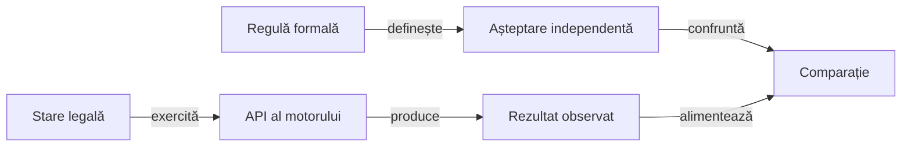

# Componentele care verifică regulile Rentz

## Alegerea nivelului

O regulă se verifică prin API-ul minim care îi observă efectul. Partida virtuală verifică integrarea motorului și terminarea; nu este o partidă nouă prin interfața aplicației originale.

| Familie | Proprietăți și frontiere | Sursă |
|---|---|---|
| Masă și pachet | Populație, unicitate, ranguri și deschidere pentru fiecare număr de jucători. | [RentzRulesTest](../../rentz-lab-app/game-core/src/test/java/ro/rentzlab/core/RentzRulesTest.java) |
| Levate | Culoare obligatorie, aruncare fără atu și câștigătorul culorii cerute. | [TrickRules](../../rentz-lab-app/game-core/src/main/java/ro/rentzlab/core/TrickRules.java) și componentele regulilor. |
| Punctaj | Cumul, Q♦ cu două categorii, dublare unică și scor cumulativ. | [ScoreProfile](../../rentz-lab-app/game-core/src/main/java/ro/rentzlab/core/ScoreProfile.java) |
| Atribuire independentă | Fiecare sub-joc cu levate, scor pe capturator, fond total, opțiunea pe nevăzute și prioritatea închiderii; sosiri și ultima mână rămasă în secvențe. | [RentzSettlementTest](../../rentz-lab-app/game-core/src/test/java/ro/rentzlab/core/RentzSettlementTest.java) |
| Secvențe | Deschidere, vecinătate, duplicate, pas, as, carte minimă și actori terminați. | [RentzSequenceTest](../../rentz-lab-app/game-core/src/test/java/ro/rentzlab/core/RentzSequenceTest.java) |
| Faze | Alegere consumată o dată, refuz fără mutație, închidere unică, resetarea faptelor mâinii și număr terminal corect. | Componentele sesiunii și atribuirii. |
| Frontiere controlate | As fără continuare, carte nepermisă ori străină, alegere consumată, refuzul ultimei alegeri pe nevăzute, profil nul și distribuire fixă izolată. | [RentzBoundaryTest](../../rentz-lab-app/game-core/src/test/java/ro/rentzlab/core/RentzBoundaryTest.java) |
| Informație | Mână proprie, dimensiuni adverse și evenimente publice cu actorul păstrat. | [Contractele ATF](../../atf-tests/src/test/java/atf/rentz/RentzRuleComponentTest.java) și componentele evenimentelor. |
| Profil YAML | Paritate tipizată, duplicate, câmpuri necunoscute, tip greșit și statut necalificat. | `RentzRuleComponentTest` și [RuleProfiles](../../atf-tests/src/main/java/atf/rentz/RuleProfiles.java) |
| Proveniență și trasabilitate | Observații parțiale care nu devin preset, necunoscut diferit de zero, document unic, API și declarație de test existente. | [RuleCatalog](../../atf-tests/src/main/java/atf/rentz/RuleCatalog.java) și componentele ATF. |
| Politici | Ținte negative, câștigător economic, lanț propriu, as, lumi compatibile și aceeași decizie pentru aceeași observație permisă. | [RentzAiTest](../../rentz-lab-app/game-core/src/test/java/ro/rentzlab/core/RentzAiTest.java) |
| Evaluare offline | Refuzul datelor expuse, registru corupt sau concurent, oracol negativ și jurnale private numai pentru rolul evaluat. | [OfflineArenaComponentTest](../../atf-tests/src/test/java/atf/rentz/OfflineArenaComponentTest.java) |
| Partidă virtuală | Conservare, epuizarea alegerilor, rotație, scor și limită de acțiuni. | Cazurile generate din `RentzRulesTest`. |
| Sesiune Android fără dispozitiv | Refuz fără jurnalizare, proiecție proprie, reluare deterministă, identități incompatibile și eligibilitatea pe nevăzute la ultima alegere. | [GameSessionTest](../../rentz-lab-app/app/src/test/java/ro/rentzlab/app/GameSessionTest.java), executat prin Gradle. |

## Oracol și control negativ



<details>
<summary>Legendă: modelul nu își votează corectitudinea</summary>

Suma cumulativă, cardurile conservate și refuzul unei comenzi au proprietăți independente. O medie de joc, o alegere a botului sau simplul acord cu aceeași funcție auxiliară nu justifică singure rezultatul așteptat.

</details>

- Pentru cumul, așteptarea păstrează separat fiecare contribuție și factorul pe nevăzute.
- Pentru atribuire, oracolul recalculează câștigătorul, contribuția și fondul total, fără apel la funcțiile de punctare ori câștigător ale motorului. Profilul cu valori distincte detectează și confundarea contribuțiilor.
- Pentru as și carte minimă, oracolul urmărește locurile eligibile după mutare, inclusiv revenirea la actor cu doi jucători rămași.
- Pentru refuz, captura observației de dinainte trebuie să fie egală cu cea de după eroare.
- Distribuirile controlate verifică toate observațiile și istoricul după refuz; nu se limitează la mâna actorului care a emis comanda.
- Pentru terminare, limita de acțiuni detectează buclele, iar istoricul verifică alegerea fiecărui sub-joc o singură dată.
- Efectele speciale ale secvențelor nu se aplică în celelalte sub-jocuri; această frontieră are componentă separată.

## Execuție

Din rădăcina proiectului, cu JDK 21, Maven și cache pregătit:

```powershell
.\scripts\run-rentz-components.ps1
```

Lansatorul copiază sursele și bibliotecile, verifică identitățile și păstrează XML-urile în afara proiectului. Test Kit înregistrează comparațiile efectiv evaluate, iar [publicatorul](../../atf-tests/src/test/java/atf/rentz/RentzRulePublication.java) transmite rezultatul bibliotecii Extent, fără renderer local.

XML-urile păstrează întreaga populație executată. Raportul narativ publică selecția de contracte ATF auditate, fără multiplicarea fiecărei distribuiri generate într-un scenariu separat; populațiile și scopurile nu se confundă.

## Interpretarea rezultatului

| Rezultat | Ce califică | Frontieră |
|---|---|---|
| Componentă verde | Contractul modelat în domeniul ei. | Nu confirmă preset-ul original, grafica, funcțiile comerciale sau nivelul expert. |
| Distribuiri generate | Regresia proprietăților motorului. | Nu sunt loturi rezervate de antrenare; învățarea cere identități și partiții proprii. |
| Auditul manifestului | Clasă, metodă publică și declarație de test existente, cu mutanți negativi. | Nu dovedește execuția testului, independența oracolului sau adevărul sursei. |

Statutul din [manifest](../../config/rentz-rules.yaml) se schimbă numai cu probă nouă. [Arhitectura](ATF_Architecture.md) separă sursa, configurația, observația și evaluarea jucătorilor.
