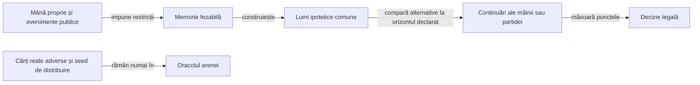
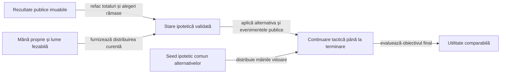
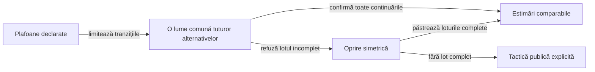

# Construirea și evaluarea jucătorilor Rentz

## Domeniu și limite

Jucătorii urmăresc punctele profilului configurat, cu mâna proprie și informația publică. Modelul de reguli rămâne separat de strategie; paritatea cu preset-urile aplicației originale este [criteriu deschis](ATF_RuleSources.md).

| Politică | Alegerea sub-jocului | Alegerea cărții |
|---|---|---|
| Reper păstrat, `LabPolicy` | Estimare simplă după rangul propriu. | Rang minim în negative și maxim în pozitive ori secvențe. |
| Normal, `RentzPlayer` | Reperul simplu de alegere, cu limita declarată. | Reguli tactice publice, fără lumi adverse simulate. |
| Hard, `RentzPlayer` | Compară jocurile disponibile pe aceleași lumi ipotetice. | Mutare forțată, regulă publică a asului sau comparație prin continuarea mâinii. |

Hard este un mod de joc cu buget explicit, nu o declarație de optimalitate. [Politica implicită](../../config/rentz-policy.yaml) păstrează reperul; profilurile offline separă dovada locală de euristici și de orizontul complet, fără înlocuirea fabricii produsului înaintea calificării.

| Profil | Mecanism evaluat |
|---|---|
| [Hard cu dovadă publică](../../config/rentz-hard-policy.yaml) | Păstrează tactica legacy și închide numai captura demonstrabilă a țintei la obiectivul mâinii. |
| [Contextual experimental](../../config/rentz-contextual-policy.yaml) | Adaugă costul cărții și eliminarea penalității în continuarea proprie; o regulă locală corectă poate avea efect strategic negativ. |
| [Partidă experimentală](../../config/rentz-match-policy.yaml) | Evaluează obiectivul terminal cu bugete aliniate; nu este implicitul produsului. |

| Obiectiv explicit | Orizont și utilitate | Limită |
|---|---|---|
| `HAND_MARGIN` | Finalul mâinii: puncte proprii minus media adversarilor. | Nu folosește poziția în clasamentul final. |
| `MATCH_POINTS` | Finalul partidei: totalul propriu. | Maximizarea punctelor poate alege alt risc decât câștigarea partidei. |
| `MATCH_WIN_SHARE` | Finalul partidei: unu împărțit între liderii egali, zero pentru ceilalți. | Frecvență condiționată de lumile și continuarea simulate, fără probabilitate reală calibrată. |

## Informația permisă



<details>
<summary>Legendă: lumi ipotetice, nu secrete ale mesei reale</summary>

Politica primește `Observation`, nu `RentzMatch`, generatorul sau fișierele arenei. Simulatorul poate urmări consecințele unei distribuiri ipotetice; aceasta nu devine observație a cărților reale adverse.

</details>

| Fapt public | Restricția folosită | Limită |
|---|---|---|
| Carte jucată | Este eliminată din necunoscute și atribuită actorului public. | Nu se elimină altă carte de același rang. |
| Aruncare în afara culorii cerute | Actorul nu mai poate avea acea culoare în cărțile rămase. | O culoare pe care nu a fost obligat să o urmeze nu devine automat absentă. |
| Pas în Rentz | Actorul nu putea avea o carte jucabilă la tabla din acel moment. | Continuările deschise ulterior rămân posibile. |
| Dimensiunea mâinii | Limitează capacitatea fiecărui loc. | Nu identifică rangurile singură. |
| Istoric public al mâinilor | Reface totalurile, rotația și sub-jocurile rămase fiecărui alegător. | Nu reconstruiește cărțile reale adverse sau seed-ul real. |

`KnowledgeSampler` folosește potrivire între cărți și locuri disponibile, cu ordine aleatorizată. Distribuirile respectă restricțiile și sunt reluate pe istoricul public; uniformitatea, probabilitățile calibrate și intențiile adversarului nu sunt demonstrate de această construcție.

## Reguli tactice și ponderi

| Context | Mecanism | Tip |
|---|---|---|
| Negativ, actor fără culoarea cerută | Aruncă o contribuție penalizată; departajează prin puterea eliminată. | Regulă locală. |
| Negativ, carte sigur pierzătoare | Candidatul elimină întâi contribuția penalizată, apoi puterea; reperul păstrează rangul maxim. | Preferință locală, fără etichetă de optimalitate globală. |
| Negativ, ultimul actor obligat să câștige | Candidatul minimizează costul propriei cărți, apoi elimină puterea mare la cost egal. | Penalitatea deja pe masă este aceeași pentru toate alternativele. |
| Zece de treflă cu dovadă publică | Fără treflă mai mare necunoscută în afara mâinii, folosește ieșirea câștigătoare și capturează ținta. | În `HAND_MARGIN`, dovada închide decizia fără sampling; nu certifică orizontul complet. |
| Whist pozitiv, ultimul loc | Câștigă cu cel mai mic câștigător disponibil. | Rang verificabil în levata completată. |
| Zece de treflă, levată imposibil de câștigat | Păstrează ținta dacă există altă aruncare legală. | Regulă locală, fără promisiune de captură viitoare. |
| Secvențe | Ponderează cărțile proprii conectate, frontierele eliberate și apropierea actorului sărit de terminare. | Caracteristici recalculate din context. |
| As legal în secvențe | Elimină asul cu tură suplimentară, păstrând celelalte continuări legale. | Scurtătură publică, în varianta laboratorului. |

Coeficienții din `PolicySettings` sunt fixați de candidat. Contextul se schimbă după mutări; coeficienții nu se rescriu automat după o victorie sau înfrângere.

| Intrare | Consum efectiv |
|---|---|
| YAML de strategie | `PolicyInputs` verifică schema, parametrii și legăturile către cod/teste. Schema reperului are probă de paritate cu fabrica; schema candidatului declară separat obiectivul complet. |
| Arena JVM | Protocolul fixează fișierul de politică, obiectivul, bugetul și familiile înainte de expunerea datelor. `HARD_REFERENCE` este reper de evaluare păstrat, nu al treilea nivel din meniu. |
| Aplicația Android | Folosește fabrica `PolicySettings.defaults()` din APK; nu citește YAML din directorul proiectului și nu actualizează ponderi în fundal. |

Schimbarea valorilor implicite cere actualizarea configurației, a fabricii și a verificării lor, apoi reconstruirea candidatului. Un profil diferit transmis explicit motorului are identitate distinctă în evaluare.

```text
utilitate = puncte_proprii − media_punctelor_adverse
estimare  = media_utilităților_lumilor
alegere   = estimare − pondere_risc × abatere_standard
```

Aceeași colecție de lumi este folosită pentru toate alternativele dintr-o decizie. Formula selectează utilitatea obiectivului declarat; numai reperul `HAND_MARGIN` folosește expresia marjei din prima linie.

## Orizontul întregii partide



<details>
<summary>Legendă: alegerea consumă o resursă viitoare, fără acces la viitorul real</summary>

`fromPublicProgress` validează rotația, unicitatea sub-jocurilor, fondul punctelor și cumulul din registrul public. `FullMatchRollout.restore` confruntă totalurile și rejucarea mâinii curente; lipsa istoricului complet refuză obiectivul de partidă.

</details>

| Mecanism | Contract și limită |
|---|---|
| Alocarea sub-jocurilor | Alegerea curentă dispare din portofoliul alegătorului; continuarea consumă toate alegerile rămase în ordinea legală. |
| Viitor comun | Alternativele primesc aceleași distribuiri ipotetice viitoare, derivate din sampler; seed-ul real nu este intrare. |
| Actorii simulați | Continuarea proprie poate folosi tactica nouă; adversarii păstrează modelul tactic legacy declarat și văd numai mâna ipotetică proprie. Nu există căutare Hard recursivă sau citire a dificultății reale a adversarului. |
| Cost | Număr maxim de lumi și plafon de tranziții pe decizie; timpul și lucrul efectiv sunt păstrate separat. |
| Egalitate de utilitate | Obiectivele complete folosesc marja față de lider numai la egalitate a estimării primare în toleranța numerică. |
| Istoric validat | Se verifică consistența registrului, nu se demonstrează retrospectiv legalitatea fiecărei cărți din mâinile deja încheiate. |
| Eroare de model | O continuare mai lungă poate amplifica o tactică slabă sau variația distribuirilor; nu demonstrează forță mai mare. |

[Regresiile situaționale](../../rentz-lab-app/game-core/src/test/java/ro/rentzlab/core/RentzMatchStrategyTest.java) separă punctele de victorie, avantajul public de cărțile curente și observația permisă de secretele reale. Componentele tactice păstrează separat aruncarea penalității, pasul, asul și frontierele de sosire.

## Buget și comparabilitate



<details>
<summary>Legendă: aceeași limită nu înseamnă același lucru consumat</summary>

`RolloutBudget` numără alegerea, rejucarea publică și tranzițiile înainte din continuare. Sampling-ul, alocarea obiectelor și timpul procesorului nu sunt unități ale acestui plafon; duratele măsurate rămân vizibile separat.

</details>

| Frontieră | Contract |
|---|---|
| Lot comun | O lume contribuie numai după încheierea tuturor alternativelor; un prefix favorabil primei cărți nu intră în medie. |
| Buget epuizat | Se folosesc loturile comune complete; dacă lipsesc, decizia raportează fallback public, fără estimări parțiale. |
| Receipt de decizie | Lumi cerute/completate, alternative, tranziții, plafon și epuizare; mutările forțate și dovezile publice nu inventează sampling. |
| Setări comparabile | Numărul maxim de lumi, plafonul de tranziții și riscul sunt aliniate; raportul arată și consumul efectiv, fallback-urile și timpul în decizii. |
| Orizont lung | Poate consuma mult mai multe tranziții la aceleași plafoane; egalitatea parametrilor nu este egalitate de latență sau precizie. |
| Reproductibilitate | Profilurile vechi păstrează tactica legacy; schema strategiei contextualizează obiectivul, tactica și plafonul. Un candidat nou nu rescrie politica implicită. |

## Îmbunătățire și evaluare

```mermaid
flowchart LR
    DEV[Distribuiri de dezvoltare] -->|localizează pierderea| QUESTION[Întrebare despre o decizie]
    QUESTION -->|restrânge| CASE[Regresie mică]
    CASE -->|califică| FREEZE[Surse și protocol înghețate]
    FREEZE -->|admite prin registru| FRESH[Evaluare nouă]
    FRESH -->|arată progres sau regresie| REVIEW[Decizie explicită]
```



<details>
<summary>Legendă: evaluarea nouă nu ajustează retrospectiv candidatul</summary>

Registrul înregistrează expunerea înaintea rulării, inclusiv în caz de întrerupere. Modificarea candidatului sau numelui directorului nu redeschide distribuirile deja văzute; ele rămân disponibile pentru diagnostic, cu rolul original păstrat.

Documentul registrului are schemă închisă: cheile duplicate, documentele suplimentare, tipurile coercibile și câmpurile necunoscute sunt refuzate înaintea scrierii. O intrare invalidă păstrează octeții existenți; nu declanșează resetarea registrului. [Regresiile de validare](../../atf-tests/src/test/java/atf/rentz/EvaluationRegistryValidationTest.java) confruntă fiecare refuz cu vecinul valid și cu memoria expunerilor anterioare.

</details>

| Mecanism | Verificare |
|---|---|
| Comparare pereche | Pentru Hard, controlul înlocuiește numai actorul evaluat cu Hard legacy la aceeași poziție; aceiași adversari și aceeași distribuire. Familia Normal desemnează adversarii, nu un control complet Normal. |
| Corectitudinea jocului | `OfflineGameAudit` recalculează legalitatea publică, capturatorul, punctele și terminarea, separat de politica evaluată. |
| Identitatea datelor | Namespace-ul jocului, versiunea generatorului, numărul de jucători și seed-ul; sursa candidatului are identitate separată. |
| Promovare | Protocol `FRESH_EVALUATION`, familiile Normal și Hard păstrat, limită inferioară pozitivă pe obiectivul primar și credit de victorie fără regresie în fiecare familie. Bugetele inegale, familia lipsă sau datele insuficiente refuză promovarea. |
| Retenție | Rezumatul păstrează toate comparațiile; numai pierderi reprezentative și un câștig de contrast păstrează jurnalul complet. |
| Diagnostic | O pierdere nu etichetează automat mutarea drept greșită; regresia cere o regulă, o invariantă sau o comparație independentă. |

Rotațiile aceleiași distribuiri sunt corelate. `ClusteredEvaluation` agregă mai întâi toate locurile unui seed, apoi reeșantionează seed-urile pereche, cu minimum opt clustere și corecție pentru numărul familiilor declarate.

| Interpretare | Regulă |
|---|---|
| Obiectiv primar | Diferența de marjă, puncte finale sau credit de victorie, aleasă înaintea expunerii; celelalte metrici rămân secundare. |
| Incertitudine | Bootstrap finit, determinist, cu limită unilaterală; nu este garanție universală sau corecție pentru încercări adaptive nedeclarate. |
| Insuficiență | Limita inferioară este `null`; rotațiile nu măresc artificial numărul de distribuiri independente. |
| Reper păstrat | Tactica și ponderile reperului rămân fixe; `matchedReferenceSettings` aliniază numărul de lumi, riscul și plafonul de tranziții cu candidatul. Profilul de comparație nu este un nivel nou în meniu. |
| Ne-promovare | Un raport poate refuza progresul strategic chiar dacă toate tranzițiile sunt legale și componentele trec. Reperul produsului rămâne neschimbat. |
| Identitate | Rezumatul păstrează politica, setările efective, sursa înghețată și classpath-ul; o evaluare JVM nu inventează identitatea unui APK nou. |

## Trecerea către produs și interfață

| Etapă | Criteriu înaintea extinderii |
|---|---|
| Motor și politici | Componente trecute, observație permisă, limită de cost și jocuri offline validate. |
| Aplicație locală | Adaptorul Android consumă fabrica implicită și portul `RentzPlayer`; candidatul complet rămâne offline. Codec-ul debug nu transportă încă registrul `completedHands` către un jucător extern; promovarea cere integrare și calificare separate. |
| Aplicație originală | Pachet și profil identificate, ecran utilizabil, reguli neconfirmate păstrate distinct. |
| E2E | Scenarii pornite și parcurse prin interfață, rezervare exclusivă, date și afișaj păstrate, capturi native și scor confruntat cu oracolul. |

O partidă offline sau un rezultat injectat nu se raportează ca joc prin interfață. [Transferul](ATF_Transfer.md) păstrează lecțiile reutilizabile; [componentele](ATF_Components.md) și [feedback-ul](../feedback/ATF_Rentz.md) dețin verificarea și lacunele active.
