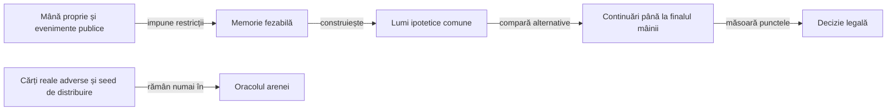

# Construirea și evaluarea jucătorilor Rentz

## Domeniu și limite

Jucătorii urmăresc punctele profilului configurat, cu mâna proprie și informația publică. Modelul de reguli rămâne separat de strategie; paritatea cu preset-urile aplicației originale este [criteriu deschis](ATF_RuleSources.md).

| Politică | Alegerea sub-jocului | Alegerea cărții |
|---|---|---|
| Reper păstrat, `LabPolicy` | Estimare simplă după rangul propriu. | Rang minim în negative și maxim în pozitive ori secvențe. |
| Normal, `RentzPlayer` | Reperul simplu de alegere, cu limita declarată. | Reguli tactice publice, fără lumi adverse simulate. |
| Hard, `RentzPlayer` | Compară jocurile disponibile pe aceleași lumi ipotetice. | Mutare forțată, regulă publică a asului sau comparație prin continuarea mâinii. |

Hard este un mod de joc cu buget explicit, nu o declarație de optimalitate. [Configurația strategiei](../../config/rentz-policy.yaml) este candidat experimental; evaluarea pe un lot finit nu garantează câștigul oricărei partide.

## Informația permisă



<details>
<summary>Legendă: lumi ipotetice, nu secrete ale mesei reale</summary>

Politica primește `Observation`, nu `RentzMatch`, generatorul sau fișierele arenei. Simulatorul poate urmări consecințele unei distribuiri ipotetice; aceasta nu devine observație a cărților reale adverse.

</details>

| Fapt public | Restricția folosită | Limită |
|---|---|---|
| Carte jucată | Este eliminată din necunoscute și atribuită actorului public. | Nu se elimină altă carte de același rang. |
| Aruncare în afara culorii cerute | Actorul nu mai poate avea acea culoare în cărțile rămase. | O culoare pe care nu a fost obligat să o urmeze nu devine automat absentă. |
| Pas în Rentz | Actorul nu putea avea o carte jucabilă la tabla din acel moment. | Continuările deschise ulterior rămân posibile. |
| Dimensiunea mâinii | Limitează capacitatea fiecărui loc. | Nu identifică rangurile singură. |

`KnowledgeSampler` folosește potrivire între cărți și locuri disponibile, cu ordine aleatorizată. Distribuirile respectă restricțiile și sunt reluate pe istoricul public; uniformitatea, probabilitățile calibrate și intențiile adversarului nu sunt demonstrate de această construcție.

## Reguli tactice și ponderi

| Context | Mecanism | Tip |
|---|---|---|
| Negativ, actor fără culoarea cerută | Aruncă o contribuție penalizată; departajează prin puterea eliminată. | Regulă locală. |
| Negativ, există carte sigur pierzătoare | Elimină cartea pierzătoare mai mare. | Regulă locală de conservare a ieșirilor mici. |
| Whist pozitiv, ultimul loc | Câștigă cu cel mai mic câștigător disponibil. | Rang verificabil în levata completată. |
| Zece de treflă, levată imposibil de câștigat | Păstrează ținta dacă există altă aruncare legală. | Regulă locală, fără promisiune de captură viitoare. |
| Secvențe | Ponderează cărțile proprii conectate, frontierele eliberate și apropierea actorului sărit de terminare. | Caracteristici recalculate din context. |
| As legal în secvențe | Elimină asul cu tură suplimentară, păstrând celelalte continuări legale. | Scurtătură publică, în varianta laboratorului. |

Coeficienții din `PolicySettings` sunt fixați de candidat. Contextul se schimbă după mutări; coeficienții nu se rescriu automat după o victorie sau înfrângere.

| Intrare | Consum efectiv |
|---|---|
| YAML de strategie | `PolicyInputs` citește parametrii și verifică legăturile și paritatea cu fabrica Java. |
| Arena JVM | Protocolul fixează candidatul și bugetul înainte de expunerea datelor. |
| Aplicația Android | Folosește fabrica `PolicySettings.defaults()` din APK; nu citește YAML din directorul proiectului și nu actualizează ponderi în fundal. |

Schimbarea valorilor implicite cere actualizarea configurației, a fabricii și a verificării lor, apoi reconstruirea candidatului. Un profil diferit transmis explicit motorului are identitate distinctă în evaluare.

```text
utilitate = puncte_proprii − media_punctelor_adverse
estimare  = media_utilităților_lumilor
alegere   = estimare − pondere_risc × abatere_standard
```

Aceeași colecție de lumi este folosită pentru toate alternativele dintr-o decizie. Continuarea folosește tactica publică până la închiderea mâinii, cu limită de acțiuni; nu estimează încă restul întregii partide sau o strategie adversă calibrată.

## Îmbunătățire și evaluare

```mermaid
flowchart LR
    DEV[Distribuiri de dezvoltare] -->|localizează pierderea| QUESTION[Întrebare despre o decizie]
    QUESTION -->|restrânge| CASE[Regresie mică]
    CASE -->|califică| FREEZE[Surse și protocol înghețate]
    FREEZE -->|admite prin registru| FRESH[Evaluare nouă]
    FRESH -->|arată progres sau regresie| REVIEW[Decizie explicită]
```



<details>
<summary>Legendă: evaluarea nouă nu ajustează retrospectiv candidatul</summary>

Registrul înregistrează expunerea înaintea rulării, inclusiv în caz de întrerupere. Modificarea candidatului sau numelui directorului nu redeschide distribuirile deja văzute; ele rămân disponibile pentru diagnostic, cu rolul original păstrat.

Documentul registrului are schemă închisă: cheile duplicate, documentele suplimentare, tipurile coercibile și câmpurile necunoscute sunt refuzate înaintea scrierii. O intrare invalidă păstrează octeții existenți; nu declanșează resetarea registrului. [Regresiile de validare](../../atf-tests/src/test/java/atf/rentz/EvaluationRegistryValidationTest.java) confruntă fiecare refuz cu vecinul valid și cu memoria expunerilor anterioare.

</details>

| Mecanism | Verificare |
|---|---|
| Comparare pereche | Aceleași seed-uri de distribuire, locuri rotite, control păstrat și familii de adversari distincte. |
| Corectitudinea jocului | `OfflineGameAudit` recalculează legalitatea publică, capturatorul, punctele și terminarea, separat de politica evaluată. |
| Identitatea datelor | Namespace-ul jocului, versiunea generatorului, numărul de jucători și seed-ul; sursa candidatului are identitate separată. |
| Promovare | Progresul mediei marjei trebuie să fie pozitiv pentru fiecare familie declarată; aceasta este o gardă locală a protocolului, nu dovadă statistică universală. |
| Retenție | Rezumatul păstrează toate comparațiile; numai pierderi reprezentative și un câștig de contrast păstrează jurnalul complet. |
| Diagnostic | O pierdere nu etichetează automat mutarea drept greșită; regresia cere o regulă, o invariantă sau o comparație independentă. |

Rotațiile aceleiași distribuiri sunt corelate. Mediile pe seed și familii rămân vizibile, inclusiv valorile negative; creditul de victorie împarte egalitățile și are rol descriptiv.

## Trecerea către produs și interfață

| Etapă | Criteriu înaintea extinderii |
|---|---|
| Motor și politici | Componente trecute, observație permisă, limită de cost și jocuri offline validate. |
| Aplicație locală | Adaptorul Android consumă același motor și portul `RentzPlayer`; interfața, persistența și lifecycle-ul au componente proprii. |
| Aplicație originală | Pachet și profil identificate, ecran utilizabil, reguli neconfirmate păstrate distinct. |
| E2E | Scenarii pornite și parcurse prin interfață, rezervare exclusivă, date și afișaj păstrate, capturi native și scor confruntat cu oracolul. |

O partidă offline sau un rezultat injectat nu se raportează ca joc prin interfață. [Transferul](ATF_Transfer.md) păstrează lecțiile reutilizabile; [componentele](ATF_Components.md) și [feedback-ul](../feedback/ATF_Rentz.md) dețin verificarea și lacunele active.
