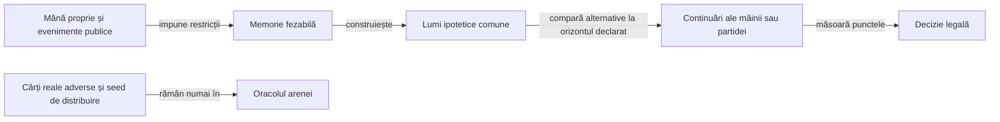
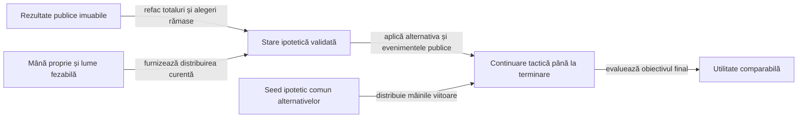
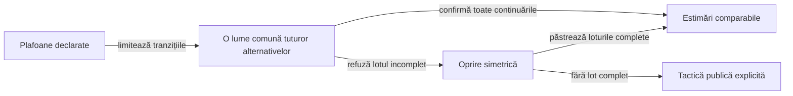
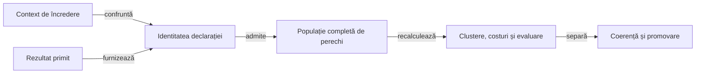

# Construirea și evaluarea jucătorilor Rentz

## Domeniu și limite

Jucătorii urmăresc punctele profilului configurat, cu mâna proprie și informația publică. Modelul de reguli rămâne separat de strategie; paritatea cu preset-urile aplicației originale este [criteriu deschis](ATF_RuleSources.md).

| Politică | Alegerea sub-jocului | Alegerea cărții |
|---|---|---|
| Reper păstrat, `LabPolicy` | Estimare simplă după rangul propriu. | Rang minim în negative și maxim în pozitive ori secvențe. |
| Normal, `RentzPlayer` | Reperul simplu de alegere, cu limita declarată. | Reguli tactice publice, fără lumi adverse simulate. |
| Hard, `RentzPlayer` | Compară jocurile disponibile pe aceleași lumi ipotetice. | Mutare forțată, regulă publică a asului sau comparație prin continuarea mâinii. |

Hard este un mod de joc cu buget explicit, nu o declarație de optimalitate. [Politica implicită](../../config/rentz-policy.yaml) păstrează reperul; profilurile offline separă dovada locală de euristici și de orizontul complet, fără înlocuirea fabricii produsului înaintea calificării.

| Profil | Mecanism evaluat |
|---|---|
| [Hard cu dovadă publică](../../config/rentz-hard-policy.yaml) | Păstrează tactica legacy și închide numai captura demonstrabilă a țintei la obiectivul mâinii. |
| [Contextual experimental](../../config/rentz-contextual-policy.yaml) | Adaugă costul cărții și eliminarea penalității în continuarea proprie; o regulă locală corectă poate avea efect strategic negativ. |
| [Partidă experimentală](../../config/rentz-match-policy.yaml) | Evaluează obiectivul terminal cu bugete aliniate; nu este implicitul produsului. |

| Obiectiv explicit | Orizont și utilitate | Limită |
|---|---|---|
| `HAND_MARGIN` | Finalul mâinii: puncte proprii minus media adversarilor. | Nu folosește poziția în clasamentul final. |
| `MATCH_POINTS` | Finalul partidei: totalul propriu. | Maximizarea punctelor poate alege alt risc decât câștigarea partidei. |
| `MATCH_WIN_SHARE` | Finalul partidei: unu împărțit între liderii egali, zero pentru ceilalți. | Frecvență condiționată de lumile și continuarea simulate, fără probabilitate reală calibrată. |

## Informația permisă



<details>
<summary>Legendă: lumi ipotetice, nu secrete ale mesei reale</summary>

Politica primește `Observation`, nu `RentzMatch`, generatorul sau fișierele arenei. Simulatorul poate urmări consecințele unei distribuiri ipotetice; aceasta nu devine observație a cărților reale adverse.

</details>

| Fapt public | Restricția folosită | Limită |
|---|---|---|
| Carte jucată | Este eliminată din necunoscute și atribuită actorului public. | Nu se elimină altă carte de același rang. |
| Aruncare în afara culorii cerute | Actorul nu mai poate avea acea culoare în cărțile rămase. | O culoare pe care nu a fost obligat să o urmeze nu devine automat absentă. |
| Pas în Rentz | Actorul nu putea avea o carte jucabilă la tabla din acel moment. | Continuările deschise ulterior rămân posibile. |
| Dimensiunea mâinii | Limitează capacitatea fiecărui loc. | Nu identifică rangurile singură. |
| Istoric public al mâinilor | Reface totalurile, rotația și sub-jocurile rămase fiecărui alegător. | Nu reconstruiește cărțile reale adverse sau seed-ul real. |

`KnowledgeSampler` folosește potrivire între cărți și locuri disponibile, cu ordine aleatorizată. Distribuirile respectă restricțiile și sunt reluate pe istoricul public; uniformitatea, probabilitățile calibrate și intențiile adversarului nu sunt demonstrate de această construcție.

## Reguli tactice și ponderi

| Context | Mecanism | Tip |
|---|---|---|
| Negativ, actor fără culoarea cerută | Aruncă o contribuție penalizată; departajează prin puterea eliminată. | Regulă locală. |
| Negativ, carte sigur pierzătoare | Candidatul elimină întâi contribuția penalizată, apoi puterea; reperul păstrează rangul maxim. | Preferință locală, fără etichetă de optimalitate globală. |
| Negativ, ultimul actor obligat să câștige | Candidatul minimizează costul propriei cărți, apoi elimină puterea mare la cost egal. | Penalitatea deja pe masă este aceeași pentru toate alternativele. |
| Zece de treflă cu dovadă publică | Fără treflă mai mare necunoscută în afara mâinii, folosește ieșirea câștigătoare și capturează ținta. | În `HAND_MARGIN`, dovada închide decizia fără sampling; nu certifică orizontul complet. |
| Whist pozitiv, ultimul loc | Câștigă cu cel mai mic câștigător disponibil. | Rang verificabil în levata completată. |
| Zece de treflă, levată imposibil de câștigat | Păstrează ținta dacă există altă aruncare legală. | Regulă locală, fără promisiune de captură viitoare. |
| Secvențe | Ponderează cărțile proprii conectate, frontierele eliberate și apropierea actorului sărit de terminare. | Caracteristici recalculate din context. |
| As legal în secvențe | Elimină asul cu tură suplimentară, păstrând celelalte continuări legale. | Scurtătură publică, în varianta laboratorului. |

Coeficienții din `PolicySettings` sunt fixați de candidat. Contextul se schimbă după mutări; coeficienții nu se rescriu automat după o victorie sau înfrângere.

| Intrare | Consum efectiv |
|---|---|
| YAML de strategie | `PolicyInputs` verifică schema, parametrii și legăturile către cod/teste. Schema reperului are probă de paritate cu fabrica; schema candidatului declară separat obiectivul complet. |
| Arena JVM | Protocolul fixează fișierul de politică, obiectivul, bugetul și familiile înainte de expunerea datelor. `HARD_REFERENCE` este reper de evaluare păstrat, nu al treilea nivel din meniu. |
| Aplicația Android | Folosește fabrica `PolicySettings.defaults()` din APK; nu citește YAML din directorul proiectului și nu actualizează ponderi în fundal. |

Schimbarea valorilor implicite cere actualizarea configurației, a fabricii și a verificării lor, apoi reconstruirea candidatului. Un profil diferit transmis explicit motorului are identitate distinctă în evaluare.

```text
utilitate = puncte_proprii − media_punctelor_adverse
estimare  = media_utilităților_lumilor
alegere   = estimare − pondere_risc × abatere_standard
```

Aceeași colecție de lumi este folosită pentru toate alternativele dintr-o decizie. Formula selectează utilitatea obiectivului declarat; numai reperul `HAND_MARGIN` folosește expresia marjei din prima linie.

## Orizontul întregii partide



<details>
<summary>Legendă: alegerea consumă o resursă viitoare, fără acces la viitorul real</summary>

`fromPublicProgress` validează rotația, portofoliul, fondul, alocarea pe locuri și cumulul din registrul public. `FullMatchRollout.restore` confruntă totalurile și rejucarea mâinii curente. Lipsa istoricului complet refuză obiectivul de partidă. [Contractul registrului](ATF_Architecture.md#admiterea-scorurilor-din-registru)

</details>

| Mecanism | Contract și limită |
|---|---|
| Alocarea sub-jocurilor | Alegerea curentă dispare din portofoliul alegătorului; continuarea consumă toate alegerile rămase în ordinea legală. |
| Viitor comun | Alternativele primesc aceleași distribuiri ipotetice viitoare, derivate din sampler; seed-ul real nu este intrare. |
| Actorii simulați | Continuarea proprie poate folosi tactica nouă; adversarii păstrează modelul tactic legacy declarat și văd numai mâna ipotetică proprie. Nu există căutare Hard recursivă sau citire a dificultății reale a adversarului. |
| Cost | Număr maxim de lumi și plafon de tranziții pe decizie; timpul și lucrul efectiv sunt păstrate separat. |
| Egalitate de utilitate | Obiectivele complete folosesc marja față de lider numai la egalitate a estimării primare în toleranța numerică. |
| Istoric validat | Se verifică consistența registrului, nu se demonstrează retrospectiv legalitatea fiecărei cărți din mâinile deja încheiate. |
| Eroare de model | O continuare mai lungă poate amplifica o tactică slabă sau variația distribuirilor; nu demonstrează forță mai mare. |

[Regresiile situaționale](../../rentz-lab-app/game-core/src/test/java/ro/rentzlab/core/RentzMatchStrategyTest.java) separă punctele de victorie, avantajul public de cărțile curente și observația permisă de secretele reale. Componentele tactice păstrează separat aruncarea penalității, pasul, asul și frontierele de sosire.

## Buget și comparabilitate



<details>
<summary>Legendă: aceeași limită nu înseamnă același lucru consumat</summary>

`RolloutBudget` numără alegerea, rejucarea publică și tranzițiile înainte din continuare. Sampling-ul, alocarea obiectelor și timpul procesorului nu sunt unități ale acestui plafon; duratele măsurate rămân vizibile separat.

</details>

| Frontieră | Contract |
|---|---|
| Lot comun | O lume contribuie numai după încheierea tuturor alternativelor; un prefix favorabil primei cărți nu intră în medie. |
| Buget epuizat | Se folosesc loturile comune complete; dacă lipsesc, decizia raportează fallback public, fără estimări parțiale. |
| Receipt de decizie | Lumi cerute/completate, alternative, tranziții, plafon și epuizare; mutările forțate și dovezile publice nu inventează sampling. |
| Setări comparabile | Numărul maxim de lumi, plafonul de tranziții și riscul sunt aliniate; raportul arată și consumul efectiv, fallback-urile și timpul în decizii. |
| Orizont lung | Poate consuma mult mai multe tranziții la aceleași plafoane; egalitatea parametrilor nu este egalitate de latență sau precizie. |
| Reproductibilitate | Profilurile vechi păstrează tactica legacy; schema strategiei contextualizează obiectivul, tactica și plafonul. Un candidat nou nu rescrie politica implicită. |

## Îmbunătățire și evaluare

```mermaid
flowchart LR
    DEV[Distribuiri de dezvoltare] -->|localizează pierderea| QUESTION[Întrebare despre o decizie]
    QUESTION -->|restrânge| CASE[Regresie mică]
    CASE -->|califică| FREEZE[Surse și protocol înghețate]
    FREEZE -->|admite prin registru| FRESH[Evaluare nouă]
    FRESH -->|arată progres sau regresie| REVIEW[Decizie explicită]
```



<details>
<summary>Legendă: evaluarea nouă nu ajustează retrospectiv candidatul</summary>

Registrul înregistrează expunerea înaintea rulării, inclusiv în caz de întrerupere. Modificarea candidatului sau numelui directorului nu redeschide distribuirile deja văzute; ele rămân disponibile pentru diagnostic, cu rolul original păstrat.

Documentul registrului are schemă închisă: cheile duplicate, documentele suplimentare, tipurile coercibile și câmpurile necunoscute sunt refuzate înaintea scrierii. O intrare invalidă păstrează octeții existenți; nu declanșează resetarea registrului. [Regresiile de validare](../../atf-tests/src/test/java/atf/rentz/EvaluationRegistryValidationTest.java) confruntă fiecare refuz cu vecinul valid și cu memoria expunerilor anterioare.

</details>

| Mecanism | Verificare |
|---|---|
| Comparare pereche | Pentru Hard, controlul înlocuiește numai actorul evaluat cu Hard legacy la aceeași poziție; aceiași adversari și aceeași distribuire. Familia Normal desemnează adversarii, nu un control complet Normal. |
| Corectitudinea jocului | `OfflineGameAudit` recalculează legalitatea publică, capturatorul, punctele și terminarea, separat de politica evaluată. |
| Identitatea datelor | Namespace-ul jocului, versiunea generatorului, numărul de jucători și starea efectivă a generatorului. Protocolul păstrează seed-ul original pentru reproducere, iar sursa candidatului are identitate separată. |
| Promovare | Protocol `FRESH_EVALUATION`, familiile Normal și Hard păstrat, limită inferioară pozitivă pe obiectivul primar și credit de victorie fără regresie în fiecare familie. Bugetele inegale, familia lipsă sau datele insuficiente refuză promovarea. |
| Retenție | Rezumatul păstrează toate comparațiile; numai pierderi reprezentative și un câștig de contrast păstrează jurnalul complet. |
| Diagnostic | O pierdere nu etichetează automat mutarea drept greșită; regresia cere o regulă, o invariantă sau o comparație independentă. |

### Identitatea distribuirii și expunerea

[DealSeed](../../rentz-lab-app/game-core/src/main/java/ro/rentzlab/core/deal/DealSeed.java) definește identitatea pentru generatorul `jvm-shuffle-eight-cards-v1`. Cei 48 de biți inferiori ai seed-ului identifică starea efectivă la inițializarea generatorului. Aceeași stare și același număr de jucători repetă fluxul distribuirilor.

| Frontieră | Regulă |
|---|---|
| Protocol și lot | Două valori cu aceeași stare efectivă refuză lotul înainte de simulare. Aceeași verificare protejează intrarea directă în registru. |
| Istoric | Registrul citește istoricul v1 și păstrează ordinea intrărilor la trecerea în v2. Un refuz păstrează octeții vechi, inclusiv când istoricul conține mai multe etichete ale aceleiași stări. |
| Dezvoltare | Reluarea intenționată este permisă pentru același seed original când toate expunerile care corespund stării sunt de dezvoltare și au aceeași etichetă. |
| Evaluare rezervată | Arena cere registrul v2 revizuit și asociat căii comune. O stare expusă anterior pentru aceeași masă refuză evaluarea nouă. O stare rezervată refuză reutilizarea ulterioară în dezvoltare. |
| Agregare | `ClusteredEvaluation` refuză aliasurile înainte de bootstrap și grupează toate rotațiile aceleiași stări. Pragul este de opt clustere, cu o corecție pentru numărul familiilor declarate. |

Arena și lansatoarele native folosesc registrul comun din rădăcina de date a instalării. Lansatorul arenei și punctul de intrare Java refuză o cale alternativă. Copierea registrului v2 păstrează asocierea cu destinația originală.

- **Revizie.** Proprietarul verifică expunerile, declară responsabilul și păstrează referința deciziei. Un istoric gol cere o revizie explicită pentru o instalare curată.
- **Migrare.** Inițializarea atomică păstrează ordinea intrărilor existente. Revizia poate adăuga expuneri la finalul istoricului. [Comanda de inițializare](../../atf-tests/README.md#inițializarea-registrului)

La schimbarea generatorului, definiți întâi echivalența distribuirilor și tratamentul istoricului.

#### Expunerea în calificarea nativă

| Etapă | Contract |
|---|---|
| Înaintea distribuirii | Lansatorul obține un marcaj în registrul comun, sub același lock. O evaluare rezervată refuză pornirea cât timp există o expunere nativă nerezolvată. |
| Jurnal disponibil | Adaptorul înregistrează seed-ul și numărul de jucători. După scrierea atomică a registrului, eliberează marcajul. Jurnalul de istoric cunoscut este înregistrat înainte de încărcare. |
| Publicare | Receipt-ul păstrează numele, SHA-256 și tokenul jurnalului. Raportorul verifică dovezile și păstrează accesul la receipt-urile istorice. |

Pentru un traseu care pornește o partidă sau încarcă un jurnal, folosiți un rezultat de componente care califică adaptorul nativ. Indicați directorul prin ComponentRun dacă build-ul nu îl declară. Traseul de ajutor rămâne fără expunere de distribuiri.

- **Reluare.** Pentru un jurnal verificat, reexecutați comanda adaptorului complete-exposure cu jurnalul, registrul și tokenul original, prin classpath-ul calificat. O scriere deja confirmată pentru același token este recunoscută.
- **Întrerupere.** Dacă jurnalul lipsește sau proveniența lui nu poate fi verificată, păstrați marcajul. Adaptorul respinge un token străin și, după prima scriere, un seed care contrazice înregistrarea aceluiași token. Înaintea primei scrieri, asocierea cu jurnalul rulării trebuie verificată separat; [feedback-ul tehnic](../feedback/ATF_RentzQuality.md#constatări-deschise) urmărește automatizarea acestei verificări.

| Interpretare | Regulă |
|---|---|
| Obiectiv primar | Diferența de marjă, puncte finale sau credit de victorie, aleasă înaintea expunerii; celelalte metrici rămân secundare. |
| Incertitudine | Bootstrap finit, determinist, cu limită unilaterală; nu este garanție universală sau corecție pentru încercări adaptive nedeclarate. |
| Insuficiență | Limita inferioară este `null`; rotațiile nu măresc artificial numărul de distribuiri independente. |
| Reper păstrat | Tactica și ponderile reperului rămân fixe; `matchedReferenceSettings` aliniază numărul de lumi, riscul și plafonul de tranziții cu candidatul. Profilul de comparație nu este un nivel nou în meniu. |
| Ne-promovare | Un raport poate refuza progresul strategic chiar dacă toate tranzițiile sunt legale și componentele trec. Reperul produsului rămâne neschimbat. |
| Identitate | Rezumatul păstrează politica, setările efective, sursa înghețată și classpath-ul; o evaluare JVM nu inventează identitatea unui APK nou. |

## Admiterea rezultatelor reluate



<details>
<summary>Legendă: identitatea așteptată nu se recapturează din rezultat</summary>

[PromotionAdmission](../../atf-tests/src/main/java/atf/rentz/arena/PromotionAdmission.java) primește protocolul, identitatea SHA-256 a sursei și politica citită din intrările de încredere. Rezultatul nu furnizează propriul reper de acceptare. Producătorul CLI verifică această frontieră înaintea publicării și păstrează verdictul în admission.json.

```text
Profil solicitat + protocol → setări cu bugetul experimentului
                             ├→ obiectiv → metrică pe distribuiri
                             └→ politici efective → actori → jocuri pereche
Intrări de încredere → aceeași rezolvare → confruntare cu rezumatul și costul
```

| Actor | Configurație folosită la joc |
|---|---|
| HARD | Profilul solicitat, cu numărul de lumi al protocolului. |
| HARD_REFERENCE | Tactică legacy, obiectiv de căutare HAND_MARGIN și ponderile reperului. Numărul de lumi, riscul și plafonul de tranziții sunt potrivite cu profilul solicitat. |
| NORMAL | Politică euristică, fără căutare pe lumi. |
| BASELINE | Alegerile deterministe ale LabPolicy, fără căutare pe lumi. |

Pentru un candidat cu căutare, controlul folosește HARD_REFERENCE la locul evaluat. Pentru ceilalți candidați, controlul folosește politica familiei la întreaga masă. Raportul Extent afișează profilul cerut separat de actorii efectivi și compară plafoanele când ambii actori evaluați folosesc căutare.

</details>

| Intrare sau etapă | Contract |
|---|---|
| Context independent | Protocolul și sursa calificată provin din receipt-urile verificate. Politica și profilul de scor se citesc din snapshot-ul fixat. Contextul Expected se construiește din aceste intrări. |
| Declarație completă | declaredProtocol păstrează inclusiv candidat, ordine, seed-uri, jucători, lumi, retenție și fișier de politică. Un rezumat istoric fără această declarație rămâne lizibil, fără admitere retrospectivă. |
| Configurație și politică efectivă | Protocolul suprascrie numărul de lumi. [ArenaPolicies](../../atf-tests/src/main/java/atf/rentz/arena/ArenaPolicies.java) leagă obiectivul evaluării de actorul candidat și, pentru fiecare familie, de adversari și control. Rezumatele fără această declarație rămân lizibile și sunt refuzate la admitere. |
| Profilul de scor executat | Rezumatul, partidele reținute și Extent păstrează profilul tipizat folosit pentru ambele brațe. Admiterea compară penalizările, recompensele și ordinea premiilor cu profilul de încredere. Un rezumat istoric fără profil poate fi citit și este refuzat la admitere. |
| Lansare CLI | Manifestul cu amprente verificate trebuie să includă fișierul de scor. Profilul citit din snapshot configurează rularea și furnizează așteptarea la admitere. |
| Perechi | Exact o pereche pentru fiecare familie, seed și loc. Se verifică actorii, diferența de marjă, creditul și costurile înaintea agregării. |
| Marjă și credit | Marja este scorul locului minus media adversarilor. Creditul este zero la înfrângere și 1/k când k jucători împart primul loc. O marjă pozitivă permite și înfrângerea. Creditul pozitiv la marjă zero cere egalitatea întregii mese. |
| Filtre numerice pentru scor | În fiecare braț, scorul final și suma adversarilor implicată de marjă sunt multipli ai divizorului comun al contribuțiilor profilului de încredere. Suma adversarilor trebuie să fie întreagă. Profilul cu contribuții zero impune egalitatea întregii mese. |
| Deficitul adversarilor | Pentru un lider cu credit pozitiv, fiecare loc aflat sub primul loc contribuie cu minimum un pas de scor la deficitul total. Admiterea calculează deficitul din suma întreagă verificată. |
| Recalculare | [FamilyAnalysis](../../atf-tests/src/main/java/atf/rentz/arena/FamilyAnalysis.java) reface agregările, costurile, clusterele și bootstrap-ul din perechi. Comparația include întregul rezultat, nu doar flag-ul promotes primit. |
| Retenție | Numele jurnalelor trebuie să corespundă selecției declarate de protocol. Validarea numelor nu verifică octeții fișierelor externe. |

| Verdict | Interpretare |
|---|---|
| Incoerent | Refuz înaintea interpretării progresului; diagnosticul identifică frontiera încălcată. |
| Coerent, fără promovare | Date complete, dar etapă de dezvoltare, insuficiență ori criteriu strategic neîndeplinit. Pierderea nu este o eroare de infrastructură. |
| Coerent, eligibil | Numai evaluarea nouă care trece criteriile strategice existente în toate familiile; pragurile și profilul produsului nu se schimbă prin admitere. |

[Componentele de admitere](../../atf-tests/src/test/java/atf/rentz/ArenaAdmissionTest.java) păstrează vecinul complet și coruperi independente ale identității, populației, bugetului și agregărilor. API-ul public de promovare cere context explicit; forma fără Expected nu mai este disponibilă.

Admiterea verifică structura și coerența perechilor declarate. Nu autentifică un fișier primit și nu rejucă fiecare carte; proveniența artefactului, inventarul runtime-ului și auditul tranzițiilor au contracte separate. Un expeditor care fabrică întregul set de date nu devine de încredere prin simpla coerență aritmetică.

## Trecerea către produs și interfață

| Etapă | Criteriu înaintea extinderii |
|---|---|
| Motor și politici | Componente trecute, observație permisă, limită de cost și jocuri offline validate. |
| Aplicație locală | Adaptorul Android consumă fabrica implicită și portul `RentzPlayer`; candidatul complet rămâne offline. Codec-ul debug nu transportă încă registrul `completedHands` către un jucător extern; promovarea cere integrare și calificare separate. |
| Aplicație originală | Pachet și profil identificate, ecran utilizabil, reguli neconfirmate păstrate distinct. |
| E2E | Scenarii pornite și parcurse prin interfață, rezervare exclusivă, date și afișaj păstrate, capturi native și scor confruntat cu oracolul. |

O partidă offline sau un rezultat injectat nu se raportează ca joc prin interfață. [Transferul](ATF_Transfer.md) păstrează lecțiile reutilizabile; [componentele](ATF_Components.md) și [feedback-ul](../feedback/ATF_Rentz.md) dețin verificarea și lacunele active.

## Separarea mecanismelor și refactorizarea sigură


<details>
<summary>Legendă: fiecare etapă deține un motiv distinct de schimbare</summary>

| Responsabilitate | Implementare și invariantă |
|---|---|
| Progres public | [PublicProgress](../../rentz-lab-app/game-core/src/main/java/ro/rentzlab/core/progress/PublicProgress.java) admite numai alocările compatibile cu programul și profilul. Rezultatul copiază datele publice în structuri imuabile. |
| Tranziție | [RentzMatch](../../rentz-lab-app/game-core/src/main/java/ro/rentzlab/core/RentzMatch.java) păstrează fațada; traseele pentru secvențe și levate rămân distincte. |
| Evaluare | [DecisionEvaluator](../../rentz-lab-app/game-core/src/main/java/ro/rentzlab/ai/search/DecisionEvaluator.java) păstrează ordinea lume–alternativă, seed-ul ipotetic și consumul plafonului. |
| Estimări | [DecisionMoments](../../rentz-lab-app/game-core/src/main/java/ro/rentzlab/ai/search/DecisionMoments.java) admite numai loturi complete; ordinea stabilă, riscul și criteriul de departajare rămân explicite. |
| Experiment | [FamilyAnalysis](../../atf-tests/src/main/java/atf/rentz/arena/FamilyAnalysis.java) agregă rotațiile, metrica și costurile fără simulare sau I/O. OfflineArena deține execuția, registrul expunerii și retenția. |

</details>

Refactorizarea păstrează un reper compilat înaintea schimbării și compară observațiile publice, mutările, estimările, scorurile, lumile complete, fallback-urile și tranzițiile efective. Timpul este măsurat separat: variația duratei nu dovedește schimbarea strategiei, iar o partidă identică nu înlocuiește regresiile situaționale.

Protocolul, sursa și rezultatele comparației rămân în depozitul extern. Separarea responsabilităților permite schimbarea agregării sau a infrastructurii fără promovarea tacită a unui profil YAML; [transferul către alt joc](ATF_Transfer.md) păstrează această limită.
