# Proprietarul sesiunii și calculul de fundal

## Contract

O activitate poate fi suspendată sau înlocuită în timp ce AI-ul calculează. Comanda umană acceptată trebuie să rămână reluabilă, iar rezultatul vechi nu poate modifica sesiunea curentă, fișierul sau interfața noului proprietar.

| Componentă | Responsabilitate |
|---|---|
| `RentzApplication` | Deține un repository pentru procesul aplicației; activitățile nu creează magazine independente pentru același fișier. |
| `SessionRepository.Owner` | Identitate revocabilă; un proprietar nou invalidează scrierile, publicarea și callback-urile celui vechi. |
| `SessionController` | Salvează comanda acceptată și execută, la cererea mesei, o singură tură AI pe o copie separată. |
| `FileSessionStorage` | Scrie și sincronizează un staging unic înaintea înlocuirii atomice; nu decide proprietarul. |
| `MainActivity` | Conectează evenimentele Android și afișajul la aceste contracte, fără calcul AI sau scriere directă. |

## De la comandă la rezultat

```mermaid
flowchart LR
    HUMAN[Comandă umană] -->|validează pe copie| CHECKPOINT[Checkpoint durabil]
    CHECKPOINT -->|afișează actorul| FRAME[Cadru de masă]
    FRAME -->|după pauza de tură| WORK[O tură AI pe copie]
    WORK -->|livrează candidat| GUARD[Proprietar și revizie]
    GUARD -->|acceptă numai dacă actual| STORE[Înlocuire atomică]
    STORE -->|precede| ADOPT[Adoptare și afișare]
```

Legendă: worker-ul nu salvează și nu mută sesiunea activă

Comanda umană se salvează înaintea următorului cadru. Worker-ul reconstruiește o copie din `GameSession.Saved`, iar livrarea autorizată salvează o singură tură și adoptă rezultatul. Politicile Normal/Hard primesc numai observația actorului.

| Moment | Invariantă |
|---|---|
| Acceptarea comenzii | Refuzul regulii sau al scrierii păstrează sesiunea anterioară; un checkpoint acceptat precede calculul adversarilor. |
| Prezentarea turei | Cadrul marchează actorul curent, apoi așteaptă 550 ms înainte de o mutare AI. Colectarea levatei se încheie înaintea cadrului următorului actor. |
| Calcul | Nu există scrieri sau acces la controalele Android; modificările aparțin numai copiei. |
| Livrare | Generația, sesiunea capturată și jurnalul ei trebuie să fie încă actuale. |
| Salvarea continuării | Verificarea proprietarului și IO sunt în aceeași secțiune serializată; un eșec nu adoptă candidatul. |
| Callback | Este executat numai pentru proprietarul activ; un callback deja pus în coadă poate deveni invalid. |

## Suspendare, înlocuire și reluare

| Eveniment | Comportament |
|---|---|
| Activare | Revendică proprietatea și citește checkpoint-ul curent. Activează sesiunea după încărcare. Dacă citirea eșuează, eliberează proprietatea și permite reîncercarea pe același controller. |
| Pauză sau oprire | Invalidează cadrul și generația, anulează temporizatorul și cererea, apoi retrage dreptul de scriere. La reluare, masa pornește de la ultima mutare salvată. |
| Distrugere | Închide controller-ul și executorul; un controller închis nu se reactivează. |
| Activitate nouă | Revocă proprietarul anterior prin repository-ul comun; închiderea vechiului handle nu îl poate revoca pe cel nou. |
| Rejecție de executor | Eliberează starea ocupată; candidatul nesalvat nu devine sesiune curentă. |

Întreruperea este o cerere de anulare, nu oprirea forțată a unui thread. Un calcul care o ignoră poate termina, însă generația și proprietarul îi refuză rezultatul. Limitele de acțiuni și bugetul căutării rămân responsabilități distincte ale motorului și politicilor.

## Fișiere și erori

- `session.json` este checkpoint-ul privat; `actor-view.json` este proiecția publică debug, fără seed sau mâini adverse.
- Staging-ul fiecărei scrieri este unic și se află în cache-ul aplicației, separat de datele canonice; nu se reutilizează un nume comun `.tmp`.
- După eroare se elimină numai staging-ul propriei scrieri; fișierul original și alte fișiere din cache rămân intacte.
- O scriere neatomică nu este fallback implicit; eroarea păstrează checkpoint-ul anterior și ajunge la proprietar.
- Publicarea debug eșuată este diagnosticată separat și nu rescrie sau resetează checkpoint-ul privat.

## Verificare și reutilizare

[Componentele de lifecycle](../../rentz-lab-app/app/src/test/java/ro/rentzlab/app/lifecycle/) folosesc cozi și executori controlați, repository comun și IO injectabil. Testele intercalează explicit pauza, revendicarea, calculul și livrarea, fără `sleep` sau emulator.

| Nivel | Ce confruntă | Limită |
|---|---|---|
| Componente | Checkpoint durabil, rezultat depășit, revizie schimbată, erori IO, executor respins și reluare. | Nu execută lifecycle-ul sistemului Android. |
| Adaptor de fișiere JVM | Staging unic, înlocuire reală și refuz fără pierderea originalului. | Filesystem-ul și performanța Android se calibrează separat. |
| Compilare Android | Tipurile, compoziția aplicației și apelurile către controller. | Nu reprezintă acceptanță pe dispozitiv. |

Mecanismul transferabil este separarea dintre stare, calcul, proprietate și IO. Comenzile, restaurarea și deciziile Rentz rămân adaptoare ale domeniului; nu se mută în bibliotecile comune doar pentru a reutiliza forma coordonatorului.

[Arhitectură](ATF_Architecture.md) · [Contractul salvării](../../rentz-lab-app/app/README.md) · [Acceptanță Android](ATF_Android.md)
