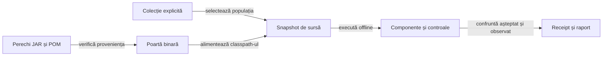
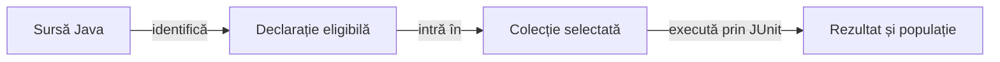
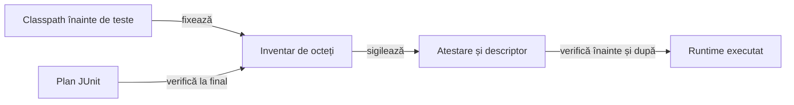

# Calificarea consumatorului și colecțiile offline

## Contract

O bibliotecă publicată, un proces încheiat și un HTML prezent au identități distincte de acceptanța produsului. Calificarea leagă intrările înghețate, populația selectată și rezultatele observate; un rezultat al altui consumator nu este acceptanță locală.



<details>
<summary>Legendă: identitatea și comportamentul sunt verificări complementare</summary>

Hash-ul identifică octeții declarați, nu demonstrează singur corectitudinea sau autenticitatea producătorului. Probele de comportament rulează clasele din JAR-ul efectiv, iar documentele și rezultatele istorice rămân legate de execuția lor originală.

</details>

## Poarta bibliotecilor

| Control | Sursă și limită |
|---|---|
| Suprafață declarată | [Politica adopției](../../config/library-adoption.json) cere cele cinci biblioteci și ghidurile admise; [proveniența](../../library-provenance.json) deține identitățile și originea. |
| Pereche fizică | Versiunea din POM-ul rădăcină, coordonata publicată, hash-urile JAR/POM și POM-ul încorporat trebuie să corespundă. |
| Coeziune binară | O versiune per bibliotecă, fără repository imbricat, implementări sursă paralele, surse Java în JAR sau clase străine bibliotecii. |
| Originea clasei | `CodeSource` trebuie să fie un JAR ale cărui octeți corespund perechii declarate; prezența numelui clasei nu este suficientă. |
| Contract consumat | [Componentele binare](../../atf-tests/src/test/java/atf/rentz/libraries/) verifică JSON și URL, politica Console, catalogul Mock și refuzurile de integritate. |
| Reporting | Adaptorul de test și inspectorul public confruntă Extent și fallback cu o populație declarată, verdicturi și comparații independente. |
| Responsabilitate | Test Kit este consumat prin JAR/POM; codul, nativele și guvernanța implementării rămân la owner; [rutarea feedback-ului](../feedback/README.md#biblioteci-comune) separă defectele comune de intrările consumatorului. |

Livrarea se compară cu perechea publicată și dovada producătorului, apoi primește acceptanță locală. Perechea înlocuită și proveniența ei se arhivează extern înaintea promovării; nu se reconstruiește biblioteca vecină pentru a satisface testele consumatorului.

## Colecții și populații

[Registrul colecțiilor](../../config/test-collections.json) este interpretat de [selectorul PowerShell](../../scripts/TestCollections.psm1). Intrarea standard este `regression`; o opțiune necunoscută, un selector fără țintă sau o populație XML diferită opresc calificarea.

| Colecție | Scop | Etape |
|---|---|---|
| `quick` | Reguli, frontiere și integrare rapidă. | Selecția Maven declarată, inclusiv adopția binară și guvernanța sursei; controale de infrastructură și runtime. |
| `regression` | Calificarea offline standard. | Toate clasele Maven de test, componente Android JVM, infrastructură și runtime. |
| `learning` | Regresii ale politicilor și mecanismului de evaluare. | Selecție Maven pentru AI și arenă; nu antrenează și nu admite automat date noi. |
| `infrastructure` | Adopție, surse, documentație și adaptorul de publicare. | Selecția Maven a porților și controalele PowerShell. |
| `android-jvm` | Coordonare, codec și persistență fără dispozitiv. | Bootstrap binar și teste Gradle ale aplicației; fără asamblare APK. |

```powershell
.\scripts\run-rentz-components.ps1 -Collection regression
```

Comanda pornește din rădăcina proiectului în PowerShell 7, cu JDK 21, Maven, SDK Android și cache-urile pregătite. [Infrastructura](ATF_Infrastructure.md) alocă staging-ul și ieșirile externe; [lansatorul Android JVM](../../scripts/test-rentz-android-jvm.ps1) primește sursa înghețată, nu o altă versiune live.

- Un [inventar executabil comun](../../atf-tests/src/main/java/atf/rentz/discovery/TestSourceInventory.java) alimentează clasificarea și selecția. Formele Jupiter declarate, inclusiv compoziția, sunt analizate înaintea convenției de nume; o sursă executabilă neconformă este refuzată explicit.
- Clasele executate trebuie să coincidă cu selecția derivată din sursă; dublurile, suitele goale, eșecurile și skip-urile refuză calificarea.
- Android JVM păstrează propria populație XML și receipt; nu este raportat drept test Maven sau execuție Android nativă.
- Asamblarea APK cere calificarea `regression`, inclusiv Android JVM; o colecție focalizată nu devine acceptanță integrală prin redenumirea rezultatului.
- Arena și adaptorul nativ cer descriptorul clasei compilate și componenta lor calificată; nu depind de existența unui scenariu narativ fără legătură.

## Reconcilierea unei revizii editoriale

Păstrați checkout-ul curat și rularea `regression` care au produs dovada originală. Dintr-un al doilea worktree înregistrat, pe commitul editorial, rulați colecția `infrastructure`. Compositorul cere controalele de documentație și verifică fiecare receipt împotriva sursei sale.

```powershell
.\scripts\run-rentz-components.ps1 -Collection infrastructure -SourceRoot $candidate -RunRoot $documentationRun
.\scripts\run-release-rag.ps1 -Question "reconciliere editorială" -ComponentRun $originalRegression -DocumentationRun $documentationRun -RunRoot $reviewRun
```

Apelați a doua comandă din worktree-ul editorial. Folosiți același depozit de artefacte și directoare de rulare distincte.

| Verificare | Ce apare în dovadă |
|---|---|
| Commituri curate din același repository | Commitul testat trebuie să fie strămoșul reviziei editoriale. |
| Diferența Git | Căile modificate, adăugate sau eliminate sunt fișiere Markdown obișnuite din `docs/rentz`, `docs/feedback`, `docs/README.md` sau `README.md`. |
| Intrări înghețate | Setul căilor diferite din cele două manifeste coincide cu diferența Git. SHA-256 agregat identifică toate intrările comune, în ordinea căilor. |
| Dovezi păstrate | Compoziția înregistrează căile și hash-urile receipt-urilor, manifestelor și rapoartelor Extent originale. Documentele diferite au hash înainte și după. |

- Rezultatele sunt `documentation-reconciliation.json` și `documentation-reconciliation.html`.
- Un rezultat original eșuat sau o diferență executabilă blochează compoziția.
- Această dovadă acoperă echivalența intrărilor offline și guvernanța documentelor. Pentru APK, Android nativ și promovare rămân aplicabile porțile pe commit exact. [Procesul de release](ATF_Release.md)

## Legăturile manifestelor către teste

[Catalogul regulilor](../../atf-tests/src/main/java/atf/rentz/RuleCatalog.java) leagă fiecare regulă de implementare și de o declarație de test eligibilă. Referința metodei are forma clasei și a numelui ei; metoda trebuie să fie declarată direct, fără supraîncărcare ambiguă, în clasa și pachetul așteptate.

[Verificatorul sintactic](../../atf-tests/src/main/java/atf/rentz/bindings/TestVerification.java) folosește parserul public al JDK-ului, fără generare de clase, procesarea adnotărilor sau executarea testelor. Fișierul este analizat o singură dată în lotul apelului, iar managerul de fișiere este închis și la eroare; un apel nou recitește sursa.

| Frontieră | Contract |
|---|---|
| Proprietar | Clasă concretă și metodă directă unică, de instanță, cu rezultat void și corp. |
| Marker | Jupiter Test sau ParameterizedTest, calificat ori rezolvat neambiguu prin importuri; numele străine sau mascate sunt refuzate. |
| Text și sintaxă | Comentariile, literalii și blocurile de text nu declară metode; sintaxa invalidă este refuzată cu identitatea regulii, fișierului și metodei. |
| Domeniu | Catalogul nu deduce moștenirea, adnotările compuse sau alte forme Jupiter; acestea cer o extindere explicită, nu acceptare după nume. |

Un import explicit are prioritate față de importurile cu wildcard. Dacă markerul simplu rămâne ambiguu între pachete necunoscute, declarați importul explicit sau numele calificat; existența unui marker în altă clasă nu autorizează metoda legată.



<details>
<summary>Legendă: declarația nu este rezultat de execuție</summary>

Catalogul verifică prima relație. JUnit descoperă testele, iar lansatorul verifică populația și rezultatele selecției; o legătură validă nu dovedește rularea metodei, rezolvarea parametrilor sau fidelitatea regulii față de produsul original.

</details>

[Regresiile legăturilor](../../atf-tests/src/test/java/atf/rentz/governance/RuleBindingGovernanceTest.java) aparțin colecției de infrastructură și validează și manifestele curente de reguli și politici. JDK 21 este precondiție a verificatorului; motorul Android nu primește această dependență.

## Proces și captură proaspătă

| Frontieră | Invariantă |
|---|---|
| Înaintea comenzii | Verifică proprietarul și refuză numele de dovezi deja existente. |
| Proces deținut | UTF‑8 explicit, timeout de execuție și așteptări finite pentru terminare și drenarea stream-urilor; nu oprește alte procese. |
| După comandă | Verifică din nou proprietarul; un rezultat întors după revocare nu este acceptat. |
| Rezultat semantic | Exit zero nu confirmă singur dump-ul; mesajul de eroare, fișierul lipsă sau XML-ul invalid refuză observația. |
| Captură | XML nou, nume remote unic și semnătură PNG; octeții nativi sunt păstrați. Aceste verificări nu înlocuiesc acceptanța vizuală. |
| Eroare secundară | Închiderea nu înlocuiește cauza principală; diagnosticul de cleanup se păstrează separat. |

[Controalele runtime](../../atf-tests/tools/test-runtime-controls.ps1) injectează procesul și fișierele rezervării. Porturile de test nu trimit comenzi ADB; [protocolul nativ](ATF_Android.md) păstrează calificarea pe dispozitiv separat.

## Publicare și interpretare

[Adaptorul Reporting](../../atf-tests/src/test/java/atf/rentz/RentzRulePublication.java) transmite comparațiile deja evaluate și verdictul Kitului. Faza păstrează diagnosticul și durata execuției; rendererul măsoară publicarea separat.

| Probă | Ce trebuie păstrat |
|---|---|
| Pregătire, corp și închidere | Faza reală a erorii și verdictul JUnit; o pregătire eșuată nu produce o invocare verde. |
| Erori combinate | Cauza principală, erorile de teardown, publicare și close, fără înlocuire sau succes inventat. |
| Întrerupere controlată | Statut de skip, distinct de PASS; skip-ul refuză calificarea colecției standard. |
| Artefact fizic | Populația, expected/actual, verdicturile și resursele confruntate prin inspectorul public; un mutant cu resursă externă trebuie refuzat. |

XML-urile și receipt-urile descriu toate probele executate. HTML-ul narativ rămâne o selecție explicită de contracte auditate, fără a pretinde că publică fiecare probă de infrastructură sau fiecare distribuire virtuală.

[Componente](ATF_Components.md) · [Lifecycle aplicație](ATF_Lifecycle.md) · [Învățare](ATF_Learning.md)

## Guvernanța permanentă

Colecția de infrastructură execută porțile pe copia înghețată. [Inventarul sursei](../../config/java-source-layout.json) deține rădăcinile și excluderile exacte; [retenția documentară](../../config/documentation-policy.json) deține instantaneele istorice, care nu devin documentație activă prin excludere tacită.

| Poartă | Criteriu verificat | Frontieră |
|---|---|---|
| Nivel executabil | [Rezolvarea adnotărilor](../../atf-tests/src/test/java/atf/rentz/governance/source/TestLayerGovernanceTest.java) cere un singur nivel permis per build; urmărește forme calificate, compoziție, ambiguități, cicluri și clase Jupiter imbricate. | Graful sursei rezolvă strămoșii cunoscuți, semnăturile substituite și metadatele compuse; baza externă necunoscută cere refuz explicit. Jupiter rămâne oracol independent. |
| Maven ATF | Markerii Unit, Component, Integration și E2E provin din Kit. Clasele ajutătoare fără teste executabile nu cer marker. | Un marker din alt namespace cu același nume nu califică sursa. |
| Gradle JVM | Motorul folosește markerul de test RentzComponentLayer cu tag Jupiter; aplicația folosește AndroidComponentLayer ca metadată JUnit 4. | Markerii sunt exclusiv în sursele de test. Producția nu importă ATF sau clasificarea de test. |
| Documente active | [Validatorii adaptați](../../atf-tests/src/test/java/atf/rentz/governance/documentation/) verifică toate README-urile, ghidurile din lib și documentele active: structură, proză, stil, diagrame, legende, linkuri și fragmente. | Instantaneele istorice păstrează hash-urile și contractul de retenție. |
| Identitatea regulilor | [Manifestul validatorilor](../../config/documentation-validators.json) identifică sursa comună și octeții adaptați; probele negative păstrează vecinul valid. | Adaptor sursă temporar pentru guvernanță; API-ul generic împachetat rămâne o cerință separată în feedback. |
| Schimbarea porților | [Controlul Git](../../atf-tests/src/test/java/atf/rentz/governance/changes/TestChangeGovernanceTest.java) confruntă diferențele reale cu baza explicită și [controalele exacte](../../config/test-change-controls.json). | Controlul unei schimbări nu este acceptanța comportamentului produsului. |

### Revizuirea unei schimbări de test

1. Fixați un commit de bază existent și strămoș al HEAD; nu substituiți baza cu numele unei rulări.
2. Citiți diferențele comise, pregătite, nepregătite și fișierele noi, inclusiv testele ignorate de Git.
3. Păstrați pentru fiecare cale protejată motivul, criteriul independent, responsabilul, proba, expirarea și hash-ul octeților revizuiți. Ștergerea cere permisiune explicită în control.
4. Rulați defectul urmărit înaintea remedierii și păstrați separat erorile de compilare sau infrastructură.
5. Calificați sursa înghețată; o modificare paralelă sau o schimbare după revizie refuză rezultatul și cere reconciliere.

Lansatorul transmite rădăcina originală explicit. Linkurile interne se verifică în snapshot; linkurile locale externe folosesc originalul numai când documentul copiat are aceiași octeți, fără a transforma un link lipsă în excepție permisă. Git este consultat read-only în checkout; singurele repository-uri modificate de probe sunt fixture-uri izolate.

## Identitatea runtime-ului calificat

[Inventarul classpath-ului](../../atf-tests/src/main/java/atf/rentz/runtime/ClasspathInventory.java) păstrează ordinea intrărilor și hash-ul fiecărui JAR, fiecărei clase și resurse din directoare. Schimbarea datei unui fișier nu schimbă identitatea octeților; adăugarea și ștergerea sunt schimbări de populație.



<details>
<summary>Legendă: descriptorul păstrează octeții calificați, nu îi redefinește</summary>

[Listenerul](../../atf-tests/src/test/java/atf/rentz/governance/runtime/QualifiedRuntimeListener.java) observă începutul și sfârșitul planului exterior JUnit. Recorderul unei execuții imbricate nu înlocuiește atestarea planului; rezultatul funcțional al testului și stabilitatea binarelor rămân condiții distincte.

</details>

| Frontieră | Contract |
|---|---|
| Început și sfârșit JUnit | Același inventar complet; un test trecut care schimbă classpath-ul nu produce o calificare validă. |
| Descriptor | Referințe și hash-uri către inventar și atestare, token unic și classpath executabil explicit. Lipsa atestării sau un descriptor vechi cere recalificare. |
| Lansare | [Verificatorul PowerShell](../../scripts/RuntimeQualification.psm1) confruntă independent octeții și populația, înaintea comenzii și după execuție. Nu generează așteptarea din runtime-ul găsit după schimbare. |
| Căi | Intrări absolute, fără elemente goale, duplicate, resurse lipsă sau linkuri fizice; ordinea este păstrată. |
| Metadata Surefire | Separatorul final raportat este eliminat numai după confruntarea rădăcinilor efective ale classloaderului. Un director de lucru implicit suplimentar refuză calificarea; comanda runtime nu conține intrări goale. |
| Limită | Verificare la granițele protocolului, în workspace deținut și cu cache rezervat; nu este un sandbox împotriva unui proces ostil care rescrie fișiere. |

[Componentele](../../atf-tests/src/test/java/atf/rentz/governance/runtime/) verifică atât capturarea, cât și listenerul într-un JVM separat. [Controalele lansatorului](../../atf-tests/tools/test-qualified-runtime.ps1) păstrează vecinul valid și modificări de helper, resursă, JAR, populație, ordine și referințe, fără pornirea jocului sau a emulatorului.

## Inventarul sursei executabile

[Parserul JDK](../../atf-tests/src/main/java/atf/rentz/discovery/) este o capabilitate a modulului de testare, fără JUnit sau Android în bootstrap. [Puntea PowerShell](../../scripts/TestSourceInventory.psm1) compilează numai parserul într-un workspace înregistrat, verifică octeții săi la reutilizare și interoghează sursele înghețate ale selecției.

- Apartenența Maven provine din modulele declarate; o cale Android fixă nu decide excluderea din Maven.
- Clasele ajutătoare, comentariile, literalii și tipurile de adnotare nu devin suite.
- Clasele executabile declarate folosesc un fișier și un nume convenționale; formatele Jupiter neconforme sunt refuzate, fără omisiune tăcută.
- Graful urmărește baze și interfețe disponibile, suprascrieri, supraîncărcări și substituții generice. Clasele abstracte nu devin suite autonome; metodele lor pot face descendenții executabili.
- Vizibilitatea Java și descoperirea Jupiter sunt distincte: o metodă package-private din alt pachet nu dispare doar fiindcă un descendent declară același nume.
- Metadatele compuse respectă moștenirea declarată; interfețele urmează contractul verificat cu Jupiter. O bază externă necunoscută nu devine automat helper.
- Populația selectată se confruntă în continuare cu XML-urile reale; cazurile lipsă, suplimentare, goale sau omise nu pot califica rularea.

[Controalele de descoperire](../../atf-tests/tools/test-test-discovery.ps1) folosesc aceeași capabilitate ca [poarta nivelurilor](../../atf-tests/src/test/java/atf/rentz/governance/source/TestLayerGovernanceTest.java), nu o expresie regulată paralelă.

### Frontiere explicite ale ierarhiei

| Frontieră | Contract și verificare |
|---|---|
| Surse și roluri | [Layout-ul](../../config/java-source-layout.json) separă main, test și apartenența la build; sursele de producție pot avea strămoși externi, dar o suită care depinde de acea ierarhie trebuie rezolvată. |
| Interfețe externe fără teste | Lista exactă externalNonTestBases este o declarație revizuită, nu o excludere de fișiere. [Proba pe JAR-urile calificate](../../atf-tests/src/test/java/atf/rentz/governance/source/InheritedTestInventoryTest.java) cere interfețe fără metode de test și confruntă contractul markerilor externi. |
| Platformă | Rezolvarea poate consulta metadatele JDK prin classloaderul platformei, fără inițializarea ori încărcarea claselor aplicației. |
| Override și compoziție | Aceleași surse de fixture sunt analizate și compilate într-un spațiu propriu, apoi descoperite de Jupiter; parserul nu își definește singur rezultatul așteptat. |
| Necunoscut sau ciclu | Refuz înaintea selecției. Tipurile corecte semantic și execuția efectivă rămân verificate de compilator și de populația XML. Alte motoare de test cer un adaptor și probe proprii. |

### Containere Jupiter imbricate

```text
Clasă selectată → lanțul superclaselor → containere Nested executabile
         ↓                                      ↓
  selectorul Maven                     clase binare așteptate
                                                ↓
                         XML Surefire → suite și proprietarii cazurilor
```

[Inventarul](../../atf-tests/src/main/java/atf/rentz/discovery/TestSourceInventory.java) păstrează separat numele clasei selectate și numele binare ale containerelor. Jupiter execută containerele de instanță moștenite și când strămoșul care le declară este abstract. Un container static adnotat Nested nu intră în această proiecție.

[Poarta populației](../../scripts/TestCollections.psm1) confruntă lista suitelor și clasele din elementele testcase pentru grupurile imbricate. Un XML al clasei exterioare poate avea zero cazuri, iar cazurile pot apărea grupate în XML-ul unui container interior. O clasă binară comună mai multor rădăcini selectate oprește calificarea, deoarece raportul Surefire nu poate atribui independent cazurile fiecărei rădăcini.

| Raport | Validare |
|---|---|
| Suită simplă | Poarta confruntă contoarele și atribuie cazurile clasei din antet. Numele complet al fiecărei invocări trebuie să fie unic în clasă. Surefire distinge cazurile parametrizate, repetate și dinamice prin identificatori de invocare. |
| Grup imbricat | Inventarul stabilește clasele permise. Poarta confruntă identitatea formată din clasă și numele complet al invocării, inclusiv între rapoarte. Surefire poate consolida cazurile într-un container și poate lăsa celelalte rapoarte fără noduri. |
| Structură XML | Poarta acceptă elementele Surefire cunoscute, fără namespace de element. Un rezultat de caz trebuie să fie copilul direct al cazului. Declarațiile de schemă ale raportului autentic rămân valide. |
| Raport refuzat | Lansatorul păstrează XML-ul original și diagnosticul la fișier ilizibil, nume inconsecvent sau caz invalid. Atestarea runtime-ului eligibil continuă după validarea populației. |
