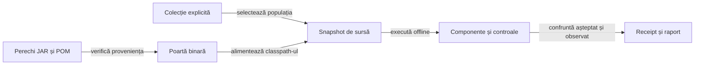

# Calificarea consumatorului și colecțiile offline

## Contract

O bibliotecă publicată, un proces încheiat și un HTML prezent au identități distincte de acceptanța produsului. Calificarea leagă intrările înghețate, populația selectată și rezultatele observate; un rezultat al altui consumator nu este acceptanță locală.



<details>
<summary>Legendă: identitatea și comportamentul sunt verificări complementare</summary>

Hash-ul identifică octeții declarați, nu demonstrează singur corectitudinea sau autenticitatea producătorului. Probele de comportament rulează clasele din JAR-ul efectiv, iar documentele și rezultatele istorice rămân legate de execuția lor originală.

</details>

## Poarta bibliotecilor

| Control | Sursă și limită |
|---|---|
| Suprafață declarată | [Politica adopției](../../config/library-adoption.json) cere cele cinci biblioteci și ghidurile admise; [proveniența](../../library-provenance.json) deține identitățile și originea. |
| Pereche fizică | Versiunea din POM-ul rădăcină, coordonata publicată, hash-urile JAR/POM și POM-ul încorporat trebuie să corespundă. |
| Coeziune binară | O versiune per bibliotecă, fără repository imbricat, implementări sursă paralele, surse Java în JAR sau clase străine bibliotecii. |
| Originea clasei | `CodeSource` trebuie să fie un JAR ale cărui octeți corespund perechii declarate; prezența numelui clasei nu este suficientă. |
| Contract consumat | [Componentele binare](../../atf-tests/src/test/java/atf/rentz/libraries/) verifică JSON și URL, politica Console, catalogul Mock și refuzurile de integritate. |
| Reporting | Adaptorul de test și inspectorul public confruntă Extent și fallback cu o populație declarată, verdicturi și comparații independente. |
| Responsabilitate | Test Kit este consumat prin JAR/POM; codul, nativele și guvernanța implementării rămân la owner; [rutarea feedback-ului](../feedback/README.md#biblioteci-comune) separă defectele comune de intrările consumatorului. |

Livrarea se compară cu perechea publicată și dovada producătorului, apoi primește acceptanță locală. Perechea înlocuită și proveniența ei se arhivează extern înaintea promovării; nu se reconstruiește biblioteca vecină pentru a satisface testele consumatorului.

## Colecții și populații

[Registrul colecțiilor](../../config/test-collections.json) este interpretat de [selectorul PowerShell](../../scripts/TestCollections.psm1). Intrarea standard este `regression`; o opțiune necunoscută, un selector fără țintă sau o populație XML diferită opresc calificarea.

| Colecție | Scop | Etape |
|---|---|---|
| `quick` | Reguli, frontiere și integrare rapidă. | Selecția Maven declarată, inclusiv adopția binară și guvernanța sursei; controale de infrastructură și runtime. |
| `regression` | Calificarea offline standard. | Toate clasele Maven de test, componente Android JVM, infrastructură și runtime. |
| `learning` | Regresii ale politicilor și mecanismului de evaluare. | Selecție Maven pentru AI și arenă; nu antrenează și nu admite automat date noi. |
| `infrastructure` | Adopție, surse, documentație și adaptorul de publicare. | Selecția Maven a porților și controalele PowerShell. |
| `android-jvm` | Coordonare, codec și persistență fără dispozitiv. | Bootstrap binar și teste Gradle ale aplicației; fără asamblare APK. |

```powershell
.\scripts\run-rentz-components.ps1 -Collection regression
```

Comanda pornește din rădăcina proiectului în PowerShell 7, cu JDK 21, Maven, SDK Android și cache-urile pregătite. [Infrastructura](ATF_Infrastructure.md) alocă staging-ul și ieșirile externe; [lansatorul Android JVM](../../scripts/test-rentz-android-jvm.ps1) primește sursa înghețată, nu o altă versiune live.

- Clasele Maven noi care respectă numele `*Test` intră automat în regresie; sursele de test neconforme sunt refuzate, nu ascunse printr-un glob.
- Clasele executate trebuie să coincidă cu selecția derivată din sursă; dublurile, suitele goale, eșecurile și skip-urile refuză calificarea.
- Android JVM păstrează propria populație XML și receipt; nu este raportat drept test Maven sau execuție Android nativă.
- Asamblarea APK cere calificarea `regression`, inclusiv Android JVM; o colecție focalizată nu devine acceptanță integrală prin redenumirea rezultatului.
- Arena și adaptorul nativ cer descriptorul clasei compilate și componenta lor calificată; nu depind de existența unui scenariu narativ fără legătură.

## Proces și captură proaspătă

| Frontieră | Invariantă |
|---|---|
| Înaintea comenzii | Verifică proprietarul și refuză numele de dovezi deja existente. |
| Proces deținut | UTF‑8 explicit, timeout de execuție și așteptări finite pentru terminare și drenarea stream-urilor; nu oprește alte procese. |
| După comandă | Verifică din nou proprietarul; un rezultat întors după revocare nu este acceptat. |
| Rezultat semantic | Exit zero nu confirmă singur dump-ul; mesajul de eroare, fișierul lipsă sau XML-ul invalid refuză observația. |
| Captură | XML nou, nume remote unic și semnătură PNG; octeții nativi sunt păstrați. Aceste verificări nu înlocuiesc acceptanța vizuală. |
| Eroare secundară | Închiderea nu înlocuiește cauza principală; diagnosticul de cleanup se păstrează separat. |

[Controalele runtime](../../atf-tests/tools/test-runtime-controls.ps1) injectează procesul și fișierele rezervării. Porturile de test nu trimit comenzi ADB; [protocolul nativ](ATF_Android.md) păstrează calificarea pe dispozitiv separat.

## Publicare și interpretare

[Adaptorul Reporting](../../atf-tests/src/test/java/atf/rentz/RentzRulePublication.java) transmite comparațiile deja evaluate și verdictul Kitului. Faza păstrează diagnosticul și durata execuției; rendererul măsoară publicarea separat.

| Probă | Ce trebuie păstrat |
|---|---|
| Pregătire, corp și închidere | Faza reală a erorii și verdictul JUnit; o pregătire eșuată nu produce o invocare verde. |
| Erori combinate | Cauza principală, erorile de teardown, publicare și close, fără înlocuire sau succes inventat. |
| Întrerupere controlată | Statut de skip, distinct de PASS; skip-ul refuză calificarea colecției standard. |
| Artefact fizic | Populația, expected/actual, verdicturile și resursele confruntate prin inspectorul public; un mutant cu resursă externă trebuie refuzat. |

XML-urile și receipt-urile descriu toate probele executate. HTML-ul narativ rămâne o selecție explicită de contracte auditate, fără a pretinde că publică fiecare probă de infrastructură sau fiecare distribuire virtuală.

[Componente](ATF_Components.md) · [Lifecycle aplicație](ATF_Lifecycle.md) · [Învățare](ATF_Learning.md)
