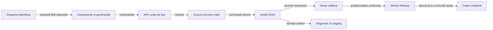

# Livrarea și distribuția Rentz Lab

## Pe scurt

Livrarea Rentz Lab identifică APK-ul Android semnat, sursa construirii, porțile trecute și copia descărcată. Dosarul din Git documentează ediția, iar canalul GitHub Releases distribuie binarul.

## Stări și responsabilități

| Stare | Criteriu |
|---|---|
| DRAFT | Metadate și documente inspectabile; fără binar sau descărcare calificată. |
| PREPARED | Porțile locale Android au trecut. Dosarul candidatului verifică APK-ul semnat și integritatea lui. |
| PUBLISHED | Tagul identifică sursele calificate. APK-ul publicat și copia descărcată sunt confruntate în canalul declarat. |

## Calificarea iOS

Catalogul și porțile RAG curente califică exclusiv APK-ul Android. O eventuală livrare iOS cere o țintă nativă, propriul artefact semnat și porți explicite de calificare și distribuție. [Criteriile de extindere](../feedback/ATF_Rentz.md#platforma-ios)

## Versiunea candidatului și staging

- `release/index.json` separă `currentVersion` de `candidate.version` și `candidate.versionCode`; pregătirea candidatului nu schimbă linkul produsului.
- O schimbare care cere release, inclusiv o refactorizare, avansează minorul. Catalogul permite omiterea minorilor care nu au fost publicați. O ruptură de compatibilitate justifică următorul major. `versionCode` crește și corespunde valorilor Gradle.
- Candidatele și rezultatele se pregătesc în workspace-ul J5 alocat, în afara checkout-ului. Rapoartele și APK-urile rămân sub rădăcina de date configurată prin `RENTZ_DATA_ROOT`, niciodată în TEMP arbitrar.
- Runner-ele folosesc workspace-uri externe înregistrate `components-<id>`, cu descriptor pentru proprietar, tip, ID și `sourceRoot`; RAG acceptă stagingul Android JVM numai când toate valorile corespund politicii și candidatului fixat.
- Promovarea în `main` păstrează același commit, manifest, rapoarte, APK și checksum. Orice schimbare de octeți cere o nouă calificare.
- După publicare și verificarea accesului, promovați versiunea la `currentVersion`, actualizați README-ul și eliminați `candidate` când acesta coincide cu ediția publicată.


<details>
<summary>Legendă: surse, dovezi și publicare</summary>

Tagul identifică sursa calificată a APK-ului. Commitul editorial poate fi ulterior. O corecție de prezentare păstrează tagul, binarul și dovada originale. Validarea navigării în browser cere o probă separată.

</details>

## Ordinea calificării Android curente

- Descărcați APK-ul ediției active și checksum-ul în `distribution/incoming/<versiune>` din depozitul extern.
- Comparați dimensiunea și SHA-256 cu manifestul înainte de regresie. Catalogul citește APK-ul și checksum-ul din `distribution/incoming/<versiune>` sub rădăcina externă de date. Git păstrează documentația și manifestul.

Din rădăcina proiectului, în PowerShell 7, cu JDK 21, Maven, SDK Android și cache-urile pregătite:

```powershell
.\scripts\run-rentz-components.ps1 -Collection regression -SourceRoot <worktree-J5-inregistrat>
.\scripts\build-rentz-android.ps1 -UiSanityOnly -ComponentRun <regresie-trecuta> -RunRoot <build-izolat>
.\atf-tests\tools\run-shared-ui-sanity.ps1 -BuildQualification <build-izolat>\ui-sanity-build-qualification.json -ComponentRun <regresie-trecuta> -ConsecutiveSubgames -CompactConsecutive -RunRoot <rulare-nativa>
.\scripts\run-release-rag.ps1 -Question 'gate:native-ui Rentz trei jocuri consecutive' -ComponentRun <regresie-trecuta> -UiBuildRun <build-izolat> -NativeUiRun <rulare-nativa> -RunRoot <RAG-prebuild>
```

După verdictul `readyForProductBuild=true`, construiți produsul cu identitatea de semnare provisionată. Builderul primește cele două dosare de acceptanță și recalculează verdictul pe sursa calificată înainte de staging Android și semnare.

```powershell
.\scripts\build-rentz-android.ps1 -Configuration Release -ComponentRun <regresie-trecuta> -UiBuildRun <build-izolat> -NativeUiRun <rulare-nativa> -RunRoot <build-produs>
.\scripts\run-release-rag.ps1 -Question 'gate:release-build APK Rentz semnat' -ComponentRun <regresie-trecuta> -BuildRun <build-produs> -UiBuildRun <build-izolat> -NativeUiRun <rulare-nativa> -RunRoot <RAG-final>
```

RAG citește dovezile originale, aplică verificările de calificare și înregistrează verdictul.

- Evaluatorul Java primește rădăcina externă `rentz_back/j5-active` calculată din Git common directory sau din `RENTZ_DATA_ROOT`. Workspace-ul de componente se înregistrează pe rădăcina sursei testate. RAG validează aceeași rădăcină la citirea dovezii Android JVM, inclusiv când scriptul este lansat din alt checkout.
- `READY_FOR_MAIN_PROMOTION_REVIEW` permite revizuirea operatorului.
- Publicarea și probele de descărcare au porți proprii.

- **Calificare locală:** regresie, Extent, Android JVM, build și acceptanța nativă obligatorie trebuie legate de același commit.
- **Traseul Android de release.** 3 mâini complete, cu Rentz prima.

Verificatorul nativ stabilește verdictul execuției din receipt. Validarea Extent confruntă separat capturile și comparațiile originale. Un raport alterat păstrează verdictul execuției și blochează calificarea. [Contractele distribuției](../../atf-tests/src/main/java/atf/rentz/distribution/README.md)
- **Distribuție reproductibilă.** Numai traseul consecutiv pornește varianta de test cu distribuția fixă declarată în Gradle. Din meniul normal se alege Rentz, apoi adversarii reali aleg Levate și Whist. Runnerul confruntă seed-ul din jurnal cu configurația și cere trei contracte distincte. Produsul folosește ceasul pentru partidele noi. [Configurația Android](../../rentz-lab-app/app/build.gradle) · [Proba de componentă](../../rentz-lab-app/app/src/test/java/ro/rentzlab/app/GameSessionTest.java)
- **Jocuri și afișaj.** Varianta `ro.rentzlab.app.uisanity` joacă în aceeași partidă contracte distincte până la `DEAL_END`. Profilul compact folosește 720 × 1280 pixeli, densitate 360 și text la 150%. Raportul verifică locurile, scorurile, istoricul după reluare și replay-ul independent, cu capturi native inline Base64. [Poarta RAG](../../atf-tests/src/main/java/atf/rentz/distribution/ReleaseReadinessRag.java) · [Probe de release](../../atf-tests/src/test/java/atf/rentz/governance/release/ReleaseGovernanceTest.java)
- **Legătura cu produsul:** RAG confruntă commitul și manifestul sursei, APK-ul de produs, APK-ul UI-sanity, raportul Extent și runnerul. Varianta UI-sanity este pachet de test distinct; hash-ul ei nu este raportat drept hash-ul APK-ului produs.
- **Profil de acceptanță:** runnerul citește dimensiunea logică, densitatea și scala de font din Android. RAG cere profilul compact efectiv și dimensiunea logică la fiecare checkpoint. Pierderea temporară a rădăcinii UI Automator se reîncearcă în limite, iar fiecare tap cere ierarhie proaspătă.
- **Realizări:** acceptanța verifică panoul de progres la primul punctaj manual, închiderea și reluarea fără o notificare repetată. Totalul de obiective vine din catalog. În Antrenament verifică separat filtrul Greu, căutarea și eligibilitatea. Traseul include repornirea și redenumirea profilului.
- **Build după acceptanță:** folosiți `-UiSanityOnly` pentru pachetul de test. RAG poate verifica probele native cu `-UiBuildRun` înaintea buildului de produs. Porniți buildul semnat după `readyForProductBuild=true`, apoi rulați RAG cu ambele dosare.
- **Joc automat:** acceptanța nativă joacă prima carte din Rentz manual, apoi bifează delegarea și cere mutări proprii în jurnalul public până la scor. Tabla finală este verificată după deschiderea ei din ecranul de punctaj.
- **Promovare:** lipsa, FAIL-ul sau o captură fără verificare păstrează candidatul în `STAGED_CANDIDATE_ONLY`. Numai trecerea porților `native-ui` și `native-ui-report`, alături de regresie și build, permite `READY_FOR_MAIN_PROMOTION_REVIEW`; publicarea remote rămâne o etapă separată.
- **Staging:** `ReleaseCatalog` verifică separat ediția publicată local și pasul de versiune al candidatului.
- **Revizuire:** după trecerea porților locale, RAG poate raporta `READY_FOR_MAIN_PROMOTION_REVIEW`; operatorul decide promovarea.
- **Publicare:** rularea locală lasă porțile remote la `NOT_RUN`. Verificarea după push folosește dovada GitHub autentificată și răspunsul anonim, prin `verify-release-readme.ps1 -Restricted`.

- Lansatorul verifică workspace-ul și colecția completă, apoi scrie indexul și raportul într-un director extern nou. Filtrele `gate:`, `class:` și `version:` sunt exacte; sunt returnate cel mult cinci citări cu commit, cale, linii și SHA-256.
- Corpusul este allowlistat și verificat înainte de indexare. Testele negative acoperă lipsa sursei, fragmente ostile și date sensibile; textul recuperat nu are autoritate de execuție sau verdict.
- Căutarea furnizează citările, indexul și semnalul de abținere. Calificarea citește separat receiptele originale și păstrează abținerea drept motiv de blocare a verdictului, cu starea porților consemnată din dovezi.
- La scriere, o schimbare a snapshotului revocă eligibilitatea pentru build și revizuirea promovării. Raportul păstrează stările și diagnosticele porților deja citite. [Responsabilitățile distribuției](../../atf-tests/src/main/java/atf/rentz/distribution/README.md)
- Poarta Extent confruntă fiecare suită și caz cu receipt-ul execuției și amprenta manifestului de sursă. Hash-ul HTML verifică integritatea fișierului; identitatea și rezultatele se verifică separat. [Dovezile componentei](ATF_Components.md#execuție)
- Pentru o regresie Maven eșuată înainte de Android JVM, lansatorul selectează classpath-ul din XML-urile Surefire ale modulului `atf-tests`, inclusiv dacă `game-core` apare primul. RAG păstrează `offline-regression = FAIL`, `android-jvm = NOT_RUN` și `aggregate = BLOCKED`. [Probe de guvernanță](../../atf-tests/src/test/java/atf/rentz/governance/release/ReleaseGovernanceTest.java)
- Diagnosticul scrie `release-rag-failure-extent.html` alături de raportul JSON. Extent leagă verdictul de hash-urile receipt-ului și raportului de componentă originale.
- Buildul folosește numai sursa fixată din receipt-ul regresiei. [Criteriile RAG rămase](../feedback/ATF_Release_RAG.md)

- **Cache concurent:** folosiți `-MavenRepository <cache-dedicat>` la calificare când alte procese pot încărca aceleași JAR-uri; calea rămâne în `infrastructure/cache`. Nu opriți procesele altui proprietar și nu transformați eroarea de înlocuire într-un rezultat verde.
- **Izolare:** staging-ul este workspace-ul temporar înregistrat de J5, în afara sursei și a TEMP-ului Windows. APK-ul, rapoartele și dovada originală rămân în depozitul extern. În `release/<versiune>` se publică documentele și manifestul ediției curente. Catalogul păstrează o singură ediție publicată, iar candidatul are un câmp separat în index. Poarta `local-catalog` refuză orice APK sau checksum găsit sub `release` și verifică binarul în `distribution/incoming/<versiune>` din rădăcina de date. Actualizați indexul și linkurile din README numai după descărcarea verificată.
- **Istoric:** Păstrați la căile originale dovezile citite de RAG și tagurile de sursă. Retragerea unei intrări GitHub Release urmează verificarea ediției noi. [Verificarea după curățare](ATF_Infrastructure.md#verificare-după-curățare)
- **Commit fixat:** pregătiți candidatul DRAFT într-un worktree `atf_j5` dintr-un workspace alocat de J5. Regresia refuză un worktree modificat și verifică din nou commit-ul, populația și hash-urile la final.
- **Intrări Android:** build-ul Release preia automat sursa din receipt-ul regresiei. Confruntă întregul inventar Android JVM, inclusiv configurația Gradle, resursele și biblioteca UI. Opțiunea `-UiSanity` produce separat varianta izolată și comparațiile pentru Extent din același snapshot.
- **Teste:** se păstrează populațiile Maven și Android JVM, fără FAIL, erori sau skip-uri; o selecție scurtă nu se redenumește regresie. Testele de guvernanță și controalele negative ale descărcării se execută offline înainte de publicare.
- **Build:** verifică sursa calificată, pachetul, versiunea, SDK-urile, caracterul nedebuggable, certificatul și alinierea. Numele final este `RentzLab-<versiune>.apk`.
- **Produs:** acceptanța nativă cu trei jocuri consecutive complete este obligatorie pentru fiecare APK candidat, inclusiv pentru refactorizări. Include Rentz și două contracte distincte, are rezervare proprie, registru de expuneri izolat și Extent auditat; registrul comun de învățare rămâne nemodificat. Lipsa ei nu devine PASS.
- **Date:** primul APK semnat are o identitate de cheie separată de prototipurile Debug. Nu dezinstalați automat un prototip cu date pentru a forța instalarea release-ului; migrarea datelor este o operație distinctă.

## Semnare și păstrarea cheii

- Cheia Rentz se păstrează în `.atf-signing` din checkout-ul principal. Toate worktree-urile folosesc această locație. Directorul este privat și exclus din Git.
- Parola aleatoare este protejată cu Windows DPAPI pentru utilizatorul curent. Procesul Java o primește prin mediu, fără argumente, loguri sau valori în Gradle.
- Inițializarea refuză o identitate parțială și nu rotește automat cheia. Pierderea cheii afectează actualizările: păstrați backup-ul cheii și o recuperare securizată a credențialei, inclusiv pentru schimbarea contului sau a calculatorului.
- [Contractul Android de semnare](https://developer.android.com/studio/publish/app-signing) deține compatibilitatea actualizărilor; `targetSdk` nu demonstrează singur funcționarea pe toate versiunile Android.

## Dosar și raportare

| Fișier | Rol |
|---|---|
| release/index.json | Versiunea curentă și repository-ul; sursa păstrează numai dosarul ediției active. |
| release-validation.json | Identitatea binarului, starea, calificarea și inventarul hash-urilor. |
| README și release-notes | Descărcare și capabilități confirmate; testele se explică prin legătura către reports. |
| reports/README | Scopul fiecărei selecții, proveniența, suprapunerile și limitele ei. |
| HTML Extent | Comparații capturate, diagnostice originale și corpuri inline; folderele cu copii redundante nu sunt livrabilul de audit. |
| XML și receipt | Numărare independentă și identitatea intrărilor; nu substituie expected/actual necapturat. |

- `atf-reporting` este dependența modulului Maven `atf-tests`; versiunea vine din proprietatea `atf.reporting.version`, iar testul de adopție verifică perechea JAR/POM și SHA-256 din [proveniența consumerului](../../library-provenance.json).
- Colecția de componente produce Extent din XML-urile Surefire originale și reconciliază fiecare suită, testcase și total. Raportul nu inventează aserțiuni de domeniu pe care XML-ul nu le păstrează.
- Sanity-ul Android produce Extent prin aceeași bibliotecă. RAG confruntă fiecare checkpoint în ordinea execuției, cu toate perechile așteptat și observat, și verifică octeții PNG inline față de captura originală. Capturile identice pot referi aceeași imagine încorporată. Ierarhia nativă rămâne în dosarul de dovezi.
- Receipt-ul păstrează versiunea și hash-ul JAR-ului, sursa, intrările, rezultatul și digestul HTML. APK-ul și raportul rămân artefacte externe.

[Politica de reproducere a sursei](ATF_Qualification.md#reproducerea-sursei-atestate) păstrează octeții Git pentru toate intrările atestate. Înainte de push se confruntă inventarul din Git cu octeții din workspace.

## Publicare și descărcare

1. Promovați commitul calificat pe `main`. Pentru GitHub restricționat, porniți [reluarea publicării](#reluarea-publicării-restricționate) cu artefactul semnat și checksum-ul lui.
2. Citiți receipt-ul publicării înaintea pregătirii catalogului. La întrerupere, păstrați același jurnal și recitiți starea remote.
3. Verificați README → release curent → asset: bytes efectivi, SHA-256 și toate CRC-urile. Un răspuns 404 salvat cu extensia APK rămâne eroare.
4. Păstrați distinct accesul autentificat, accesul fără sesiune și blocarea browserului. Tokenul API nu se transmite originilor CDN; o probă Android poate consuma numai redirectul temporar al asset-ului, fără expunerea lui în rapoarte.
5. Rulați intrarea explicită de acceptanță a distribuției cu classpath-ul calificat și tokenul numai în mediu. Nu o includeți implicit în regresia offline.
6. Actualizați catalogul și secțiunea **Jocul** din README conform [contractului de navigare](#linkurile-din-readme).
7. După push, rulați `scripts/verify-release-readme.ps1 -Restricted` cu raportul RAG calificat și directorul probelor de distribuție. Verificatorul citește README-ul din commitul remote, confruntă linkurile și octeții descărcați și salvează `readme-publication` în depozitul extern.
8. Retrageți edițiile anterioare când `readme-publication.retirement.allowed` este `true`. Pe lângă tagul `latest` și descărcarea autentificată, verificatorul recitește Extent-ul componentelor și cel nativ. Pentru apelul direct, transmiteți `-ComponentExtent` și `-NativeExtent` cu căile fișierelor originale.
9. Păstrați tagurile Git și dovezile de audit. După retragere, confruntați din nou inventarul și descărcarea ediției curente.

[Calificarea componentelor](ATF_Qualification.md) · [Protocolul Android](ATF_Android.md) · [Catalogul livrării](../../release/README.md)

### Reluarea publicării restricționate

Din checkout-ul calificat, utilizați acreditările Git pentru tag și `GH_TOKEN` sau `GITHUB_TOKEN` pentru [API-ul GitHub Releases](https://docs.github.com/en/rest/releases/releases). Păstrați același fișier de jurnal extern între încercări și un director nou pentru fiecare rulare RAG.

```powershell
.\scripts\run-release-rag.ps1 -Question 'publicare GitHub restricționată' `
  -ComponentRun $components -BuildRun $build -NativeUiRun $native -UiBuildRun $uiBuild `
  -ResumeRestrictedPublication -PublicationJournal $journal -PublicationChecksum $checksum -RunRoot $attempt
```

| Stare observată | Efect |
|---|---|
| Sursa calificată se află pe `main`, iar canalul de artefacte este privat | RAG recitește porțile și reconciliază tagurile ambelor repository-uri. |
| Există un draft unic pentru tag | Confirmă release ID și salvează identitatea înainte de upload. Verifică inventarul complet al draftului. |
| GitHub confirmă crearea, iar draftul încă lipsește din inventar | Salvează ID-ul și citește inventarul de cel mult trei ori. Un ID diferit, un duplicat, o sursă diferită sau o ediție stabilă mai nouă opresc publicarea. |
| APK-ul sau checksum-ul are nume, stare, mărime și SHA-256 identice | Reutilizează fișierul și încarcă doar ce lipsește. |
| Repo-ul de distribuție are o ediție stabilă mai nouă | Refuză promovarea cu `PUBLICATION-NEWER-STABLE`. Trimite zero cereri `PATCH`. |
| Inventarul publicării este incomplet ori un tag stabil are format necunoscut | Oprește promovarea. Verifică accesul API și tagurile din canal înainte de reluare. |
| Draftul are ambele artefacte exacte și versiunea este admisă | Publică draftul verificat și recitește starea. |
| Ediția căutată este deja publicată și verificată | Refolosește ID-ul și artefactele prin citire, inclusiv după publicarea altei ediții. |
| Tagul, draftul sau artefactul diferă ori răspunsul la scriere se pierde | Oprește operația. Următoarea rulare recitește starea și jurnalul înainte să decidă următoarea scriere. |

- Dacă draftul rămâne invizibil, RAG înregistrează `PUBLICATION-DRAFT-NOT-VISIBLE` și păstrează ID-ul pentru reluare. Încărcarea pornește după confirmarea identității.
- **Inventar.** Citește toate paginile canalului și compară numeric tagurile stabile `vMAJOR.MINOR.PATCH`. Exclude drafturile și prerelease-urile.
- **Momentul verificării.** Verifică ordinea înaintea scrierilor în GitHub și din nou imediat înainte de promovare.
- **Recitirea porților.** Valorile întregi din raport și din evaluarea curentă trebuie să fie egale exact. Un număr schimbat sau înlocuit cu text blochează publicarea.
- **Jurnal și raport.** Jurnalul fixează repository-urile, tagul, commitul, hash-urile și ID-ul observat. Raportul Extent păstrează pașii confirmați și diagnosticul ultimei încercări. [Implementare și mock-uri](../../atf-tests/src/test/java/atf/rentz/distribution/publication/ReleasePublicationResumeTest.java)

Verificarea README-ului remote, descărcarea autentificată și refuzul accesului anonim se fac după publicare. Pentru retragere se aplică aceleași [porți de distribuție](#distribuție-cu-autentificare).

### Rezervarea canalului de promovare

Fiecare canal privat de distribuție are o referință Git comună, `refs/tags/atf-rentz-promotion-lock`. Procesul o creează numai dacă este liberă și înregistrează în Extent SHA-ul proprietarului. Operarea cere acces Git pentru crearea și ștergerea acelei referințe.

| Stare | Efect |
|---|---|
| Canal liber | Rezervă canalul cu un SHA unic. Recitește draftul, artefactele și edițiile stabile după obținerea rezervării. |
| Canal ocupat | Întoarce `PUBLICATION-CHANNEL-IN-USE`, cu zero cereri `PATCH` din încercarea blocată. |
| Promovare confirmată sau oprire înainte de PATCH | Eliberează referința numai dacă SHA-ul proprietarului corespunde. |
| PATCH trimis cu rezultat incert | Păstrează rezervarea. Administratorul confruntă identitatea raportată cu starea de pe GitHub. |

Rezervarea acoperă operatorii care publică prin RAG. Pentru recuperare, confirmați oprirea proprietarului și rezultatul cererii PATCH înainte de preluare.

1. Citiți SHA-ul curent și confruntați-l cu dovada operației.
2. Ștergeți referința condiționat folosind SHA-ul confirmat.
3. Reluați verificarea versiunii din jurnalul propriu.

```powershell
$ref = 'refs/tags/atf-rentz-promotion-lock'
git ls-remote --refs $channel $ref
git push "--force-with-lease=${ref}:$ownerSha" $channel ":${ref}"
```

`$channel` este URL-ul Git al canalului de distribuție, iar `$ownerSha` este SHA-ul confirmat pentru operația închisă. [Condiția Git pentru actualizarea referinței](https://git-scm.com/docs/git-push) · [Probe de coordonare](../../atf-tests/src/test/java/atf/rentz/distribution/publication/ReleasePromotionCoordinationTest.java)

### Calificarea permisiunilor pe GitHub

Folosiți un repository privat de test fără ediții și trei conturi GitHub distincte. Două conturi au drept de citire și scriere, iar al treilea poate citi. Alegeți explicit canalul de test și furnizați credențialele în mediul procesului, prin mecanismul local de secrete.

| Variabilă | Identitatea verificată |
|---|---|
| `RENTZ_PROMOTION_WRITER_A` | Primul cont cu citire și scriere |
| `RENTZ_PROMOTION_WRITER_B` | Al doilea cont cu citire și scriere |
| `RENTZ_PROMOTION_READER` | Contul cu citire |

```powershell
.\scripts\run-release-rag.ps1 -Question 'calificare permisiuni canal' `
  -ComponentRun $components -RunRoot $attempt -PromotionTestRepository $testRepository
```

- **Identitate.** API-ul confirmă ID-uri de utilizator distincte și același ID de repository privat. Comenzile Git folosesc credențiala rolului curent, limitată la URL-ul de test.
- **Drepturi.** Cititorul primește refuz de la serviciul Git de scriere și rezervarea rămâne liberă. Operatorii o obțin pe rând, iar un SHA străin păstrează rezervarea curentă.
- **Dovadă.** `promotion-channel.json` identifică sursa și amprenta raportului Extent. O rulare incompletă rămâne `BLOCKED`. Certificarea APK-ului are porțile din [ordinea calificării Android](#ordinea-calificării-android-curente).

[Controalele offline ale probei](../../atf-tests/src/test/java/atf/rentz/distribution/publication/GitHubPromotionQualificationTest.java) · [Identități în API-ul GitHub](https://docs.github.com/en/rest/users/users) · [Permisiuni de repository](https://docs.github.com/en/rest/repos/repos#get-a-repository)

### Linkurile din README

README-ul principal începe cu jocul, descărcarea și prima partidă. Secțiunea **Jocul** conține câte o legătură pe rând.

| Stare | Legături în ordine |
|---|---|
| `DRAFT` | Dosarul ediției |
| `PREPARED` | Dosarul ediției, APK-ul local |
| `PUBLISHED`, acces restricționat | Dosarul ediției, APK-ul direct din canalul calificat |
| `PUBLISHED`, acces public | Pagina release-ului, APK-ul direct din canalul calificat |

Catalogul verifică unicitatea secțiunii, ordinea și adresele. Verificatorul post-publicare cere aceeași formă în README-ul remote. Condițiile de acces, compatibilitatea Android și dovezile ediției se citesc în documentele de distribuție și în dosarul ediției.

### Distribuție cu autentificare

Distribuiți candidatul numai după calificarea RAG locală și verificarea semnăturii. Folosiți un canal cu acces restricționat la conturile permise. Un prerelease GitHub dintr-un repository public are aceeași vizibilitate publică a artefactelor.

- Confirmați prin API că repository-ul GitHub al artefactelor este privat înainte de upload. Un repository privat separat, al aceluiași proprietar, permite păstrarea accesului existent la surse. Tagul din ambele repository-uri identifică același commit calificat.
- Verificați permisiunile și descărcați APK-ul și fișierul SHA-256 din GitHub Releases cu un cont autorizat. Confruntați dimensiunea, digestul și numele fișierului cu binarul calificat. Păstrați dovada în dosarul extern, fără acreditări sau URL-uri temporare.
- Registrul `release/restricted-<versiune>.json` leagă release-ul și asset-ul privat de manifestul ediției active. Catalogul refuză o a doua rută de descărcare în README.
- După push, folosiți `verify-release-readme.ps1 -Restricted` cu raportul RAG local calificat și proba de descărcare autentificată. `run-release-rag.ps1 -PublicationEvidence <dovezi> -RestrictedPublication` transmite și rapoartele din rulările calificate.
- `retirement.extentEvidence` păstrează calea, lungimea, SHA-256 și commitul fiecărui Extent verificat. Un fișier lipsă, modificat sau atribuit altei surse blochează retragerea. Verificarea descărcării are verdict propriu.

### APK de test

Varianta `ui-sanity` are pachet și artefact separat pentru acceptanța Android. Secțiunea **Jocul** păstrează linkul ediției de produs calificate până la publicarea succesorului. Poarta `release-build` confruntă `versionName` din APK-ul semnat cu versiunea numerică din catalog și cere numele exact `RentzLab-<versiune>.apk`.

### Proba Android a APK-ului livrat

- Identificați APK-ul folosit de fiecare probă nativă. Dacă măsurătorile folosesc un APK de test, notați-i hash-ul separat.
- Pentru acceptanța binarului livrat, instalați APK-ul semnat cu hash-ul din manifest și verificați identitatea instalată.
- Executați o probă scurtă de pornire și reluare. La upgrade, comparați salvarea înainte și după instalare pornind din versiunea publicată anterior.

## Acceptanța live a descărcării

Din rădăcina proiectului, după publicare, cu JDK 21 și descriptorul componentelor trecute:

```powershell
$runtime = Get-Content -Raw <ComponentRun>/native-runtime.json | ConvertFrom-Json
& java -cp $runtime.classpath atf.rentz.distribution.ReleaseDownloadAcceptance (Get-Location).Path <director-extern-nou>
```

- Tokenul se citește din `GH_TOKEN` sau `GITHUB_TOKEN`; nu se transmite ca argument și nu intră în rapoarte.
- Intrarea cere starea PUBLISHED și identitatea curentă verificată; produce șase comparații efective și diagnostic FAIL la eroare, fără fallback la o versiune anterioară.
- Componentele offline califică separat oracolul comparațiilor, metadata și transportul loopback. Raportul live rămâne distinct de navigarea browserului și de instalarea Android.

## Corpuri complete în dosarul de audit

- Raportul de livrare configurează explicit `new ReportingSettings(240, ReportingSettings.DISABLE_BODY_DISPLAY_LIMIT)`: bugetul aserțiunii rămâne separat de păstrarea integrală a corpului. Setarea implicită a corpului este un preview de 100 de caractere, nu o arhivă recuperabilă prin expandare.
- Deschideți efectiv scenariul, faza și fiecare disclosure de corp în browserul offline; verificați ultima aserțiune și textul integral al dovezii. Nu considerați prezența unui titlu sau a prefixului JSON drept audit complet.
- Dacă prezentarea a trunchiat o probă capturată, regenerați numai HTML-ul din aceleași intrări, păstrând verdictul și durata execuției originale. Fără replay implicit sau nou rezultat JUnit dedus.
