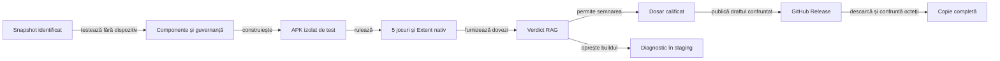

# Livrarea și distribuția Rentz Lab

## Pe scurt

O livrare identifică artefactele semnate ale platformelor declarate (în prezent Android/APK), sursele construirii, porțile trecute și copia primită de utilizator. Publicarea GitHub și dosarul documentar sunt suprafețe distincte.

## Stări și responsabilități

| Stare | Criteriu |
|---|---|
| DRAFT | Metadate și documente inspectabile; fără binar sau descărcare calificată. |
| PREPARED | Porțile comune și cele specifice fiecărei platforme declarate au trecut; artefactele semnate și integritatea lor sunt verificate în dosarul candidatului. |
| PUBLISHED | Tag fixat pe sursele calificate, artefactele tuturor platformelor declarate confruntate și descărcarea fiecăruia verificată în canalul anunțat. |

## Calificarea iOS

Livrarea curentă este Android. Orice extindere iOS are contract și probe proprii.

| Decizie iOS | Cerință |
|---|---|
| Platforme declarate | Candidatele noi numesc explicit platformele. Un manifest istoric numai cu APK înseamnă livrare Android; lipsa câmpului nu implică iOS. |
| Motor | Înainte de implementare, documentați motorul portabil comun sau motorul iOS separat. Ambele folosesc aceiași vectori pentru reguli, scor, Normal/Hard, salvare și reluare. |
| Aplicație | Interfața, ciclul de viață și persistența native au calificare distinctă. |
| Diferențe | Orice abatere de la Android este deliberată, vizibilă în contract și verificată cu aceleași așteptări de domeniu. |

| Cerință | Dovadă minimă pentru o afirmație de suport iOS |
|---|---|
| Versiuni OS | Politica de suport declară versiunea minimă și califică cea mai nouă versiune stabilă publică iOS disponibilă la momentul release-ului. Versiunile intermediare incluse în politica produsului rămân în matrice; versiunile beta nu înlocuiesc calificarea stabilă. |
| Build și simulator | Țintă Xcode reală, scheme identificabile, versiune Xcode/SDK fixată în receipt și teste pe simulatorul versiunii minime și pe simulatorul stabil curent. Numele plutitor `macos-latest` fără versiunea Xcode/runtime observată nu este identitate de build suficientă. |
| Reguli și componente | Suitele iOS verifică aceiași vectori de reguli și scor ai motorului de referință; testele componente rămân principala acoperire. Un rezultat JVM Android nu substituie testul adapterului sau al persistenței iOS. |
| Dispozitiv fizic | Înaintea unei afirmații de distribuție către utilizatori, cel puțin o instalare pe un iPhone fizic verifică pornirea, o partidă, salvarea și reluarea. Simulatorul nu certifică performanța sau capabilitățile hardware ale dispozitivului. |
| Distribuție | IPA/Archive-ul, Bundle ID, versiunea/build number, echipa și identitatea semnării sunt distincte de APK. TestFlight/App Store au receipt-uri și fluxuri de distribuție proprii; niciun link Android nu este reutilizat pentru iOS. |

Planificați infrastructura macOS separat de semnarea și distribuția iOS.

- Un simulator iOS poate fi construit și exercitat într-un job macOS; dezvoltatorul nu are nevoie de un Mac local.
- Conform politicii curente, runner-ele GitHub standard sunt gratuite pentru repository-urile publice, iar runner-ele mai mari sunt taxate. Verificați politica, eticheta runnerului și versiunea Xcode înaintea fiecărui release.
- Semnarea și distribuția iOS cer configurarea protejată a certificatelor, profilurilor și accesului Apple.
- Surse oficiale: [facturarea Actions](https://docs.github.com/en/actions/concepts/billing-and-usage), [runner-ele găzduite](https://docs.github.com/en/actions/reference/runners/github-hosted-runners), [versiunile stabile Apple](https://developer.apple.com/news/releases/), [testarea pe simulator sau dispozitiv](https://developer.apple.com/documentation/Xcode/running-your-app-on-simulated-or-physical-devices), [certificate Apple](https://developer.apple.com/help/account/certificates/certificates-overview), [distribuirea prin Xcode](https://developer.apple.com/documentation/Xcode/distributing-your-app-for-beta-testing-and-releases).

RAG-ul aplică domeniul declarat: pentru o ediție numai pentru Android, iOS este în afara livrării și nu se deduce PASS; pentru o ediție care declară iOS, lipsa țintei, a buildului Xcode, a receipt-urilor sau a probei cerute blochează afirmația iOS independent de rezultatul Android. Ghidul de produs și criteriile deschise sunt în [feedback-ul iOS](../feedback/ATF_Rentz.md#platforma-ios).

## Versiunea candidatului și staging

- `release/index.json` separă `currentVersion` de `candidate.version` și `candidate.versionCode`; pregătirea candidatului nu schimbă linkul produsului.
- O schimbare care cere release, inclusiv o refactorizare, avansează minorul. Catalogul permite omiterea minorilor care nu au fost publicați. O ruptură de compatibilitate justifică următorul major. `versionCode` crește și corespunde valorilor Gradle.
- Candidatele și rezultatele se pregătesc în workspace-ul J5 alocat, în afara checkout-ului. Rapoartele și APK-urile rămân sub rădăcina de date configurată prin `RENTZ_DATA_ROOT`, niciodată în TEMP arbitrar.
- Runner-ele folosesc workspace-uri externe înregistrate `components-<id>`, cu descriptor pentru proprietar, tip, ID și `sourceRoot`; RAG acceptă stagingul Android JVM numai când toate valorile corespund politicii și candidatului fixat.
- Promovarea în `main` păstrează același commit, manifest, rapoarte, APK și checksum. Orice schimbare de octeți cere o nouă calificare.
- După publicare și verificarea accesului, promovați versiunea la `currentVersion`, actualizați README-ul și eliminați `candidate` când acesta coincide cu ediția publicată.


<details>
<summary>Legendă: surse, dovezi și publicare</summary>

Tagul identifică sursa comună a artefactelor declarate. Fiecare artefact își păstrează identitatea și receipt-ul platformei. Commit-ul dovezilor poate fi ulterior; corecția unei prezentări nu mută tagul și nu înlocuiește binarul publicat. O descărcare API sau nativă nu califică automat navigarea vizuală din browser.

</details>

## Ordinea calificării Android curente

- Aduceți în `release/<versiune>` APK-ul ediției active și checksum-ul, din depozitul extern sau din GitHub cu un cont autorizat.
- Comparați dimensiunea și SHA-256 cu manifestul înainte de regresie. Git păstrează manifestul, iar fișierele binare sunt ignorate.

Din rădăcina proiectului, în PowerShell 7, cu JDK 21, Maven, SDK Android și cache-urile pregătite:

```powershell
.\scripts\run-rentz-components.ps1 -Collection regression -SourceRoot <worktree-J5-inregistrat>
.\scripts\build-rentz-android.ps1 -UiSanityOnly -ComponentRun <regresie-trecuta> -RunRoot <build-izolat>
.\atf-tests\tools\run-shared-ui-sanity.ps1 -BuildQualification <build-izolat>\ui-sanity-build-qualification.json -ComponentRun <regresie-trecuta> -ConsecutiveSubgames -CompactConsecutive -RunRoot <rulare-nativa>
.\scripts\run-release-rag.ps1 -Question 'gate:native-ui Rentz cinci jocuri consecutive' -ComponentRun <regresie-trecuta> -UiBuildRun <build-izolat> -NativeUiRun <rulare-nativa> -RunRoot <RAG-prebuild>
```

După verdictul `readyForProductBuild=true`, construiți produsul cu identitatea de semnare provisionată. Builderul primește cele două dosare de acceptanță și recalculează verdictul pe sursa calificată înainte de staging Android și semnare.

```powershell
.\scripts\build-rentz-android.ps1 -Configuration Release -ComponentRun <regresie-trecuta> -UiBuildRun <build-izolat> -NativeUiRun <rulare-nativa> -RunRoot <build-produs>
.\scripts\run-release-rag.ps1 -Question 'gate:release-build APK Rentz semnat' -ComponentRun <regresie-trecuta> -BuildRun <build-produs> -UiBuildRun <build-izolat> -NativeUiRun <rulare-nativa> -RunRoot <RAG-final>
```

RAG citește dovezile originale, aplică verificările de calificare și înregistrează verdictul. Etapa `READY_FOR_MAIN_PROMOTION_REVIEW` permite operatorului să revizuiască promovarea. Publicarea și probele de descărcare au porți proprii.

- **Calificare locală:** regresie, Extent, Android JVM, build și acceptanța nativă obligatorie trebuie legate de același commit.
- **Jocuri și display:** pentru fiecare APK candidat, varianta `ro.rentzlab.app.uisanity` execută prin interfață cinci deal-uri complete în aceeași partidă. Începe cu Rentz și acoperă cel puțin trei contracte distincte. Fiecare deal ajunge la `DEAL_END`. Profilul compact folosește 720 × 1280 pixeli, densitate 360 și text la 150%. Raportul verifică locurile la fiecare joc și după reluare, scorurile și istoricul, replay-ul independent și capturile native inline Base64. Poarta este impusă de [`attachNativeUiReceipt`](../../atf-tests/src/main/java/atf/rentz/distribution/ReleaseReadinessRag.java) și protejată de [regresia mutantelor de release](../../atf-tests/src/test/java/atf/rentz/governance/release/ReleaseGovernanceTest.java). Traseul califică segmentul de cinci deal-uri, de la pornire până la reluarea sesiunii după repornirea procesului.
- **Legătura cu produsul:** RAG confruntă commitul și manifestul sursei, APK-ul de produs, APK-ul UI-sanity, raportul Extent și runnerul. Varianta UI-sanity este pachet de test distinct; hash-ul ei nu este raportat drept hash-ul APK-ului produs.
- **Profil de acceptanță:** runnerul citește dimensiunea logică, densitatea și scala de font din Android. RAG cere profilul compact efectiv și dimensiunea logică la fiecare checkpoint. Pierderea temporară a rădăcinii UI Automator se reîncearcă în limite, iar fiecare tap cere ierarhie proaspătă.
- **Realizări:** acceptanța verifică panoul de progres la primul punctaj manual, închiderea și reluarea fără o notificare repetată. Totalul de obiective vine din catalog. În Antrenament verifică separat filtrul Greu, căutarea și eligibilitatea. Traseul include repornirea și redenumirea profilului.
- **Build după acceptanță:** folosiți `-UiSanityOnly` pentru pachetul de test. RAG poate verifica probele native cu `-UiBuildRun` înaintea buildului de produs. Porniți buildul semnat după `readyForProductBuild=true`, apoi rulați RAG cu ambele dosare.
- **Joc automat:** acceptanța nativă joacă prima carte din Rentz manual, apoi bifează delegarea și cere mutări proprii în jurnalul public până la scor. Tabla finală este verificată după deschiderea ei din ecranul de punctaj.
- **Promovare:** lipsa, FAIL-ul sau o captură fără verificare păstrează candidatul în `STAGED_CANDIDATE_ONLY`. Numai trecerea porților `native-ui` și `native-ui-report`, alături de regresie și build, permite `READY_FOR_MAIN_PROMOTION_REVIEW`; publicarea remote rămâne o etapă separată.
- **Staging:** `ReleaseCatalog` verifică separat ediția publicată local și pasul de versiune al candidatului.
- **Revizuire:** după trecerea porților locale, RAG poate raporta `READY_FOR_MAIN_PROMOTION_REVIEW`; operatorul decide promovarea.
- **Publicare:** rularea locală lasă porțile remote la `NOT_RUN`. Verificarea după push folosește dovada GitHub autentificată și răspunsul anonim, prin `verify-release-readme.ps1 -Restricted`.

- Lansatorul verifică workspace-ul și colecția completă, apoi scrie indexul și raportul într-un director extern nou. Filtrele `gate:`, `class:` și `version:` sunt exacte; sunt returnate cel mult cinci citări cu commit, cale, linii și SHA-256.
- Corpusul este allowlistat și verificat înainte de indexare. Testele negative acoperă lipsa sursei, fragmente ostile și date sensibile; textul recuperat nu are autoritate de execuție sau verdict.
- Poarta Extent confruntă fiecare suită și caz cu receipt-ul execuției și amprenta manifestului de sursă. Hash-ul HTML verifică integritatea fișierului; identitatea și rezultatele se verifică separat. [Dovezile componentei](ATF_Components.md#execuție)
- Pentru o regresie Maven eșuată înainte de Android JVM, lansatorul selectează classpath-ul din XML-urile Surefire ale modulului `atf-tests`. RAG păstrează `offline-regression = FAIL`, `android-jvm = NOT_RUN` și `aggregate = BLOCKED`.
- Diagnosticul scrie `release-rag-failure-extent.html` alături de raportul JSON. Extent leagă verdictul de hash-urile receipt-ului și raportului de componentă originale.
- Buildul folosește numai sursa fixată din receipt-ul regresiei. [Criteriile RAG rămase](../feedback/ATF_Release_RAG.md)

- **Cache concurent:** folosiți `-MavenRepository <cache-dedicat>` la calificare când alte procese pot încărca aceleași JAR-uri; calea rămâne în `infrastructure/cache`. Nu opriți procesele altui proprietar și nu transformați eroarea de înlocuire într-un rezultat verde.
- **Izolare:** staging-ul este workspace-ul temporar înregistrat de J5, în afara sursei și a TEMP-ului Windows. Rulările intermediare rămân în depozitul extern; numai dosarul selectat se copiază în `release/<versiune>`.
- **Istoric:** arhivați dovezile în `distribution/archives` înainte de înlocuirea dosarului activ. Păstrați tagurile de sursă. Retrageți intrările GitHub Release înlocuite după verificarea ediției noi.
- **Commit fixat:** pregătiți candidatul DRAFT într-un worktree `atf_j5` dintr-un workspace alocat de J5. Regresia refuză un worktree modificat și verifică din nou commit-ul, populația și hash-urile la final.
- **Intrări Android:** build-ul Release preia automat sursa din receipt-ul regresiei. Confruntă întregul inventar Android JVM, inclusiv configurația Gradle, resursele și biblioteca UI. Opțiunea `-UiSanity` produce separat varianta izolată și comparațiile pentru Extent din același snapshot.
- **Teste:** se păstrează populațiile Maven și Android JVM, fără FAIL, erori sau skip-uri; o selecție scurtă nu se redenumește regresie. Testele de guvernanță și controalele negative ale descărcării se execută offline înainte de publicare.
- **Build:** verifică sursa calificată, pachetul, versiunea, SDK-urile, caracterul nedebuggable, certificatul și alinierea. Numele final este `RentzLab-<versiune>.apk`.
- **Produs:** acceptanța nativă cu cinci jocuri consecutive complete este obligatorie pentru fiecare APK candidat, inclusiv pentru refactorizări. Are rezervare proprie, registru de expuneri izolat și Extent auditat; registrul comun de învățare rămâne nemodificat. Lipsa ei nu devine PASS.
- **Date:** primul APK semnat are o identitate de cheie separată de prototipurile Debug. Nu dezinstalați automat un prototip cu date pentru a forța instalarea release-ului; migrarea datelor este o operație distinctă.

## Semnare și păstrarea cheii

- Cheia Rentz este persistentă în zona privată `infrastructure/signing` a depozitului extern; nu aparține cache-ului, sursei sau dosarului release.
- Parola aleatoare este protejată cu Windows DPAPI pentru utilizatorul curent. Procesul Java o primește prin mediu, fără argumente, loguri sau valori în Gradle.
- Inițializarea refuză o identitate parțială și nu rotește automat cheia. Pierderea cheii afectează actualizările: păstrați backup-ul cheii și o recuperare securizată a credențialei, inclusiv pentru schimbarea contului sau a calculatorului.
- [Contractul Android de semnare](https://developer.android.com/studio/publish/app-signing) deține compatibilitatea actualizărilor; `targetSdk` nu demonstrează singur funcționarea pe toate versiunile Android.

## Dosar și raportare

| Fișier | Rol |
|---|---|
| release/index.json | Versiunea curentă și repository-ul; sursa păstrează numai dosarul ediției active. |
| release-validation.json | Identitatea binarului, starea, calificarea și inventarul hash-urilor. |
| README și release-notes | Descărcare și capabilități confirmate; testele se explică prin legătura către reports. |
| reports/README | Scopul fiecărei selecții, proveniența, suprapunerile și limitele ei. |
| HTML Extent | Comparații capturate, diagnostice originale și corpuri inline; folderele cu copii redundante nu sunt livrabilul de audit. |
| XML și receipt | Numărare independentă și identitatea intrărilor; nu substituie expected/actual necapturat. |

- `atf-reporting` este dependența modulului Maven `atf-tests`; versiunea vine din proprietatea `atf.reporting.version`, iar testul de adopție verifică perechea JAR/POM și SHA-256 din [proveniența consumerului](../../library-provenance.json).
- Colecția de componente produce Extent din XML-urile Surefire originale și reconciliază fiecare suită, testcase și total. Raportul nu inventează aserțiuni de domeniu pe care XML-ul nu le păstrează.
- Sanity-ul Android produce Extent prin aceeași bibliotecă. RAG confruntă fiecare checkpoint în ordinea execuției, cu toate perechile așteptat și observat, și verifică octeții PNG inline față de captura originală. Capturile identice pot referi aceeași imagine încorporată. Ierarhia nativă rămâne în dosarul de dovezi.
- Receipt-ul păstrează versiunea și hash-ul JAR-ului, sursa, intrările, rezultatul și digestul HTML. APK-ul și raportul rămân artefacte externe.

[Atributele Git](https://git-scm.com/docs/gitattributes) dezactivează conversia text pentru intrările APK și dosarul release. Înainte de push se confruntă octeții din Git cu inventarul, separat de copia din workspace.

## Publicare și descărcare

1. Comiteți sursele calificate și fixați tagul; nu publicați un APK construit din alte intrări.
2. Creați draftul prin [API-ul GitHub Releases](https://docs.github.com/en/rest/releases/releases), cu APK și checksum. Salvați imediat ID-ul draftului în rezultatul extern.
3. La o reluare, recitiți obiectul după ID, asset-urile și hash-urile. Un 404 după tag nu justifică recrearea sau upload-ul repetat fără reconciliere.
4. Publicați doar populația exactă de assets și marcați ediția curentă drept latest. Binarul publicat rămâne stabil; o schimbare a sa cere versiune nouă.
5. Verificați README → release curent → asset: bytes efectivi, SHA-256 și toate CRC-urile. Un răspuns 404 salvat cu extensia APK rămâne eroare.
6. Păstrați distinct accesul autentificat, accesul fără sesiune și blocarea browserului. Tokenul API nu se transmite originilor CDN; o probă Android poate consuma numai redirectul temporar al asset-ului, fără expunerea lui în rapoarte.
7. Rulați intrarea explicită de acceptanță a distribuției cu classpath-ul calificat și tokenul numai în mediu. Nu o includeți implicit în regresia offline.
8. Actualizați catalogul și secțiunea **Jocul** din README conform [contractului de navigare](#linkurile-din-readme).
9. După push, rulați `scripts/verify-release-readme.ps1 -Restricted` cu raportul RAG calificat și directorul probelor de distribuție. Verificatorul citește README-ul din commitul remote, confruntă linkurile și octeții descărcați și salvează `readme-publication` în depozitul extern.
10. Retrageți edițiile anterioare când `readme-publication.retirement.allowed` este `true`. Pe lângă tagul `latest` și descărcarea autentificată, verificatorul recitește Extent-ul componentelor și cel nativ. Pentru apelul direct, transmiteți `-ComponentExtent` și `-NativeExtent` cu căile fișierelor originale.
11. Păstrați tagurile Git și dovezile de audit. După retragere, confruntați din nou inventarul și descărcarea ediției curente.

[Calificarea componentelor](ATF_Qualification.md) · [Protocolul Android](ATF_Android.md) · [Catalogul livrării](../../release/README.md)

### Linkurile din README

README-ul principal începe cu jocul, descărcarea și prima partidă. Secțiunea **Jocul** conține câte o legătură pe rând.

| Stare | Legături în ordine |
|---|---|
| `DRAFT` | Dosarul ediției |
| `PREPARED` | Dosarul ediției, APK-ul local |
| `PUBLISHED`, acces restricționat | APK-ul direct din canalul calificat |
| `PUBLISHED`, acces public | Pagina release-ului, APK-ul direct din canalul calificat |

Catalogul verifică unicitatea secțiunii, ordinea și adresele. Verificatorul post-publicare cere aceeași formă în README-ul remote. Condițiile de acces, compatibilitatea Android și dovezile ediției se citesc în documentele de distribuție și în dosarul ediției.

### Distribuție cu autentificare

Distribuiți candidatul numai după calificarea RAG locală și verificarea semnăturii. Folosiți un canal cu acces restricționat la conturile permise. Un prerelease GitHub dintr-un repository public are aceeași vizibilitate publică a artefactelor.

- Confirmați prin API că repository-ul GitHub al artefactelor este privat înainte de upload. Un repository privat separat, al aceluiași proprietar, permite păstrarea accesului existent la surse. Tagul din ambele repository-uri identifică același commit calificat.
- Verificați permisiunile și descărcați APK-ul și fișierul SHA-256 din GitHub Releases cu un cont autorizat. Confruntați dimensiunea, digestul și numele fișierului cu binarul calificat. Păstrați dovada în dosarul extern, fără acreditări sau URL-uri temporare.
- Registrul `release/restricted-<versiune>.json` leagă release-ul și asset-ul privat de manifestul ediției active. Catalogul refuză o a doua rută de descărcare în README.
- După push, folosiți `verify-release-readme.ps1 -Restricted` cu raportul RAG local calificat și proba de descărcare autentificată. `run-release-rag.ps1 -PublicationEvidence <dovezi> -RestrictedPublication` transmite și rapoartele din rulările calificate.
- `retirement.extentEvidence` păstrează calea, lungimea, SHA-256 și commitul fiecărui Extent verificat. Un fișier lipsă, modificat sau atribuit altei surse blochează retragerea. Verificarea descărcării are verdict propriu.

### APK de test

Intrarea existentă către APK-ul de test poate rămâne în **Jocul** până la calificarea următoarei ediții. Pentru următoarea descărcare, secțiunea indică APK-ul de produs cu versiunea numerică și numele `RentzLab-<versiune>.apk`.

- Verificați regresia offline, semnătura și identitatea Android izolată înainte de distribuție.
- Descărcați binarul cu un cont autorizat și confirmați că accesul anonim este refuzat.
- Păstrați ultimul APK descărcabil în README până când succesorul trece verificarea. Ediția de producție se găsește în catalogul tehnic.
- Citiți `versionName` din APK-ul semnat și confruntați-l cu versiunea declarată. Poarta RAG `release-build` cere aceeași versiune numerică și numele exact al fișierului.
- Păstrați sufixul `-ui-sanity` pentru pachetul izolat folosit la verificări. La promovarea ediției de producție, eliminați înregistrarea de test din intrarea principală.

### Proba Android a APK-ului livrat

- Identificați APK-ul folosit de fiecare probă nativă. Dacă măsurătorile folosesc un APK de test, notați-i hash-ul separat.
- Pentru acceptanța binarului livrat, instalați APK-ul semnat cu hash-ul din manifest și verificați identitatea instalată.
- Executați o probă scurtă de pornire și reluare. La upgrade, comparați salvarea înainte și după instalare pornind din versiunea publicată anterior.

## Acceptanța live a descărcării

Din rădăcina proiectului, după publicare, cu JDK 21 și descriptorul componentelor trecute:

```powershell
$runtime = Get-Content -Raw <ComponentRun>/native-runtime.json | ConvertFrom-Json
& java -cp $runtime.classpath atf.rentz.distribution.ReleaseDownloadAcceptance (Get-Location).Path <director-extern-nou>
```

- Tokenul se citește din `GH_TOKEN` sau `GITHUB_TOKEN`; nu se transmite ca argument și nu intră în rapoarte.
- Intrarea cere starea PUBLISHED și identitatea curentă verificată; produce șase comparații efective și diagnostic FAIL la eroare, fără fallback la o versiune anterioară.
- Componentele offline califică separat oracolul comparațiilor, metadata și transportul loopback. Raportul live rămâne distinct de navigarea browserului și de instalarea Android.

## Corpuri complete în dosarul de audit

- Raportul de livrare configurează explicit `new ReportingSettings(240, ReportingSettings.DISABLE_BODY_DISPLAY_LIMIT)`: bugetul aserțiunii rămâne separat de păstrarea integrală a corpului. Setarea implicită a corpului este un preview de 100 de caractere, nu o arhivă recuperabilă prin expandare.
- Deschideți efectiv scenariul, faza și fiecare disclosure de corp în browserul offline; verificați ultima aserțiune și textul integral al dovezii. Nu considerați prezența unui titlu sau a prefixului JSON drept audit complet.
- Dacă prezentarea a trunchiat o probă capturată, regenerați numai HTML-ul din aceleași intrări, păstrând verdictul și durata execuției originale. Fără replay implicit sau nou rezultat JUnit dedus.
