# Livrarea și distribuția Rentz Lab

## Pe scurt

O livrare identifică exact APK-ul semnat, sursele construirii, selecțiile trecute și copia primită de utilizator. Publicarea GitHub și folderul documentar sunt suprafețe distincte.

## Stări și responsabilități

| Stare | Criteriu |
|---|---|
| DRAFT | Metadate și documente inspectabile; fără binar sau descărcare calificată. |
| PREPARED | Regresie offline și Android JVM trecute, build Release semnat, integritate verificată și dosar coerent. |
| PUBLISHED | Tag fixat pe sursele calificate, assets confruntate și descărcare integrală verificată în canalul declarat. |

Un APK semnat pentru verificare locală, construit înainte de calificarea completă a commit-ului, rămâne în dosarul extern al probei. Păstrați acolo manifestul surselor, semnătura și checksum-ul. Versiunea publicată din README se schimbă după verificarea descărcării noului asset.

```mermaid
flowchart LR
    SOURCE[Snapshot identificat] -->|testează fără dispozitiv| CHECK[Componente și guvernanță]
    CHECK -->|permite build izolat| APK[APK Release semnat]
    APK -->|verifică identitatea| READY[Dosar calificat]
    READY -->|publică draftul confruntat| RELEASE[GitHub Release]
    RELEASE -->|descarcă și confruntă octeții| FILE[Copie completă]
```



<details>
<summary>Legendă: surse, dovezi și publicare</summary>

Tagul identifică sursele APK-ului. Commit-ul dovezilor poate fi ulterior; corecția unei prezentări nu mută tagul și nu înlocuiește binarul publicat. O descărcare API sau nativă nu califică automat navigarea vizuală din browser.

</details>

## Ordinea calificării

Din rădăcina proiectului, în PowerShell 7, cu JDK 21, Maven, SDK Android și cache-urile pregătite:

```powershell
.\scripts\run-rentz-components.ps1 -Collection regression -SourceRoot <worktree-J5-inregistrat>
.\scripts\Initialize-RentzSigning.ps1
.\scripts\build-rentz-android.ps1 -RunRoot <director-extern-nou> -ComponentRun <regresie-trecuta> -Configuration Release
```

- **Cache concurent:** folosiți `-MavenRepository <cache-dedicat>` la calificare când alte procese pot încărca aceleași JAR-uri; calea rămâne în `infrastructure/cache`. Nu opriți procesele altui proprietar și nu transformați eroarea de înlocuire într-un rezultat verde.
- **Izolare:** staging-ul este workspace-ul temporar înregistrat de J5, în afara sursei și a TEMP-ului Windows. Rulările intermediare rămân în depozitul extern; numai dosarul selectat se copiază în `release/<versiune>`.
- **Istoric:** înainte de înlocuirea dosarului ediției curente, arhivați-l în `distribution/archives` și verificați toate căile, dimensiunile și SHA-256 față de sursă. Tagurile și release-urile deja publicate rămân imuabile.
- **Commit fixat:** pregătiți candidatul DRAFT într-un worktree `atf_j5` dintr-un workspace alocat de J5. Regresia refuză un worktree modificat și verifică din nou commit-ul, populația și hash-urile la final.
- **Intrări Android:** build-ul Release preia automat sursa din receipt-ul regresiei. Confruntă întregul inventar Android JVM, inclusiv configurația Gradle, resursele și biblioteca UI. Opțiunea `-UiSanity` produce separat varianta izolată și comparațiile pentru Extent din același snapshot.
- **Teste:** se păstrează populațiile Maven și Android JVM, fără FAIL, erori sau skip-uri; o selecție scurtă nu se redenumește regresie. Testele de guvernanță și controalele negative ale descărcării se execută offline înainte de publicare.
- **Build:** verifică sursa calificată, pachetul, versiunea, SDK-urile, caracterul nedebuggable, certificatul și alinierea. Numele final este `RentzLab-<versiune>.apk`.
- **Produs:** o regresie E2E completă nu se repetă la fiecare publicare. Sanity-ul nativ se selectează numai pentru comportamentul Android modificat și are propria rezervare și dovadă; lipsa lui nu devine PASS.
- **Date:** primul APK semnat are o identitate de cheie separată de prototipurile Debug. Nu dezinstalați automat un prototip cu date pentru a forța instalarea release-ului; migrarea datelor este o operație distinctă.

## Semnare și păstrarea cheii

- Cheia Rentz este persistentă în zona privată `infrastructure/signing` a depozitului extern; nu aparține cache-ului, sursei sau dosarului release.
- Parola aleatoare este protejată cu Windows DPAPI pentru utilizatorul curent. Procesul Java o primește prin mediu, fără argumente, loguri sau valori în Gradle.
- Inițializarea refuză o identitate parțială și nu rotește automat cheia. Pierderea cheii afectează actualizările: păstrați backup-ul cheii și o recuperare securizată a credențialei, inclusiv pentru schimbarea contului sau a calculatorului.
- [Contractul Android de semnare](https://developer.android.com/studio/publish/app-signing) deține compatibilitatea actualizărilor; `targetSdk` nu demonstrează singur funcționarea pe toate versiunile Android.

## Dosar și raportare

| Fișier | Rol |
|---|---|
| release/index.json | Versiunea curentă și repository-ul; sursa păstrează numai dosarul ediției active. |
| release-validation.json | Identitatea binarului, starea, calificarea și inventarul hash-urilor. |
| README și release-notes | Descărcare și capabilități confirmate; testele se explică prin legătura către reports. |
| reports/README | Scopul fiecărei selecții, proveniența, suprapunerile și limitele ei. |
| HTML Extent | Comparații capturate, diagnostice originale și corpuri inline; folderele cu copii redundante nu sunt livrabilul de audit. |
| XML și receipt | Numărare independentă și identitatea intrărilor; nu substituie expected/actual necapturat. |

[Atributele Git](https://git-scm.com/docs/gitattributes) dezactivează conversia text pentru intrările APK și dosarul release. Înainte de push se confruntă octeții din Git cu inventarul, separat de copia din workspace.

## Publicare și descărcare

1. Comiteți sursele calificate și fixați tagul; nu publicați un APK construit din alte intrări.
2. Creați draftul prin [API-ul GitHub Releases](https://docs.github.com/en/rest/releases/releases), cu APK și checksum. Salvați imediat ID-ul draftului în rezultatul extern.
3. La o reluare, recitiți obiectul după ID, asset-urile și hash-urile. Un 404 după tag nu justifică recrearea sau upload-ul repetat fără reconciliere.
4. Publicați doar populația exactă de assets și marcați ediția curentă drept latest. Binarul publicat rămâne stabil; o schimbare a sa cere versiune nouă.
5. Verificați README → release curent → asset: bytes efectivi, SHA-256 și toate CRC-urile. Un răspuns 404 salvat cu extensia APK rămâne eroare.
6. Păstrați distinct accesul autentificat, accesul fără sesiune și blocarea browserului. Tokenul API nu se transmite originilor CDN; o probă Android poate consuma numai redirectul temporar al asset-ului, fără expunerea lui în rapoarte.
7. Rulați intrarea explicită de acceptanță a distribuției cu classpath-ul calificat și tokenul numai în mediu. Nu o includeți implicit în regresia offline.
8. Actualizați starea, README-ul principal și legătura notelor către commit-ul dovezilor. Secțiunea Jocul are doar release-ul curent și descărcarea directă; catalogul tehnic rămâne în Documentație.

[Calificarea componentelor](ATF_Qualification.md) · [Protocolul Android](ATF_Android.md) · [Catalogul livrării](../../release/README.md)

### Rută publică de rezervă

- Verificați fără sesiune pagina proiectului, pagina release-ului și descărcarea efectivă.
- Dacă GitHub răspunde cu 404 anonim, confruntați întâi asset-ul prin API autentificat; apoi copiați APK-ul semnat și checksum-ul pe gazda HTTPS controlată de proiect.
- Adresa directă are forma `/v<versionName>/RentzLab-<versionName>.apk`, fără query sau fragment.
- Pagina publică de descărcare afișează versiunea și checksum-ul și rămâne accesibilă fără sesiune GitHub.

- Descărcați copia fără token sau cookies și verificați HTTP 200, octeții, SHA-256 și integritatea arhivei.
- Consemnați în `publicDownload` URL-ul, momentul UTC, statusul și identitatea copiei.
- Actualizați linkul direct din `Jocul` numai după confirmarea copiilor publice.
- Păstrați separat rezultatul autentificat GitHub și descărcarea anonimă. O schimbare de rută nu cere reconstruirea APK-ului.

### Proba Android a APK-ului livrat

- Identificați APK-ul folosit de fiecare probă nativă. Dacă măsurătorile folosesc un APK de test, notați-i hash-ul separat.
- Pentru acceptanța binarului livrat, instalați APK-ul semnat cu hash-ul din manifest și verificați identitatea instalată.
- Executați o probă scurtă de pornire și reluare. La upgrade, comparați salvarea înainte și după instalare pornind din versiunea publicată anterior.

## Acceptanța live a descărcării

Din rădăcina proiectului, după publicare, cu JDK 21 și descriptorul componentelor trecute:

```powershell
$runtime = Get-Content -Raw <ComponentRun>/native-runtime.json | ConvertFrom-Json
& java -cp $runtime.classpath atf.rentz.distribution.ReleaseDownloadAcceptance (Get-Location).Path <director-extern-nou>
```

- Tokenul se citește din `GH_TOKEN` sau `GITHUB_TOKEN`; nu se transmite ca argument și nu intră în rapoarte.
- Intrarea cere starea PUBLISHED și identitatea curentă verificată; produce șase comparații efective și diagnostic FAIL la eroare, fără fallback la o versiune anterioară.
- Componentele offline califică separat oracolul comparațiilor, metadata și transportul loopback. Raportul live rămâne distinct de navigarea browserului și de instalarea Android.

## Corpuri complete în dosarul de audit

- Raportul de livrare configurează explicit `new ReportingSettings(240, ReportingSettings.DISABLE_BODY_DISPLAY_LIMIT)`: bugetul aserțiunii rămâne separat de păstrarea integrală a corpului. Setarea implicită a corpului este un preview de 100 de caractere, nu o arhivă recuperabilă prin expandare.
- Deschideți efectiv scenariul, faza și fiecare disclosure de corp în browserul offline; verificați ultima aserțiune și textul integral al dovezii. Nu considerați prezența unui titlu sau a prefixului JSON drept audit complet.
- Dacă prezentarea a trunchiat o probă capturată, regenerați numai HTML-ul din aceleași intrări, păstrând verdictul și durata execuției originale. Fără replay implicit sau nou rezultat JUnit dedus.
