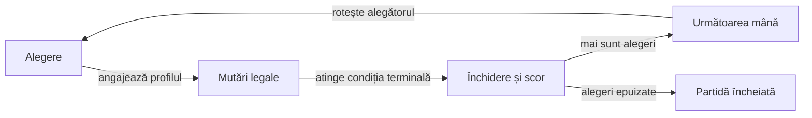
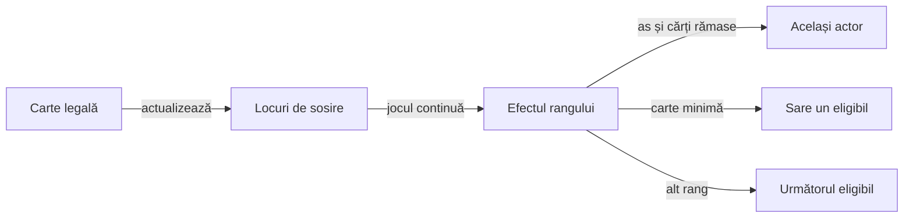

# Contractele de joc Rentz

## Domeniu și statut

Modelul de bază are opt sub-jocuri și mese de trei până la șase jucători. [Proveniența](ATF_RuleSources.md) distinge declarația autorului de interpretarea laboratorului; profilul provizoriu nu reprezintă un preset original calificat.

| Termen | Unitate în model |
|---|---|
| Partidă | Întregul program de alegeri al tuturor locurilor. |
| Mână | O distribuire de opt cărți pentru fiecare jucător, cu un sub-joc ales. |
| Sub-joc | Obiectivul și punctajul aplicate acelei distribuiri; nu este o licitație de levate. |
| Levată | Câte o carte de la fiecare loc, cu un singur capturator. |
| Secvență | Șir de cărți din aceeași culoare, extins pe tablă; nu formează levată. |

## Pregătirea mesei

| Jucători | Cărți totale | Ranguri modelate | Deschiderea secvențelor |
|---:|---:|---|---|
| 3 | 24 | 9–A | Q |
| 4 | 32 | 7–A | J |
| 5 | 40 | 5–A | 10 |
| 6 | 48 | 3–A | 9 |

Fiecare jucător primește opt cărți distincte, fără atu întors sau rest în pachetul activ. Instrucțiunile din APK declară rangurile superioare din tabel; primul alegător și indexarea sensului rotației rămân limite separate ale modelului.

## Alegerea și programul

- Alegătorul selectează un sub-joc disponibil pentru el; selecția se consumă o singură dată.
- Fiecare jucător alege fiecare sub-joc de bază o dată: partida modelată are `8 × jucători` mâini.
- Alegătorul inițial este parametru; alegerea trece apoi circular la următorul loc, independent de câștigătorul levatelor.
- Autorul declară că alegătorul deschide mâna. Eventualele excepții de deschidere Rentz, precum o carte impusă dintr-o anumită culoare, cer confirmare separată.
- Alegerea pe nevăzute se angajează înaintea dezvăluirii; ulterior este refuzată fără consumarea sub-jocului.
- Când alegătorului îi mai rămâne un singur sub-joc, alegerea pe nevăzute este refuzată chiar dacă mâna este încă ascunsă; alegerea obișnuită rămâne disponibilă.



<details>
<summary>Legendă: închiderea nu se repetă</summary>

Închiderea adaugă o singură înregistrare și un singur delta de scor. Distribuirea următoare este comandă distinctă; observația terminală păstrează numărul mâinii încheiate, fără a inventa o mână suplimentară.

</details>

## Sub-jocurile cu levate

| Sub-joc | Obiectiv și punctare | Închiderea modelată |
|---|---|---|
| Levate | Evită levatele; fiecare se penalizează. | După cele opt levate. |
| Dame | Evită cele patru dame; fiecare damă capturată se penalizează. | După levata în care este capturată ultima damă. |
| Carouri | Evită cărțile de caro; fiecare se penalizează. | După levata în care este capturat ultimul caro din pachetul mesei. |
| Regele de cupă | Evită K♥; câștigătorul levatei îl capturează și primește penalizarea. | După stabilirea câștigătorului acelei levate. |
| Totale | Cumulează levatele, damele, carourile și K♥. | După toate cărțile. |
| Whist | Câștigă levate; fiecare aduce recompensa configurată. | După cele opt levate. |
| Zece de treflă | Capturează 10♣ pentru recompensa configurată. | După levata cu 10♣, conform instrucțiunii din APK. |

- Într-o partidă nouă, punctarea levatei decisive închide contractul cu țintă fixă. Cărțile rămase în mâini nu generează levate.
- Jurnalele mai vechi păstrează regula anterioară pentru Dame și Carouri, astfel încât comenzile și scorurile lor să poată fi reluate.

Instrucțiunile declară urmarea obligatorie a culorii cerute și câștigul rangului maxim din acea culoare. În lipsa culorii se poate arunca orice altă carte; **nu există atu, licitație de levate sau tăiere obligatorie preluată din Whistul românesc**.

O carte de altă culoare poate contribui la penalizare, dar nu câștigă levata. În Totale, Q♦ contribuie ca damă și ca diamant; K♥ contribuie separat, împreună cu penalizarea levatei.

## Rentz: secvențe fără levate

Fiecare culoare are un șir propriu, deschis cu rangul mesei. Apoi se poate pune numai vecinul imediat inferior sau superior al intervalului deja deschis.

| Situație | Efect în model |
|---|---|
| Culoare nedeschisă | Numai rangul de deschidere este permis. |
| Șir existent | Se extinde cu un rang la un singur capăt. |
| Carte deja pusă sau sub rangul minim | Refuz, fără schimbarea tablei. |
| Există carte legală | Pasul voluntar este refuzat. |
| Nu există carte legală | Pas; tura trece la următorul eligibil. |
| As și cărți rămase | Același actor primește tura; poate ajunge la pas dacă nu are continuare. |
| Carte minimă | Următorul actor eligibil este sărit exact o dată. |
| Mână golită | Se atribuie locul de sosire; actorul iese din rotație. |
| Toți în afară de unul au terminat | Se punctează în ordinea sosirii. Ultimul loc primește singurul zero. |

Profilul de laborator acordă 300 de puncte câștigătorului. La mesele de 4–6 jucători, bugetul rămâne 600 de puncte. Doar ultimul loc primește zero.

| Jucători | Premii în ordinea sosirii |
|---|---|
| 3 | 300 · 200 · 0 |
| 4 | 300 · 200 · 100 · 0 |
| 5 | 300 · 175 · 100 · 25 · 0 |
| 6 | 300 · 150 · 75 · 50 · 25 · 0 |

Alegerea pe nevăzute dublează premiile. Sesiunile cu profil istoric își păstrează punctajul la reluare.



<details>
<summary>Legendă: eligibil înseamnă că mai are cărți</summary>

Actorul terminat nu primește mutare suplimentară de la as și nu este ținta săriturii. Cu doi actori rămași, cartea minimă poate readuce tura la cel care a pus-o; condiția terminală are prioritate când ultimul loc este determinat.

</details>

Efectele asului, cărții minime și pasul fără continuare sunt declarate de autor. Eliminarea actorilor terminați și prioritățile frontierelor rămân interpretări explicite ale modelului; declarația nu califică automat execuția originală.

## Punctaj și siguranță numerică

[Profilul tipizat](../../config/rentz-score-profiles.yaml) declară penalizările, recompensele și câte o grilă de sosire pentru fiecare mărime a mesei. Profilul este `LABORATORY_ONLY`. Valorile preset-urilor originale „Classic” și „Traditional” rămân neconfirmate.

[Observațiile parțiale](../../config/rentz-reference-observations.yaml) păstrează separat magnitudinile vizibile în capturile oficiale pentru patru jucători:

| Contribuție | Valoare afișată | Limită |
|---|---:|---|
| Levată negativă | −50 | Preset-ul nu este identificat în captură. |
| Damă | −40 | Unitate pe damă capturată. |
| Caro | −30 | Unitate pe carte de caro. |
| K♥ | −200 | Penalizarea cărții țintă. |
| 10♣ | +200 | Recompensa cărții țintă. |
| Prima sosire Rentz | +400 | Eticheta identifică explicit primul loc. |

Foaia publicată arată și mulțimea premiilor `0, 100, 200, 400`, fără eticheta fiecărui loc de sosire. Aceste valori nu identifică automat „Classic”, „Traditional”, punctajul Whist pe levată sau premiile meselor de alte dimensiuni.

Catalogul parțial refuză numele de preset, folosirea ca profil runtime și înlocuirea necunoscutului cu zero. Scorurile sale nu înlocuiesc implicit profilul de laborator; [proveniența](ATF_RuleSources.md) deține această frontieră.

```text
Totale = −penalizare_levată
         −număr_dame × penalizare_damă
         −număr_carouri × penalizare_caro
         −indicator_K_cupă × penalizare_rege

Delta_pe_nevăzute = 2 × Delta_normală
Total_nou = Total_anterior + Delta_mână
```

Dublarea se aplică fiecărui jucător o singură dată, inclusiv premiilor de sosire. Motorul respinge înaintea partidei profilul care poate depăși domeniul întregului; calculul pur verifică și operațiile numerice individuale.

| Fapt public | Momentul actualizării în laborator |
|---|---|
| Punctele mâinii cu levate | După completarea levatei; cartea penalizată nu identifică singură capturatorul penalizat. |
| Totalurile partidei | La închiderea mâinii. |
| Sosiri și puncte în secvențe | Sosirile apar pe parcurs; punctele se acordă când ultimul loc este determinat. |

Aceste frontiere sunt contracte ale laboratorului, distincte de prezentarea aplicației originale.

## Informație și obiectivul deciziei

| Context | Informație permisă și obiectiv |
|---|---|
| Alegere | Numai sub-jocurile rămase; mâna proprie devine disponibilă după dezvăluire. Pe nevăzute, alegerea precede accesul la ea. |
| Joc negativ | Evitarea contribuțiilor penalizate, nu evitarea abstractă a oricărei cărți mari. Obiectul capturat și câștigătorul levatei sunt lucruri distincte. |
| Whist și zece de treflă | Capturarea recompenselor declarate; nu există obiectiv licitat și nici bonus de serie importat. |
| Secvențe | Terminarea înaintea adversarilor, în limitele continuărilor legale și ale efectelor de rang. Culoarea cerută de o levată nu există aici. |
| Inferență | Cărți proprii, mutări publice, pas la frontiera respectivă, dimensiuni, puncte și sosiri. Nu mâini adverse ori ordinea viitoare a pachetului. |

Manifestul YAML descrie regulile și certitudinea lor; profilul de scor conține puncte, **nu ponderi de strategie învățate**. [Jucătorii Normal/Hard](ATF_Learning.md) au mecanisme și bugete distincte, cu un reper păstrat pentru comparație. Calificarea se separă pe sub-joc, poziție și număr de jucători; câștigul agregat nu dovedește înțelegerea tuturor regulilor.

## Conservare și limite

Invarianta este `cărți rămase în mâini + cărți jucate = pachet activ`. O mână închisă anticipat păstrează cărți nejucate; acestea nu primesc automat puncte și nu intră artificial în levata câștigătoare.

Profilul de bază nu implementează Totale plus, sub-jocuri dezactivate, refuzul distribuirii sau o alegere finală obligatoriu pe nevăzute. [Feedback-ul](../feedback/ATF_Rentz.md) păstrează aceste diferențe, fără import implicit din altă variantă.

[Componente](ATF_Components.md) · [Surse](ATF_RuleSources.md) · [Motor](../../rentz-lab-app/game-core/README.md) · [Transferul mecanismului](ATF_Transfer.md#aplicare-la-holdem)
