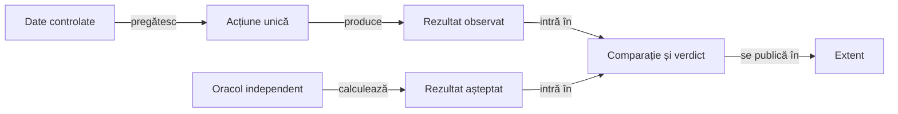

# Strategia de testare Rentz

## Pe scurt

Verificăm fiecare cerință la cel mai mic nivel care poate observa efectul ei. Regresia offline acoperă regulile, proiecțiile, starea salvată și integritatea dovezilor. Acceptanța Android verifică traseele care cer un dispozitiv și un APK identificat.

[Componente și oracole](ATF_Components.md) · [Colecții și guvernanță](ATF_Qualification.md) · [Acceptanță Android](ATF_Android.md) · [Standardul de documentație](ATF_Documentation.md)

## Alegerea nivelului

| Nivel | Ce verifică în Rentz | Unde rulează |
|---|---|---|
| Unitar | Regula izolată, calculul sau validarea unei intrări controlate. | [Motorul](../../rentz-lab-app/game-core/README.md) și suitele JVM ale modulului responsabil. |
| Componentă | Contractul motorului, al proiecției UI, al codec-ului sau al adaptorului de raportare, cu date controlate și rezultat observabil. | Maven și Android JVM prin [colecția de regresie](ATF_Qualification.md#colecții-și-populații). |
| Integrare | Jocul simulat cu motorul și politicile reale, refacerea stării din jurnal sau reconcilierea rapoartelor cu dovezile originale. | [Arena offline](ATF_Learning.md) și [calificarea](ATF_Qualification.md). |
| E2E Android | Acțiunea utilizatorului și efectul vizibil în APK, inclusiv geometria nativă, gesturile, decontarea și reluarea după repornire. | [Traseul de release](ATF_Release.md#ordinea-calificării-android-curente) și [probele focalizate](ATF_Android.md). |

## Când mutăm o verificare

1. Identifică invariantul, intrările, calea exercitată și oracolul pentru fiecare aserțiune nativă.
2. Mută verificarea deterministă la componenta care deține comportamentul. Verifică un caz care ar eșua dacă regula dispare și un caz valid vecin.
3. Păstrează pe dispozitiv interacțiunea reprezentativă și verificările care depind de randare, navigare sau lifecycle Android.
4. Actualizează fixture-ul RAG și [controlul schimbării testelor](ATF_Qualification.md#revizuirea-unei-schimbări-de-test) împreună cu selecția. Confirmă ambele granițe înaintea calificării unei ediții.

| Invariant | Verificare la componentă | Dovadă păstrată în Android |
|---|---|---|
| Catalogul Greu conține obiectivele corecte în ordine | [AchievementFullCatalogComponentTest](../../rentz-lab-app/app/src/test/java/ro/rentzlab/app/achievements/AchievementFullCatalogComponentTest.java) confruntă populația, ordinea, etichetele RO/EN și identitățile rândurilor cu catalogul. | Traseul deschide Antrenament, aplică filtre prin dialog, verifică starea goală, deschide un rezultat și revine după resetare. |
| Titlul se acordă numai după o partidă confirmată | [GameplayAchievementComponentTest](../../rentz-lab-app/app/src/test/java/ro/rentzlab/app/achievements/GameplayAchievementComponentTest.java) confruntă cheia salvată pentru o partidă în curs și pentru locul întâi confirmat. [SessionControllerTest](../../rentz-lab-app/app/src/test/java/ro/rentzlab/app/lifecycle/SessionControllerTest.java) verifică refuzul și după reluarea unei mâini jucate. | Traseul dovedește creditul manual, progresul asistat și păstrarea progresului după repornire. |

## Anatomia unui test auditabil

Legendă și limite

Fixture-ul fixează intrarea și interfața exercitată. Oracolul stabilește rezultatul așteptat înaintea comparației. Extent publică observațiile și diagnosticul capturate în execuție, cu identitatea suitei și a cazului.

- Folosește același contract de verificare când rulezi cazul singur și când îl descoperă suita.
- Folosește mock-uri la frontierele procesului, stocării sau UI. Pentru reguli de joc, exercită motorul și păstrează oracolul independent.
- Păstrează în raport intrarea relevantă, așteptarea și valoarea observată. Reconcilierea cu XML verifică inventarul și rezultatul fiecărui caz.

## Rulare și dovezi

- Rulează regresia offline înaintea probei native. Compară inventarul așteptat cu XML-urile Maven și Android JVM. Păstrează refuzurile și aserțiunile cu valori independente în [rapoartele componentei](ATF_Components.md#execuție).
- La release, verifică pe același candidat cinci subjocuri consecutive și cel puțin trei contracte distincte. RAG leagă replay-ul, capturile, versiunea și hash-ul APK-ului. Registrul cere amprenta jurnalului capturat înainte să elibereze rezervarea. [Identitatea distribuirii și expunerea](ATF_Learning.md#identitatea-distribuirii-și-expunerea)
- Păstrează contractele stabile în ghidul modulului, constatările deschise în [feedback](../feedback/README.md) și artefactele datate în depozitul extern.
