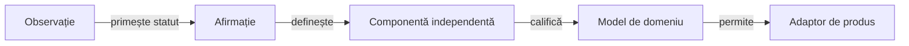

# Transferul mecanismelor către Rentz

## Ce reutilizăm

| Mecanism | Reutilizare | Limită |
|---|---|---|
| Biblioteci comune | Perechi fizice JAR/POM și proveniență păstrate. | API JVM de testare; nu se introduce în runtime-ul Android al jocului. |
| Test Kit | Clasificare, comparații evaluate, lifecycle și port de publicare. | Așteptarea și semantica domeniului aparțin testului Rentz. |
| Publicare | Același API și stil Extent. | Publicator nou, fără tipuri de licitație sau scor Whist. |
| Izolare | Copie temporară, cache și rezultate externe. | Identități și spațiu de date Rentz proprii. |
| Prezentare | Coordonare, accesibilitate și separarea modelului de controale. | Prototipul nativ are tabla și alegerea Rentz; geometria produsului nu este încă transferată integral. |

Proiectul nu copiază motorul Whist, algoritmul aplicației originale sau activele ei. Cartela de punctaj, atuul, licitația și seriile sunt concepte ale altui domeniu și nu intră implicit în modelul Rentz.

## Lecții aplicate

Legendă: infrastructura comună nu confirmă o regulă nouă

Kitul și biblioteca păstrează comparația evaluată. Regula și oracolul se definesc în noul domeniu; aceeași prezentare HTML nu implică aceeași legalitate sau aceeași semnificație a scorului.

- Declarația autorului, observația și ipoteza au stări separate înaintea implementării.
- Profilul YAML executabil, manifestul regulilor și catalogul observațiilor parțiale au consumatori și limite distincte; necunoscutul nu devine implicit zero sau valoare de preset.
- Politica primește observație, nu obiectul sesiunii cu mâinile adverse.
- Istoricul public păstrează actorul și contextul acțiunii, astfel încât inferența să nu piardă informația după închiderea levatei.
- O comandă refuzată păstrează starea; închiderea și următoarea distribuire sunt operații distincte.
- O distribuire controlată validează întregul pachet și înlocuiește numai distribuirea declarată; datele oracolului nu intră în observația politicii.
- Rezolvarea unei referințe din manifest nu echivalează cu execuția testului sau confirmarea semantică a regulii; fiecare are calificare proprie.
- Testele JVM și API-urile Android se califică separat; versiunea limbajului nu stabilește disponibilitatea metodei pe dispozitiv.
- Captura folosește cale nouă și confirmarea producerii ei; codul de ieșire zero nu autorizează reutilizarea unui XML anterior.
- Identitatea dependenței și accesul concurent sunt contracte distincte: un cache comun nu se rescrie cât timp un proces folosește JAR-urile sale, iar classpath-ul exclude intrările goale implicite.
- O sesiune reproductibilă poate folosi seed și comenzi acceptate, fără ca aceste informații private să intre în decizia actorului. Restaurarea cere aceeași identitate de schemă, profil și politică; compatibilitatea nu se presupune după o schimbare de reguli.
- Observarea stării debug poate sincroniza un test, dar nu înlocuiește interacțiunea: butoanele și cărțile sunt acționate prin interfață, iar oracolul citește separat jurnalul privat.
- Protocolul dintre procese păstrează caracterele Unicode independent de consola gazdei. Etichetele transportate în JSON folosesc escape-uri Unicode și sunt confruntate după decodare înainte de controlul interfeței.
- Progresul monitorizat folosește checkpointuri numerotate și imuabile. Cititorii nu concurează cu rescrierea unui singur fișier, iar datele de monitorizare nu înlocuiesc receipt-ul final al testului.

## Ce cere un consumator nou

Definiți pachetul, regulile, rolurile, observația, acțiunile, terminarea și unitățile scorului înaintea reutilizării interfeței. Configurația testării primește rădăcină și inventar explicite; căile sau modulele proiectului-sursă nu devin precondiții ascunse.

| Regim | Identitate și limită |
|---|---|
| Generare | Joc, variantă, generator, profil, seed și poziții; același seed din alt joc nu identifică aceeași distribuție. |
| Primă distribuire explicită | Identitatea fixture-ului și seed-ul continuării se păstrează separat; comparația politicilor nu editează rezultatele. |
| Evaluare rezervată | O partidă văzută nu devine rezervată prin schimbarea numelui directorului. |
| Progres strategic | O stare controlată permite comparație reproductibilă; calificarea cere și evaluare pe date noi. |

## Responsabilități rămase

[Feedback-ul Rentz](../feedback/ATF_Rentz.md) deține confirmarea regulilor și integrarea viitoare. Cerințele generice pentru biblioteci sau API-ul guvernanței urmează responsabilul comun indicat în [feedback](../feedback/README.md), cu probe și identitate de binar.
