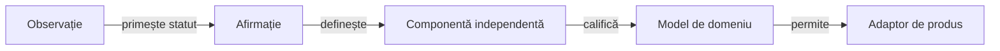
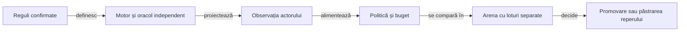

# Transferul mecanismelor de testare și învățare

Ghidul explică ce a preluat Rentz și ce poate reutiliza un joc nou. Echipa jocului deține regulile, oracolele și promovarea politicilor; bibliotecile comune oferă infrastructura de verificare și publicare.

## Ce reutilizăm

| Mecanism | Reutilizare | Limită |
|---|---|---|
| Biblioteci comune | Perechi fizice JAR/POM și proveniență păstrate. | API JVM de testare; nu se introduce în runtime-ul Android al jocului. |
| Test Kit | Clasificare, comparații evaluate, lifecycle și port de publicare. | Așteptarea și semantica domeniului aparțin testului Rentz. |
| Publicare | Același API și stil Extent. | Publicator nou, fără tipuri de licitație sau scor Whist. |
| Izolare | Copie temporară, cache și rezultate externe. | Identități și spațiu de date Rentz proprii. |
| Prezentare | Coordonare, accesibilitate și separarea modelului de controale. | Un consumator validează separat modelul ecranului și dispozitivele sale. |

Proiectul nu copiază motorul Whist, algoritmul aplicației originale sau activele ei. Cartela de punctaj, atuul, licitația și seriile sunt concepte ale altui domeniu și nu intră implicit în modelul Rentz.

## Lecții aplicate

Legendă: infrastructura comună nu confirmă o regulă nouă

Kitul și biblioteca păstrează comparația evaluată. Regula și oracolul se definesc în noul domeniu; aceeași prezentare HTML nu implică aceeași legalitate sau aceeași semnificație a scorului.

- Declarația autorului, observația și ipoteza au stări separate înaintea implementării.
- Profilul YAML executabil, manifestul regulilor și catalogul observațiilor parțiale au consumatori și limite distincte; necunoscutul nu devine implicit zero sau valoare de preset.
- Politica primește observație, nu obiectul sesiunii cu mâinile adverse.
- Istoricul public păstrează actorul și contextul acțiunii, astfel încât inferența să nu piardă informația după închiderea levatei.
- O comandă refuzată păstrează starea; închiderea și următoarea distribuire sunt operații distincte.
- O distribuire controlată validează întregul pachet și înlocuiește numai distribuirea declarată; datele oracolului nu intră în observația politicii.
- Rezolvarea unei referințe din manifest nu echivalează cu execuția testului sau confirmarea semantică a regulii; fiecare are calificare proprie.
- Testele JVM și API-urile Android se califică separat; versiunea limbajului nu stabilește disponibilitatea metodei pe dispozitiv.
- Captura folosește cale nouă și confirmarea producerii ei; codul de ieșire zero nu autorizează reutilizarea unui XML anterior.
- Identitatea dependenței și accesul concurent sunt contracte distincte: un cache comun nu se rescrie cât timp un proces folosește JAR-urile sale, iar classpath-ul exclude intrările goale implicite.
- O sesiune reproductibilă poate folosi seed și comenzi acceptate, fără ca aceste informații private să intre în decizia actorului. Restaurarea cere aceeași identitate de schemă, profil și politică; compatibilitatea nu se presupune după o schimbare de reguli.
- Observarea stării debug poate sincroniza un test, dar nu înlocuiește interacțiunea: butoanele și cărțile sunt acționate prin interfață, iar oracolul citește separat jurnalul privat.
- Protocolul dintre procese păstrează caracterele Unicode independent de consola gazdei. Etichetele transportate în JSON folosesc escape-uri Unicode și sunt confruntate după decodare înainte de controlul interfeței.
- Progresul monitorizat folosește checkpointuri numerotate și imuabile. Cititorii nu concurează cu rescrierea unui singur fișier, iar datele de monitorizare nu înlocuiesc receipt-ul final al testului.

## Ce cere un consumator nou

| Lecție strategică reutilizabilă | Aplicare în alt joc |
|---|---|
| Obiectiv înainte de ponderi | Separați punctele medii, probabilitatea modelată de victorie și resursele rămase; numiți explicit orizontul. |
| Viitor ipotetic comun | Comparați alternativele pe aceleași scenarii fezabile, fără acces la viitorul real al simulatorului. |
| Memorie publică suficientă | Reconstruiți progresul și resursele consumate dintr-un registru imuabil; nu transmiteți jurnalul privat politicii. |
| Orizont lung cu model finit | Testați separat reconstrucția și calitatea continuării; o simulare mai lungă poate agrava eroarea modelului. |
| Unitate experimentală | Agregați pozițiile corelate înaintea intervalului de incertitudine; o rotație nu este o distribuire nouă. |
| Dreptul de a refuza promovarea | Păstrați reperul, lotul rezervat și rezultatele negative; o implementare corectă nu implică progres strategic. |
| Control la aceeași poziție | Înlocuiți numai actorul evaluat; o masă uniform mai slabă nu este termenul de comparație pentru progresul versiunii noi. |
| Model propriu și advers | Rafinarea continuării proprii nu rescrie implicit comportamentul adversarilor; declarați și testați ambele roluri. |
| Limită și consum | Numărați lucrul reproductibil și măsurați timpul separat; același plafon nu dovedește același cost consumat. |
| Dovadă înainte de sampling | O frontieră demonstrabilă public poate închide o decizie; păstrați incertitudinea unde premisa nu este confirmată. |
| Oprire fără favorizare | Confirmați un scenariu numai după toate alternativele; o evaluare incompletă nu justifică preferința pentru prima opțiune. |

Definiți pachetul, regulile, rolurile, observația, acțiunile, terminarea și unitățile scorului înaintea reutilizării interfeței. Configurația testării primește rădăcină și inventar explicite; căile sau modulele proiectului-sursă nu devin precondiții ascunse.

| Regim | Identitate și limită |
|---|---|
| Generare | Joc, variantă, generator, profil, seed și poziții; același seed din alt joc nu identifică aceeași distribuție. |
| Primă distribuire explicită | Identitatea fixture-ului și seed-ul continuării se păstrează separat; comparația politicilor nu editează rezultatele. |
| Evaluare rezervată | O partidă văzută nu devine rezervată prin schimbarea numelui directorului. |
| Progres strategic | O stare controlată permite comparație reproductibilă; calificarea cere și evaluare pe date noi. |

## Aplicare la Hold’em

[Contractul Hold’em](../../../atf_j6/docs/requirements/README.md) stabilește ordinea de lucru. Punctele de intrare permit verificări mici înainte de motorul complet, evaluator și meciurile pereche:

- [Observația actorului](../../../atf_j6/holdem-core/src/main/java/ro/atf/holdem/core/HoldemObservation.java) expune mâna proprie, masa, stivele, acțiunile și istoricul textual.
- [Arena locală](../../../atf_j6/holdem-arena/src/main/java/ro/atf/holdem/arena/ArenaRun.java) apelează o singură politică.

Legendă: fiecare frontieră are un contract propriu

Motorul aplică regula; oracolul confruntă rezultatul. Arena poate vedea distribuirea pentru replay, dar politica vede numai observația. Lotul de reglaj permite reluare și ajustări; lotul de evaluare califică un candidat înghețat.

| Ordine | Preluăm mecanismul | Definim și verificăm în Hold’em |
|---|---|---|
| 1. Reguli și oracol | [Statutul regulii](ATF_Rules.md#domeniu-și-statut), profil separat de strategie, comandă refuzată fără efect. | Stive, blinduri și ordine heads-up, sumă de call și unitatea de raise. Distingeți all-in sub minim de redeschiderea acțiunii. La decontare verificați eligibilitatea pe fiecare pot, egalitățile și regula jetonului impar. Confirmați variantele înainte de implementare. |
| 2. Observație și replay | [Proiecție proprie și jurnal separat](ATF_Learning.md#informația-permisă), aceleași acțiuni acceptate la reluare. | Copiați colecțiile din observație și tipizați actorul, strada, acțiunea, suma și convenția sumei. Schimbați numai cărțile adverse, pachetul ascuns sau seed-ul dealerului: aceeași vedere și același seed separat al politicii trebuie să dea aceeași decizie. |
| 3. Componente | [Fixture mic și control negativ](ATF_Components.md#oracol-și-control-negativ), proprietăți și evaluator separat de AI. | Verificați conservarea jetoanelor la fiecare tranziție, refuzul fără schimbarea stării, clasarea celor mai bune cinci cărți cu un oracol independent și decontarea poturilor. Verificați invarianța la redenumirea culorilor și digestul replay-ului. |
| 4. Politică | [Ponderi contextualizate](ATF_Learning.md#reguli-tactice-și-ponderi), limite explicite, rezervă legală și reper fix. | Porniți de la decizii legale și deterministe. Separați clasificarea mâinii, pot odds, textură și poziție de estimarea equity și de distribuția ponderată a mâinilor adverse. Pe stări mici, confruntați samplingul cu enumerarea exactă. |
| 5. Evaluare | [Separarea distribuirilor](ATF_Learning.md#identitatea-distribuirii-și-expunerea), comparație pereche și refuz înainte de execuție. | Înghețați regulile, generatorul, politica, bugetul și metrica. Rejucați aceeași distribuire la poziții echivalente cu aceiași adversari; agregați întâi la nivelul distribuirii sau al sesiunii dacă stivele trec între mâini. Raportați big blinds la 100 de mâini, incertitudinea, drawdown-ul și costul. |

[Cerințele domeniului](../../../atf_j6/docs/requirements/DOMAIN_REQUIREMENTS.md), [criteriile AI](../../../atf_j6/docs/requirements/AI_REQUIREMENTS.md) și [strategia testelor](../../../atf_j6/docs/testing/TEST_STRATEGY.md) dețin contractele Hold’em.

Transferați prin bibliotecile comune și adaptoare locale. Pragurile, ponderile, scorurile, seed-urile, replay-urile, codul Android și regulile Rentz rămân în jocul lor. Începeți local; eventualul transport se verifică separat cu mock-uri.

## Responsabilități rămase

[Feedback-ul Rentz](../feedback/ATF_Rentz.md) deține confirmarea regulilor și integrarea viitoare. Cerințele generice pentru biblioteci sau API-ul guvernanței urmează responsabilul comun indicat în [feedback](../feedback/README.md), cu probe și identitate de binar.
