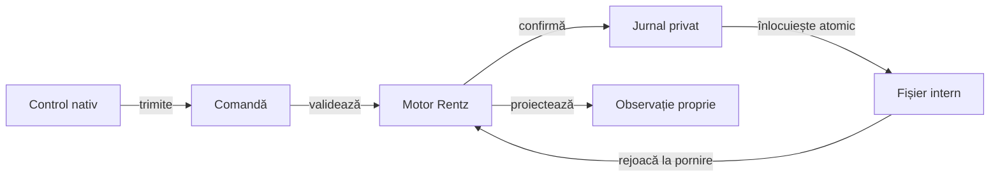

# Prezentarea Android Rentz

## Pe scurt

Modulul oferă o interfață nativă minimală pentru motorul Rentz: masă cu trei până la șase locuri, adversari Normal/Hard, cărți proprii, alegerea sub-jocului și istoricul punctelor. Este un prototip local cu profil de laborator, separat de aplicația originală și de calificarea fidelității regulilor ei.

## Responsabilități

| Componentă | Contract |
|---|---|
| [MainActivity](src/main/java/ro/rentzlab/app/MainActivity.java) | Controale native, accesibilitate, afișare și coordonarea unui singur executor pentru mutări. |
| [GameSession](src/main/java/ro/rentzlab/app/GameSession.java) | Comenzi validate de motor, jurnal reproductibil și avansarea adversarilor până la următoarea decizie umană. |
| [SessionJson](src/main/java/ro/rentzlab/app/SessionJson.java) | Serializare explicită; observația actorului și jurnalul privat sunt documente distincte. |
| [Componente de sesiune](src/test/java/ro/rentzlab/app/GameSessionTest.java) | Refuz fără jurnalizare, restaurare, istoric și frontiera informației. |

## Salvare și reluare

Legendă: salvarea reproductibilă nu este intrarea jucătorului

Fișierul privat conține seed-ul și comenzile acceptate, necesare restaurării. Politica primește numai observația permisă; în build-ul debug, aceeași proiecție poate fi citită de adaptorul de acceptanță. Un fișier incompatibil este păstrat, fără resetare automată.

## Verificare

Testele JVM califică sesiunea și contractul JSON. [Acceptanța Android](../../docs/rentz/ATF_Android.md) califică separat instalarea, controalele efective, afișarea și repornirea procesului pe configurația folosită; o mână completă nu echivalează cu o partidă completă.

Interfața nu reproduce grafica produsului original. Localizarea extinsă, preferințele persistente, accesibilitatea completă și matricea de dimensiuni se califică separat de acest adaptor minimal.
