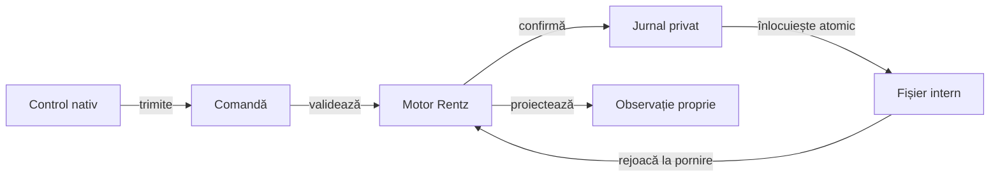

# Prezentarea Android Rentz

## Pe scurt

Modulul oferă o interfață nativă minimală pentru motorul Rentz: masă cu trei până la șase locuri, adversari Normal/Hard, cărți proprii, alegerea sub-jocului și istoricul punctelor. Este un prototip local cu profil de laborator, separat de aplicația originală și de calificarea fidelității regulilor ei.

## Responsabilități

| Componentă | Contract |
|---|---|
| [MainActivity](src/main/java/ro/rentzlab/app/MainActivity.java) | Controale native, accesibilitate, afișare și coordonarea unui singur executor pentru mutări. |
| [GameSession](src/main/java/ro/rentzlab/app/GameSession.java) | Comenzi validate de motor, jurnal reproductibil și avansarea adversarilor până la următoarea decizie umană. |
| [SessionJson](src/main/java/ro/rentzlab/app/SessionJson.java) | Serializare explicită; observația actorului și jurnalul privat sunt documente distincte. |
| [SavedJson](src/main/java/ro/rentzlab/app/SavedJson.java) | Citire strictă a unui singur document și valori exacte înaintea restaurării. |
| [Componente de sesiune](src/test/java/ro/rentzlab/app/GameSessionTest.java) | Refuz fără jurnalizare, restaurare, istoric și frontiera informației. |
| [Componente ale salvării](src/test/java/ro/rentzlab/app/SessionJsonValidationTest.java) | Intrări invalide, limite numerice, compatibilitate explicită și vecini valizi. |

## Salvare și reluare

Legendă: salvarea reproductibilă nu este intrarea jucătorului

Fișierul privat conține seed-ul și comenzile acceptate, necesare restaurării. Politica primește numai observația permisă; în build-ul debug, aceeași proiecție poate fi citită de adaptorul de acceptanță. Un fișier incompatibil este păstrat, fără resetare automată.

## Contractul documentului salvat

Citirea folosește același [JsonReader strict](https://javadoc.io/static/com.google.code.gson/gson/2.11.0/com.google.gson/com/google/gson/stream/JsonReader.html) în JVM și Android. `org.json` păstrează valorile validate și serializarea; parserul său textual nu decide acceptarea salvării. Versiunea dependenței este declarată în [build](build.gradle).

| Frontieră | Contract |
|---|---|
| Document | Un obiect complet, fără chei duplicate, comentarii, sintaxă permisivă sau conținut ulterior; imbricarea are limită explicită în cititor. |
| Numere | Token întreg zecimal exact, fără fracții, exponenți sau șiruri numerice; seed-ul păstrează întregul domeniu `long`, iar câmpurile `int` au limită proprie. |
| Formă | Câmpuri obligatorii și opționale explicite, tipuri reale de text și boolean; câmpurile necunoscute sunt refuzate. |
| Comenzi | Loc valid, rang întreg și payload specific acțiunii; apoi motorul confruntă legalitatea fiecărei comenzi rejucate. |
| Compatibilitate | Lipsa câmpului `rules` identifică formatul vechi; regulile acceptate sunt explicite, iar comenzile trebuie să rămână legale în motorul curent. |
| Refuz | Codec-ul nu scrie fișiere și nu repară implicit intrarea; eroarea ajunge la proprietarul persistenței, care păstrează salvarea incompatibilă. |

## Verificare

Testele JVM confruntă sesiunea și corpusul de validare JSON; ele nu califică lifecycle-ul activității sau întregul runtime Android. [Acceptanța Android](../../docs/rentz/ATF_Android.md) califică separat instalarea, controalele efective, afișarea și repornirea procesului pe configurația folosită; o mână completă nu echivalează cu o partidă completă.

Interfața nu reproduce grafica produsului original. Localizarea extinsă, preferințele persistente, accesibilitatea completă și matricea de dimensiuni se califică separat de acest adaptor minimal.
