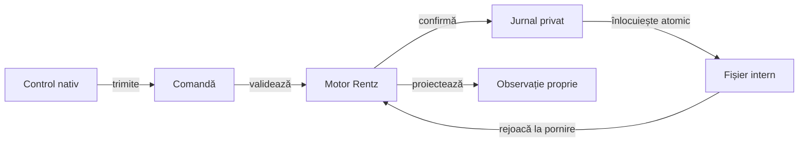

# Prezentarea Android Rentz

## Pe scurt

Modulul oferă o interfață nativă minimală pentru motorul Rentz: masă cu trei până la șase locuri, adversari Normal/Hard, cărți proprii, alegerea sub-jocului și istoricul punctelor. Interfața consumă nucleul vizual comun, cu profil de laborator și reguli Rentz proprii; calificarea fidelității față de aplicația originală rămâne distinctă.

[Nucleul UI](../../docs/rentz/ATF_UiIntegration.md) este consumat în configurația live: meniu, editor de nume, temă, chenare, geometrie, mână și depuneri. [Atlasul prezentării](src/main/java/ro/rentzlab/app/ui/README.md) delimitează adaptoarele Rentz, iar [feedback-ul](../../docs/feedback/ATF_Rentz_UI_ToDo.md) păstrează diferențele încă necalificate.

## Responsabilități

| Componentă | Contract |
|---|---|
| [MainActivity](src/main/java/ro/rentzlab/app/MainActivity.java) | Rute, lifecycle și emiterea unei comenzi pentru cadrul UI curent; compoziția este delegată. |
| [Prezentare Rentz](src/main/java/ro/rentzlab/app/ui/README.md) | Texte, profil, proiecții publice, secvențe, istoric și prezentarea levatei timp de 1,5 secunde. |
| [AAR fixat](../ui-library/README.md) | Componentele vizuale J4 fără motor Whist sau ATF în APK; hash-uri și origine verificate. |
| [RentzApplication](src/main/java/ro/rentzlab/app/RentzApplication.java) | Un singur repository al sesiunii în proces, partajat între instanțele activității. |
| [SessionController](src/main/java/ro/rentzlab/app/lifecycle/SessionController.java) | Checkpoint pe proprietar, calcul pe copie separată și refuzul rezultatelor ori callback-urilor depășite. |
| [SessionRepository](src/main/java/ro/rentzlab/app/lifecycle/SessionRepository.java) | Generația proprietarului și serializarea verificării identității cu scrierea sau callback-ul. |
| [FileSessionStorage](src/main/java/ro/rentzlab/app/lifecycle/FileSessionStorage.java) | Înlocuire atomică din staging unic în cache; fișierele canonice și originale refuzate sunt păstrate. |
| [GameSession](src/main/java/ro/rentzlab/app/GameSession.java) | Comenzi validate de motor și jurnal reproductibil; UI-ul avansează câte o tură automatizată, iar simulările offline pot consuma turele până la următoarea decizie umană. |
| [SessionJson](src/main/java/ro/rentzlab/app/SessionJson.java) | Serializare explicită; observația actorului și jurnalul privat sunt documente distincte. |
| [SavedJson](src/main/java/ro/rentzlab/app/SavedJson.java) | Citire strictă a unui singur document și valori exacte înaintea restaurării. |
| [Componente de sesiune](src/test/java/ro/rentzlab/app/GameSessionTest.java) | Refuz fără jurnalizare, restaurare, istoric și frontiera informației. |
| [Componente UI proprii](src/test/java/ro/rentzlab/app/ui/) | Contracte Rentz reale, proiecții publice, profil, permis de cadru, scor și AAR; comparații capturate la evaluare. |
| [Istoric adaptiv](src/main/java/ro/rentzlab/app/ui/score/README.md) | Antet fix vertical și coloană fixă orizontal. Δ și Σ sunt aliniate și preluate din mâinile confirmate. |
| [Componente ale salvării](src/test/java/ro/rentzlab/app/SessionJsonValidationTest.java) | Intrări invalide, limite numerice, compatibilitate explicită și vecini valizi. |
| [Componente de lifecycle](src/test/java/ro/rentzlab/app/lifecycle/) | Intercalări deterministe, proprietar înlocuit, anulare ignorată, refuz IO și livrări întârziate, fără emulator. |

La reluarea unei mâini punctate, masa prezintă ultima levată din salvare. Cărțile dispar la termenul vizual înainte de trecerea la pagina de scor. Pentru ambele trasee, raportul distinge primul cadru animat, durata totală și direcția fiecărei cărți. [Dovezile cadrelor Android](../../../../rentz_back/ui-review/restart-collection-j5/README.md)

[Contractul de lifecycle](../../docs/rentz/ATF_Lifecycle.md) explică ordinea checkpoint-urilor, reluarea și limita calificării JVM. Politica AI primește numai observația permisă, chiar dacă motorul de fundal reconstruiește privat partida din seed și jurnal.

## Salvare și reluare



<details>
<summary>Legendă: salvarea reproductibilă nu este intrarea jucătorului</summary>

Fișierul privat conține seed-ul și comenzile acceptate, necesare restaurării. Politica primește numai observația permisă; în build-ul debug, aceeași proiecție poate fi citită de adaptorul de acceptanță. Un fișier incompatibil este păstrat, fără resetare automată.

</details>

## Contractul documentului salvat

Citirea folosește același [JsonReader strict](https://javadoc.io/static/com.google.code.gson/gson/2.11.0/com.google.gson/com/google/gson/stream/JsonReader.html) în JVM și Android. `org.json` păstrează valorile validate și serializarea; parserul său textual nu decide acceptarea salvării. Versiunea dependenței este declarată în [build](build.gradle).

| Frontieră | Contract |
|---|---|
| Document | Un obiect complet, fără chei duplicate, comentarii, sintaxă permisivă sau conținut ulterior; imbricarea are limită explicită în cititor. |
| Numere | Token întreg zecimal exact, fără fracții, exponenți sau șiruri numerice; seed-ul păstrează întregul domeniu `long`, iar câmpurile `int` au limită proprie. |
| Formă | Câmpuri obligatorii și opționale explicite, tipuri reale de text și boolean; câmpurile necunoscute sunt refuzate. |
| Comenzi | Loc valid, rang întreg și payload specific acțiunii; apoi motorul confruntă legalitatea fiecărei comenzi rejucate. |
| Compatibilitate | Lipsa câmpului `rules` identifică formatul vechi; regulile acceptate sunt explicite, iar comenzile trebuie să rămână legale în motorul curent. |
| Refuz | Codec-ul nu scrie fișiere și nu repară implicit intrarea; eroarea ajunge la proprietarul persistenței, care păstrează salvarea incompatibilă. |

## Verificare

Din rădăcina proiectului, în PowerShell 7, cu JDK 21, Maven, SDK Android și cache-urile Gradle/Maven pregătite:

```powershell
.\scripts\run-rentz-components.ps1 -Collection android-jvm
```

Lansatorul pregătește [workspace-ul înregistrat](../../docs/rentz/ATF_Infrastructure.md) și descriptorul runtime înaintea testelor JVM. Calificarea completă offline folosește `regression`.

| Arie | Ce califică |
|---|---|
| Componente JVM | Sesiunea, validarea JSON și intercalările modelului de lifecycle; fără APK sau controlul dispozitivului. |
| [Acceptanță Android](../../docs/rentz/ATF_Android.md) | Instalarea, controalele efective, afișarea și repornirea procesului pe configurația folosită; o mână nu califică o partidă completă. |
| Prezentare extinsă | RO/EN și profilul au componente și sanity focalizat; accesibilitatea completă, matricea afișajului și paritatea cu referința cer probe distincte. |
