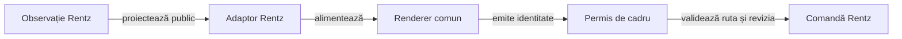

# Atlasul prezentării Rentz

## Pe scurt

Aplicația proiectează observația publică Rentz în renderer-ele `card-table-ui`. Regulile, jurnalul și calculul adversarilor rămân în proprietarii existenți; UI-ul nu primește seed sau mâini adverse.

| Pachet | Contract esențial |
|---|---|
| [copy](copy/RentzUiText.java) | RO/EN, implicit EN, etichete și cele opt sub-jocuri Rentz. |
| [profile](profile/ProfileSettings.java) | Nume NFC de 1–10 puncte de cod, preferințe durabile și refuzuri IO vizibile; identitatea locului rămâne stabilă. |
| [navigation](navigation/InputPermit.java) | Alegeri păstrate și o singură comandă pentru revizia și ruta cadrului curent. |
| [table](table/RentzTableContent.java) | Numai mâna dezvăluită, legalitatea curentă, actorul motorului, depuneri publice și sloturile reale de secvențe. |
| [score](score/README.md) | Proiecția confirmată în ordinea locurilor, măsurarea lățimilor și grila adaptivă a istoricului. |
| [screens](screens/RentzMenus.java) | Meniu și configurare separate, dialoguri, tabelă și revenire; masa nu este pusă într-un ScrollView vertical. |
| [window](window/WindowContent.java) | Spațiul util și insets furnizate explicit widgeturilor comune. |
| [collection](collection/UiLists.java) | Liste ordonate și imutabile prin API-uri Java 8 disponibile pe Android-ul minim. |

Legendă: desen comun, autoritate locală

Rendererul trimite identitatea selectată. Adaptorul o rezolvă în legalitatea curentă, iar controllerul checkpoint-ează înaintea calculului pe copie separată; navigarea sau suspendarea invalidează callback-ul vechi.

## Continuitate și limite

- `TrickPreview` observă evenimente publice noi și păstrează levata completă 1500 ms, fără extinderea termenului la redraw și fără replay de comandă.
- Reluarea initializează cursorul la evenimentele existente; o levată istorică nu este animată din nou.
- Tabla Rentz folosește rangul de deschidere real al motorului pentru fiecare număr de locuri. Slotul gol și ancora nu sunt cărți depuse.
- Calculul AI rămâne în lot; păstrarea mesei și a levatei nu califică o animație individuală pentru fiecare mutare adversă.

[Contractul aplicației](../../../../../../../README.md)
