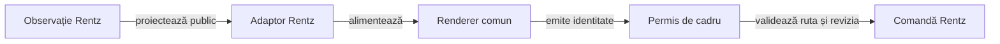

# Atlasul prezentării Rentz

## Pe scurt

Aplicația proiectează observația publică Rentz în renderer-ele `card-table-ui`. Regulile, jurnalul și calculul adversarilor rămân în proprietarii existenți; UI-ul nu primește seed sau mâini adverse.

| Pachet | Contract esențial |
|---|---|
| [copy](copy/RentzUiText.java) | RO/EN, implicit EN, etichete și cele opt sub-jocuri Rentz. |
| [profile](profile/ProfileSettings.java) | Nume NFC de 1–10 puncte de cod, preferințe durabile și refuzuri IO vizibile; identitatea locului rămâne stabilă. |
| [navigation](navigation/InputPermit.java) | Alegeri păstrate și o singură comandă pentru revizia și ruta cadrului curent. |
| [table](table/RentzTableContent.java) | Numai mâna dezvăluită, legalitatea curentă, actorul motorului, depuneri publice și sloturile reale de secvențe. |
| [score](score/README.md) | Proiecția confirmată în ordinea locurilor, măsurarea lățimilor și grila adaptivă a istoricului. |
| [screens](screens/RentzMenus.java) | Meniu, configurare, alegerea sub-jocului și [punctajul mâinii](screens/RentzHandScoreScreen.java). Masa păstrează viewportul fix, iar detaliile de scor pot derula. |
| [window](window/WindowContent.java) | Spațiul util și insets furnizate explicit widgeturilor comune. |
| [collection](collection/UiLists.java) | Liste ordonate și imutabile prin API-uri Java 8 disponibile pe Android-ul minim. |

Legendă: desen comun, autoritate locală

Rendererul trimite identitatea selectată. Adaptorul o rezolvă în legalitatea curentă, iar controllerul checkpoint-ează înaintea calculului pe copie separată; navigarea sau suspendarea invalidează callback-ul vechi.

## Continuitate și limite

- `TrickPreview` observă evenimente publice noi și furnizează cărțile și locul câștigător către animatorul comun. Fereastra este 1500 ms, cu deplasare, micșorare și estompare în ultimele 500 ms.
- Prima reluare după pornirea rece arată din jurnal ultima levată confirmată, dacă partida este încă la limita acelei levate. Bugetul începe la primul cadru pregătit pentru desen. Redesenarea folosește termenul existent, iar reluările din același proces continuă de la masa curentă.
- O levată parțială și sub-jocul Rentz păstrează afișarea lor curentă. Colectarea din checkpoint este o operație de prezentare și lasă jurnalul și punctajul neschimbate.
- Mâna vizibilă urmează ordinea ♠ ♥ ♣ ♦ și rangul crescător din J4. Selecția se rezolvă prin identitatea cărții în legalitatea curentă.
- Același loc primește același nume de adversar la masă, pe depuneri și în istoric. Chenarul afișează Δ și Σ, iar descrierea accesibilă citește complet punctele și totalul.
- După ultima levată, ecranul de punctaj folosește rândul confirmat din istoric. Jucătorul poate continua, reveni la masă sau deschide istoricul.
- [Sugestia AI](screens/ContractAdvice.java) folosește numai observația mâinii dezvăluite și opțiunile legale ale jucătorului. Dialogul anulează calculul dacă alegerea se închide sau ecranul se schimbă.
- Tabla Rentz folosește rangul de deschidere real al motorului pentru fiecare număr de locuri. Slotul gol și ancora nu sunt cărți depuse.
- Calculul AI rămâne în lot; păstrarea mesei și a levatei nu califică o animație individuală pentru fiecare mutare adversă.

[Contractul aplicației](../../../../../../../README.md)
